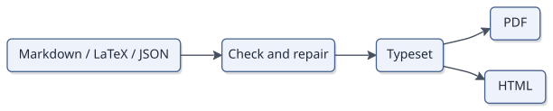

# texwright

**Markdown and LaTeX to PDF for AI agents.** A TypeScript document engine with TeX-style mathematics, citations, cross-references, diagrams, footnotes, and a stdio Model Context Protocol (MCP) server. It also accepts a structured JSON document tree and writes self-contained HTML.

No TeX installation. No browser. No runtime npm dependencies. Requires **Node.js 20+**.

[Documentation](docs/README.md) · [Agent guide](docs/agent-guide.md) · [llms.txt](llms.txt) · [Writing reference](AGENTS.md) · [MIT license](LICENSE)



## See what texwright produces

These are actual page images rendered by texwright from the included Markdown sources. Each guide has a PDF download, a self-contained HTML edition, and editable source.

<p align="center">
  <a href="docs/overview.pdf"></a>
  <a href="docs/cookbook.pdf"></a>
  <a href="docs/cookbook.pdf"></a>
</p>

| Guide | Read source | Download | Web edition |
|---|---|---|---|
| Project overview | [Markdown](docs/overview.md) | [PDF](docs/overview.pdf) | [HTML](docs/overview.html) |
| Agent integration | [Markdown](docs/agent-guide.md) | [PDF](docs/agent-guide.pdf) | [HTML](docs/agent-guide.html) |
| Visual cookbook | [Markdown](docs/cookbook.md) | [PDF](docs/cookbook.pdf) | [HTML](docs/cookbook.html) |

Also explore the [research showcase source](examples/showcase/showcase.md) and [PDF](examples/showcase/showcase.pdf), the [LaTeX article](examples/latex/article.tex) and [PDF](examples/latex/article.pdf), and the [architecture paper](paper/texwright.pdf).

## Install a ready-built release

Requires Node.js 20+. The versioned GitHub release includes the CLI, MCP server, fonts, themes, and templates. No compiler or source build is needed:

~~~sh
npm install -g https://github.com/Chorozion/texwright/releases/download/v0.3.4/texwright-0.3.4.tgz
texwright --version
texwright new report -o report.md
texwright repair report.md -o report.pdf
texwright preview report.md --page 1
~~~

Download the package and SHA-256 checksum from [release v0.3.4](https://github.com/Chorozion/texwright/releases/tag/v0.3.4). The unscoped npm package and official MCP Registry listing are pending publication; use this GitHub release or build from source. [Distribution status and publishing guide](docs/distribution.md).

### Connect an MCP client

After installing, configure the client to launch the installed command:

~~~json
{
  "mcpServers": {
    "texwright": {
      "command": "texwright",
      "args": ["mcp", "--root", "/absolute/path/to/documents"]
    }
  }
}
~~~

The documents folder must exist. GUI clients may not inherit the terminal PATH; use an absolute path to the installed command, or the portable Node configuration in the [agent guide](docs/agent-guide.md). On Windows, use that Node configuration if the client cannot launch command shims.

### When to choose texwright

- Research reports, technical notes, and papers with numbered equations, citations, tables, and cross-references.
- Local document generation in Node.js environments without TeX or a browser.
- Agent workflows that need structured diagnostics, safe typo repairs, and page images for review.

Use a full TeX distribution when exact publisher class files or unsupported packages are required. Use a browser renderer when the deliverable depends on a web page's CSS or JavaScript. The [writing reference](AGENTS.md) documents supported syntax and approximations.

## Install from source

~~~sh
git clone https://github.com/Chorozion/texwright.git
cd texwright
npm ci
npm run build
node dist/cli.mjs new report -o report.md
node dist/cli.mjs check report.md --diagnostics compact
node dist/cli.mjs report.md -o report.pdf
node dist/cli.mjs preview report.md --page 1
~~~

After building, optionally run npm link to make the texwright command available on your PATH. The examples below use that command. Rebuild all documentation with npm run docs.
## Why another document tool

Agent workflows benefit from precise source diagnostics, predictable dependencies, and page previews they can inspect. texwright brings parsing, mathematics, layout, and document output into one Node.js engine, with a repair loop that tools can drive directly.

texwright does the whole job in one small package:

- **Its own engine.** Paragraphs are broken with the Knuth–Plass algorithm, math is laid out by the rules of Appendix G of *The TeXbook*, pages are built the way TeX builds them (footnotes at the foot of their page, figures that float, headings kept with their text), and the PDF is written directly with subset fonts. Everything runs on Node's standard library.
- **LaTeX semantics where they matter.** `align` numbers each row and honours `\nonumber`; `\label`, `\ref`, `\eqref`, `\pageref` and `\cref` work in Markdown and LaTeX alike; `\newtheorem` counters are shared the way amsthm shares them; the table of contents and `\pageref` get exact page numbers from repeated layout passes, the way LaTeX's `.aux` file works.
- **Diagnostics a program can act on.** Every problem has a stable code, a severity, a file, line and column, the offending line and a hint. An undefined reference suggests the nearest labels; an unknown citation key suggests the nearest keys; a formula that won't parse says where and why; a line that sticks into the margin says which paragraph. `--diagnostics json` gives one machine-readable report.
- **Made for agents.** Diagnostics carry fixes in the shape of an edit (replace this text with that, here), and `texwright check --fix` applies the unambiguous ones. `--diagnostics compact` puts each problem on one line to save tokens. `texwright outline` tells an agent what is where in a long document without it reading the whole file. `texwright preview` draws the PDF's pages as PNG images with texwright's own rasterizer, so a model can look at what it made, and a PDF render reports the page every heading, figure and table landed on. `texwright mcp` offers all of this as tools (`render_document`, `preview_page`, `check_document`, `fix_document`, `repair_document`, `outline_document`, `new_document`, `get_schema`, `get_guide`). A document can also be emitted directly as JSON against a published schema (`texwright schema`). [AGENTS.md](AGENTS.md) is a full writing guide for people and models.
- **Reads what models write.** Models asked for a PDF reach for siunitx, mhchem and physics commands, `thebibliography`, `algorithmic`, the `letter` and `exam` classes, tcolorbox, pandoc's front matter and chat-style Markdown. texwright takes all of these as they are written. [bench/](bench/) holds 80 documents that models wrote for a PDF and the runner that measures how many come out clean on the first try.
- **Safe with untrusted input.** Agent-written documents are untrusted, so raw HTML is sanitized, nothing is fetched from the network, every expansion mechanism has a budget, and images are read only from the document's folder unless you widen that explicitly.

## Writing

Markdown, with the pandoc extensions people actually use:

```markdown
---
title: Heat flow in thin plates
author: [Ada Lovelace, Alan Turing]
bibliography: refs.bib
number-sections: true
toc: true
---

# Model {#sec:model}

The temperature $u(x,t)$ satisfies

\begin{align}
  u_t &= \alpha\, u_{xx} \label{eq:heat} \\
  u(0,t) &= u(1,t) = 0   \label{eq:bc}
\end{align}

following @doe2020. Equation \eqref{eq:heat} with @eq:bc is solved in @sec:model;
results are in @fig:temp and @tbl:runs.

{#fig:temp width=70%}

| Run | Error |
|----:|------:|
| 1   | 0.012 |

Table: Convergence runs. {#tbl:runs}
```

LaTeX works too: `\documentclass{article}` documents with sections, figures, tables with booktabs rules and `\multicolumn`, theorem environments, `\newcommand`, `\input`, BibTeX and the usual reference commands. LaTeX can also be mixed into Markdown. See [AGENTS.md](AGENTS.md) for the full syntax and [DESIGN.md](DESIGN.md) for the architecture.

## Output

- **PDF**: set in Latin Modern (LaTeX's own Computer Modern, with ligatures and kerning) and hyphenated with TeX's patterns. Letter, A4, A5, Legal or B5, portrait or landscape, with page numbers, an optional running head, bookmarks, links and searchable text. Fonts are subset, so a typical paper is a hundred-odd KB. SVG figures are drawn as vectors, with gradients, transparency, masks, blend modes, text on paths and HTML labels, much as a browser draws them; a filter's blur or shadow becomes an image under the shape. PNG and JPEG images are embedded. Set `SOURCE_DATE_EPOCH` and the same input gives the same bytes.
- **HTML**: one self-contained file with fonts and images embedded, math as MathML, and no scripts.
- **JSON**: the document tree after numbering, for tooling.

Three themes: `article` (the default, a LaTeX article look in Latin Modern), `modern` and `compact` (an installed sans-serif face). Layout lives in the document, in pandoc's front matter keys or LaTeX's class options, so an agent changes it by editing the file:

```yaml
---
author:
  - name: Thomas Garren
    affiliation: Sophia XT
papersize: a4
geometry: margin=2cm
fontsize: 12pt
theme: modern
---
```

`--css` adds your own CSS to HTML output.

## Diagrams and drawings

A fenced `mermaid` block becomes a figure. texwright reads Mermaid's syntax with its own parsers and draws the result itself, so no browser or Mermaid install is involved and a diagram takes a few milliseconds. Flowcharts, sequence, class, state and ER diagrams, gantt charts, pie, xy and quadrant charts, timelines, mindmaps and user journeys are supported. Labels are set in the sans companion of Computer Modern, measured with the real font, so they match the page around them; boxes sit on a soft shadow, edges are smooth curves that end on the shape outline, and colours hold up in greyscale.

````markdown
```{.mermaid #fig:flow caption="Request handling"}
flowchart LR
  client([Client]) --> api[API] --> db[(Database)]
```
````

With a caption or label the diagram is numbered and `@fig:flow` refers to it. Mermaid's themes (`default`, `neutral`, `forest`, `dark`) and `themeVariables` work through the diagram's own front matter or `%%{init}%%`, and `diagram-theme: neutral` in the document's front matter sets them all. A mistake is error DIAG001 at its line in the document, with a hint and, where the answer is obvious, a fix. PDF output draws diagrams as vectors; HTML inlines the SVG.

LaTeX drawings are drawn by texwright too, with no TeX: TikZ (paths, nodes, styles, `\foreach`, positioning, calc, automata), trees and mind maps, forest, the `\graph` library with layered and spring layouts, pgfplots in 2D and 3D (`\addplot3` surfaces, meshes, colour maps and colour bars, `fill between`), tikz-3dplot, circuitikz (resistors to op amps, transistors and logic gates, in American or European style) and PSTricks with pst-plot, pst-node and pst-tree. Labels use the document's own math. What can't be drawn exactly is warning TIKZ001 or PST001, and the rest of the picture is still drawn.

## Citations

BibTeX (including biblatex dates and `journaltitle`, `@string`, accents and corporate authors) or CSL-JSON. Two styles: `numeric` (IEEE-like, with compressed ranges like [1–3]) and `author-year` (APA-like, with 2020a/2020b disambiguation). Syntax: `[@key]`, `[@a; @b, p. 4]`, `@key` in running text, `\cite`, `\citep`, `\citet`, `\citeauthor`, `\citeyear`, `\nocite`.

## Using it from an AI agent

texwright exposes nine MCP tools: render_document, preview_page, check_document, fix_document, repair_document, outline_document, new_document, get_schema, and get_guide.

Build from source, then configure an MCP client to start the local bundle with Node. Use absolute paths; this illustrates the common mcpServers format:

~~~json
{
  "mcpServers": {
    "texwright": {
      "command": "node",
      "args": ["/absolute/path/to/texwright/dist/cli.mjs", "mcp", "--root", "/absolute/path/to/documents"]
    }
  }
}
~~~

On Windows, JSON paths can use forward slashes (for example D:/texwright/dist/cli.mjs). See the [agent integration guide](docs/agent-guide.md) for tool arguments and the [generated MCP catalog](docs/reference/mcp-tools.json) for exact schemas.
The server reads and writes only inside `--root` (default: the folder it starts in), and each request runs in its own worker thread with a time limit (`--timeout`, default 120 s), so a hostile document can't reach other files or stall the server. Agents that prefer a shell can use the CLI the same way: `texwright check doc.md --diagnostics json`, fix, repeat.

## Library

```js
import { convert, check } from "texwright";

const res = await convert({ input: "paper.md", to: "pdf", output: "paper.pdf" });
if (!res.ok) for (const d of res.diagnostics) console.error(`${d.line}:${d.col} ${d.code} ${d.message}`);
```

## Limits

texwright is not a TeX engine. It draws what documents use TikZ, pgfplots (2D and 3D), forest, circuitikz and PSTricks for, but not every package built on them: a picture it cannot draw at all is reported (LTX004), so export that figure as SVG or PNG. PSTricks' `psmatrix` is not supported. tikz-cd diagrams are drawn approximately, with straight arrows on a grid. PDF files can't yet be used as figures (IMG003). Hyphenation patterns are bundled for English only. Scripts that need complex shaping (Arabic, the Indic scripts) and right-to-left text aren't supported, and the PDF is not tagged for screen readers yet. In SVG figures, lighting, turbulence and displacement filters are left out (their input passes through), and HTML inside `foreignObject` is drawn as labels (text, fonts, colours, line breaks, centring) rather than with general CSS layout. Colour emoji come out in one colour.

## For LLMs and retrieval tools

Start with [llms.txt](llms.txt), then fetch only the linked references needed for the task. The [agent guide](docs/agent-guide.md) covers the complete document workflow. [Document JSON Schema](docs/reference/document.schema.json) and [MCP tool schemas](docs/reference/mcp-tools.json) are generated from this implementation. [Structured project metadata](project.jsonld) records the canonical repository, version, license, and contributors.

All important instructions are ordinary Markdown; the page images have descriptive alt text and link to editable sources or PDFs. Public discovery requires a public repository. An llms.txt index assists tools that read it; it does not guarantee search ranking or inclusion in model training.

## Common questions

**Can an LLM generate a PDF without LaTeX installed?** Yes. Give texwright Markdown, LaTeX source in its supported subset, or a JSON document tree; it performs typesetting itself.

**Does this use a browser or a hosted rendering service?** No. PDF, HTML, diagram rendering, and page previews run locally in Node.js.

**How should an agent handle a failed render?** Read the diagnostics and exit status, apply safe fixes or revise the source, then render and inspect pages again. A PDF file can exist even when the render reports errors.

**Is this a complete TeX distribution?** No. See the supported syntax in [AGENTS.md](AGENTS.md) and the limits above. Unsupported commands and drawing features produce diagnostics.

## Contributors

Created with contributions from **Sophia**, **Xe5**, and **Thomas Garren**
(SOPHIA XT LLC). See [CONTRIBUTORS.md](CONTRIBUTORS.md).

## License

MIT. The bundled fonts in `fonts/` are Latin Modern (GUST Font License, see `fonts/GUST-FONT-LICENSE.TXT`) and KaTeX's Computer Modern derivatives (SIL Open Font License 1.1, see `fonts/OFL-KaTeX.txt`). `hyphenation/en-us.json` holds TeX's US English patterns, which may be copied and distributed with their copyright notice, kept in the file. The CommonMark conformance tests adapt the spec's examples and are CC BY-SA 4.0. [THIRD-PARTY-NOTICES.md](THIRD-PARTY-NOTICES.md) lists everything by others in the repository.
