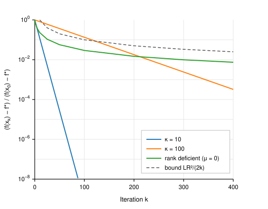

# Introduction

We study the unconstrained problem

$$
\min_{x \in \mathbb{R}^n} f(x),
$$ {#eq:problem}

where $f\colon \mathbb{R}^n \to \mathbb{R}$ is convex and differentiable and its gradient is Lipschitz continuous. Starting from a point $x_0$, gradient descent generates the sequence

$$
x_{k+1} = x_k - \eta\, \nabla f(x_k), \qquad k = 0, 1, 2, \ldots,
$$ {#eq:gd}

for a step size $\eta > 0$. The iteration goes back to Cauchy. Its complexity analysis on convex functions was developed in the 1960s and 1970s [@polyak1963; @nemirovski1983], and modern textbook accounts appear in @nesterov2004, @boyd2004 and @bubeck2015.

Two facts about [@eq:gd] are well known. On $L$-smooth convex functions with $\eta = 1/L$, the objective gap decays as $O(1/k)$. On functions that are also $\mu$-strongly convex, the iterates converge linearly at a rate governed by the condition number $\kappa = L/\mu$. Our goal is to prove both statements from first principles in a few pages, keep track of the constants, and make clear which assumption does which job. Smoothness guarantees that a gradient step decreases $f$ by a definite amount. Convexity converts that decrease into progress toward a minimizer. Strong convexity makes the progress proportional to the remaining distance.

@sec:prelim collects definitions and two lemmas. @sec:main proves the sublinear and linear rates. @sec:stepsize discusses step-size choices, @sec:lower compares the rates with lower bounds and with accelerated methods, and @sec:experiments illustrates the results numerically.

# Preliminaries {#sec:prelim}

Throughout, $\|\cdot\|$ is the Euclidean norm and $\langle \cdot, \cdot \rangle$ the standard inner product. We assume that $f$ attains its minimum value $f^\star$ at some point $x^\star$. The minimizer need not be unique unless $f$ is strongly convex.

**Definition 1** (Smoothness). A differentiable function $f$ is *$L$-smooth* if its gradient is $L$-Lipschitz:
$$
\|\nabla f(x) - \nabla f(y)\| \le L \|x - y\| \quad \text{for all } x, y \in \mathbb{R}^n.
$$

**Definition 2** (Convexity). A differentiable function $f$ is *convex* if
$$
f(y) \ge f(x) + \langle \nabla f(x), y - x \rangle \quad \text{for all } x, y,
$$ {#eq:convex}
and *$\mu$-strongly convex*, for some $\mu > 0$, if
$$
f(y) \ge f(x) + \langle \nabla f(x), y - x \rangle + \frac{\mu}{2}\|y - x\|^2 \quad \text{for all } x, y.
$$ {#eq:strong}

For twice-differentiable $f$ these conditions say that $\mu I \preceq \nabla^2 f(x) \preceq L I$ for every $x$, with $\mu = 0$ in the merely convex case. A function that is both $\mu$-strongly convex and $L$-smooth has $\mu \le L$, and we write $\kappa = L/\mu \ge 1$ for its condition number.

**Lemma 1** (Descent lemma). If $f$ is $L$-smooth, then for all $x, y$,
$$
f(y) \le f(x) + \langle \nabla f(x), y - x \rangle + \frac{L}{2}\|y - x\|^2.
$$ {#eq:descent}

*Proof.* Apply the fundamental theorem of calculus to $t \mapsto f(x + t(y - x))$:
$$
f(y) - f(x) - \langle \nabla f(x), y - x\rangle = \int_0^1 \bigl\langle \nabla f\bigl(x + t(y-x)\bigr) - \nabla f(x),\; y - x\bigr\rangle \, dt.
$$
By the Cauchy–Schwarz inequality and $L$-smoothness the integrand is at most $L t \|y - x\|^2$, and $\int_0^1 L t \, dt = L/2$. $\square$

Lemma 1 bounds $f$ from above by a quadratic that touches it at $x$. Minimizing the right-hand side of [@eq:descent] over $y$ gives $y = x - \frac{1}{L}\nabla f(x)$, which is a gradient step with $\eta = 1/L$. This is where the canonical step size comes from.

**Lemma 2** (Sufficient decrease). Let $f$ be $L$-smooth and $x^+ = x - \eta \nabla f(x)$ with $0 < \eta \le 1/L$. Then
$$
f(x^+) \le f(x) - \frac{\eta}{2}\|\nabla f(x)\|^2.
$$ {#eq:suffdec}

*Proof.* Substitute $y = x^+$ into [@eq:descent]:
$$
f(x^+) \le f(x) - \eta\|\nabla f(x)\|^2 + \frac{L\eta^2}{2}\|\nabla f(x)\|^2 = f(x) - \eta\left(1 - \frac{L\eta}{2}\right)\|\nabla f(x)\|^2,
$$
and $1 - L\eta/2 \ge 1/2$ whenever $\eta \le 1/L$. $\square$

Lemma 2 uses no convexity. On any $L$-smooth function, gradient descent with $\eta \le 1/L$ is monotone, and summing [@eq:suffdec] over $k = 0, \ldots, K-1$ gives
$$
\min_{0 \le k < K} \|\nabla f(x_k)\|^2 \le \frac{2\bigl(f(x_0) - f^\star\bigr)}{\eta K},
$$
the standard $O(1/K)$ guarantee for finding an approximate stationary point of a nonconvex function.

# Main results {#sec:main}

## The convex case

**Theorem 1** (Sublinear rate). Let $f$ be convex and $L$-smooth with a minimizer $x^\star$, and run [@eq:gd] with $\eta = 1/L$. Then for every $K \ge 1$,
$$
f(x_K) - f^\star \le \frac{L\,\|x_0 - x^\star\|^2}{2K}.
$$ {#eq:sublinear}

*Proof.* Write $g_k = \nabla f(x_k)$. Lemma 2 with $\eta = 1/L$ gives $f(x_{k+1}) \le f(x_k) - \frac{1}{2L}\|g_k\|^2$, and convexity [@eq:convex] with $y = x^\star$ gives $f(x_k) \le f^\star + \langle g_k, x_k - x^\star\rangle$. Combining the two inequalities,
$$
\begin{aligned}
f(x_{k+1}) - f^\star
&\le \langle g_k, x_k - x^\star \rangle - \frac{1}{2L}\|g_k\|^2 \\
&= \frac{L}{2}\left( \|x_k - x^\star\|^2 - \Bigl\|x_k - x^\star - \tfrac{1}{L}\, g_k\Bigr\|^2 \right) \\
&= \frac{L}{2}\left( \|x_k - x^\star\|^2 - \|x_{k+1} - x^\star\|^2 \right),
\end{aligned}
$$
where the second line follows by expanding the square. The right-hand side telescopes. Summing from $k = 0$ to $K - 1$,
$$
\sum_{k=1}^{K} \bigl(f(x_k) - f^\star\bigr) \le \frac{L}{2}\left(\|x_0 - x^\star\|^2 - \|x_K - x^\star\|^2\right) \le \frac{L}{2}\|x_0 - x^\star\|^2.
$$
By Lemma 2 the values $f(x_k)$ are nonincreasing, so the left-hand side is at least $K\bigl(f(x_K) - f^\star\bigr)$. Dividing by $K$ gives [@eq:sublinear]. $\square$

The same computation shows that $\|x_k - x^\star\|$ is nonincreasing for every minimizer $x^\star$, so gradient descent never moves away from the solution set. To guarantee $f(x_K) - f^\star \le \varepsilon$ it suffices to take
$$
K \ge \frac{L R^2}{2\varepsilon}, \qquad R = \|x_0 - x^\star\|.
$$

## The strongly convex case

**Theorem 2** (Linear rate). Let $f$ be $\mu$-strongly convex and $L$-smooth, and run [@eq:gd] with $\eta = 1/L$. Then
$$
\|x_k - x^\star\|^2 \le \left(1 - \frac{\mu}{L}\right)^{k}\|x_0 - x^\star\|^2
\quad\text{and}\quad
f(x_k) - f^\star \le \frac{L}{2}\left(1 - \frac{\mu}{L}\right)^{k}\|x_0 - x^\star\|^2.
$$ {#eq:linear}

*Proof.* Expanding the update,
$$
\|x_{k+1} - x^\star\|^2 = \|x_k - x^\star\|^2 - \frac{2}{L}\langle g_k, x_k - x^\star\rangle + \frac{1}{L^2}\|g_k\|^2.
$$ {#eq:expand}
Strong convexity [@eq:strong] with $x = x_k$ and $y = x^\star$ rearranges to
$$
\langle g_k, x_k - x^\star \rangle \ge f(x_k) - f^\star + \frac{\mu}{2}\|x_k - x^\star\|^2,
$$
and Lemma 2 together with $f(x_{k+1}) \ge f^\star$ gives $\|g_k\|^2 \le 2L\bigl(f(x_k) - f^\star\bigr)$. Substituting both bounds into [@eq:expand], the function-value terms cancel:
$$
\|x_{k+1} - x^\star\|^2 \le \left(1 - \frac{\mu}{L}\right)\|x_k - x^\star\|^2 - \frac{2}{L}\bigl(f(x_k) - f^\star\bigr) + \frac{2}{L}\bigl(f(x_k) - f^\star\bigr) = \left(1 - \frac{\mu}{L}\right)\|x_k - x^\star\|^2.
$$
Induction gives the first bound in [@eq:linear]. The second follows from Lemma 1 with $x = x^\star$, because $\nabla f(x^\star) = 0$. $\square$

**Corollary 1.** Under the assumptions of Theorem 2, $f(x_k) - f^\star \le \varepsilon$ as soon as
$$
k \ge \kappa \log\!\left( \frac{L R^2}{2\varepsilon} \right), \qquad \kappa = \frac{L}{\mu},\quad R = \|x_0 - x^\star\|.
$$

*Proof.* Use $1 - 1/\kappa \le e^{-1/\kappa}$ in [@eq:linear]. $\square$

Strong convexity is more than the linear rate needs. The same rate for function values holds under the Polyak–Łojasiewicz inequality $\frac12\|\nabla f(x)\|^2 \ge \mu\,\bigl(f(x) - f^\star\bigr)$, which allows non-unique minimizers and even some nonconvex functions [@polyak1963; @karimi2016]. Under that inequality Lemma 2 alone gives $f(x_{k+1}) - f^\star \le (1 - \mu/L)\bigl(f(x_k) - f^\star\bigr)$.

# Choosing the step size {#sec:stepsize}

The analysis above fixes $\eta = 1/L$. The decrease factor $\eta(1 - L\eta/2)$ from the proof of Lemma 2 is positive for every $\eta \in (0, 2/L)$ and largest at $\eta = 1/L$, so every constant step in that interval converges, with constants that degrade toward either end. For a quadratic $f(x) = \frac12 x^\top A x - b^\top x$ with $\mu I \preceq A \preceq L I$, the error evolves by the matrix $I - \eta A$, whose spectral radius $\max\{|1 - \eta\mu|, |1 - \eta L|\}$ is minimized by
$$
\eta^\star = \frac{2}{\mu + L}, \qquad \rho^\star = \frac{\kappa - 1}{\kappa + 1}.
$$
This improves on $1 - 1/\kappa$ by roughly a factor of two in the exponent, but it requires knowing $\mu$.

In practice $L$ is rarely known either. Backtracking line search [@armijo1966] starts from a trial step and multiplies it by $\beta \in (0,1)$ until
$$
f\bigl(x_k - \eta \nabla f(x_k)\bigr) \le f(x_k) - \frac{\eta}{2}\|\nabla f(x_k)\|^2.
$$
By Lemma 2 the test passes once $\eta \le 1/L$, so every accepted step is at least $\beta/L$, and Theorems 1 and 2 hold with $L$ replaced by $L/\beta$. The price is a few extra function evaluations per iteration. A minimal implementation:

```python
import numpy as np

def gradient_descent(f, grad, x0, eta0=1.0, beta=0.5, tol=1e-8, max_iter=10_000):
    """Gradient descent with Armijo backtracking.

    Returns the final iterate and the history of objective values.
    """
    x = np.asarray(x0, dtype=float)
    history = [f(x)]
    eta = eta0
    for _ in range(max_iter):
        g = grad(x)
        if np.linalg.norm(g) < tol:
            break
        fx = f(x)
        # Shrink the step until the sufficient-decrease test holds.
        while f(x - eta * g) > fx - 0.5 * eta * (g @ g):
            eta *= beta
        x = x - eta * g
        history.append(f(x))
    return x, np.array(history)
```

# Lower bounds and acceleration {#sec:lower}

Consider any method whose iterates satisfy $x_k \in x_0 + \operatorname{span}\{\nabla f(x_0), \ldots, \nabla f(x_{k-1})\}$. @nemirovski1983 and @nesterov2004 construct quadratic functions on which every such method obeys, for $k \le (n-1)/2$,
$$
f(x_k) - f^\star \ge \frac{3 L \|x_0 - x^\star\|^2}{32 (k+1)^2},
$$
and in the strongly convex case
$$
\|x_k - x^\star\|^2 \ge \left(\frac{\sqrt{\kappa} - 1}{\sqrt{\kappa} + 1}\right)^{2k} \|x_0 - x^\star\|^2.
$$
Gradient descent attains neither bound. Nesterov's accelerated gradient method [@nesterov1983] attains both up to constant factors. @tbl:rates summarizes the comparison.

| Setting | Gradient descent | Accelerated gradient | Lower bound |
|:--------|:----------------:|:--------------------:|:-----------:|
| $L$-smooth, convex | $O\!\left(L R^2 / k\right)$ | $O\!\left(L R^2 / k^2\right)$ | $\Omega\!\left(L R^2 / k^2\right)$ |
| $L$-smooth, $\mu$-strongly convex | $O\!\left((1 - \kappa^{-1})^k\right)$ | $O\!\left((1 - \kappa^{-1/2})^k\right)$ | $\Omega\!\left(\bigl(\tfrac{\sqrt\kappa - 1}{\sqrt\kappa + 1}\bigr)^{2k}\right)$ |
| Iterations to reach $\varepsilon$ (strongly convex) | $O(\kappa \log(1/\varepsilon))$ | $O(\sqrt{\kappa}\log(1/\varepsilon))$ | $\Omega(\sqrt{\kappa}\log(1/\varepsilon))$ |

Table: Worst-case rates of first-order methods, with $R = \|x_0 - x^\star\|$ and $\kappa = L/\mu$. {#tbl:rates}

The difference between $\kappa$ and $\sqrt{\kappa}$ matters on ill-conditioned problems. At $\kappa = 10^4$ acceleration cuts the iteration count by about a factor of 100. Plain gradient descent remains useful when gradients are noisy or inexact, where accelerated methods accumulate errors, and as the building block for stochastic and proximal variants [@bubeck2015].

# Numerical illustration {#sec:experiments}

We ran gradient descent with $\eta = 1/L$ on three least-squares objectives $f(x) = \frac12\|Ax - b\|^2$ with $A \in \mathbb{R}^{200 \times 50}$. For the first two instances we prescribed the singular values of $A$ so that $\kappa = \lambda_{\max}(A^\top A)/\lambda_{\min}(A^\top A)$ equals $10$ and $100$. For the third we made $A$ rank deficient, so that $\mu = 0$ and only Theorem 1 applies. @fig:convergence plots the relative suboptimality $\bigl(f(x_k) - f^\star\bigr)/\bigl(f(x_0) - f^\star\bigr)$ on a logarithmic scale.

{#fig:convergence width=85%}

The $\kappa = 10$ instance reaches a relative error of $10^{-8}$ in under 90 iterations. Its slope matches a contraction of $(1 - 1/\kappa)^2 = 0.81$ per iteration, the square of the factor in Theorem 2. The square appears because on a quadratic the slowest error component contracts by $1 - \mu/L$ per step and the objective gap is quadratic in the error, so Theorem 2 is loose by exactly a square on this class. The $\kappa = 100$ instance contracts ten times more slowly in the exponent and has gained only about three and a half orders of magnitude after 400 iterations. The rank-deficient instance flattens out, as any $O(1/k)$ sequence must on a semilogarithmic plot, and stays below the dashed bound $L R^2/(2k)$ throughout.

# Conclusion

Two inequalities carry the whole analysis: the descent lemma, which comes from smoothness, and the first-order characterization of convexity. Smoothness alone makes gradient descent monotone. Convexity turns monotone decrease into an $O(1/k)$ rate, and strong convexity turns it into geometric convergence at rate $1 - 1/\kappa$. Both rates are a factor of $\sqrt{\kappa}$ or $k$ away from optimal among first-order methods, which is the gap that acceleration closes. Extensions to proximal steps, stochastic gradients and the Polyak–Łojasiewicz condition follow the same template with one or two additional terms.

# References {.unnumbered}

::: {#refs}
:::
