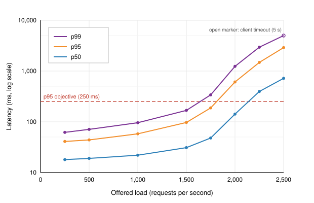

## 1. Executive Summary

We load tested `orders-api` v2.14 in the staging environment between September 28 and October 2, 2026, to confirm it can absorb the projected Q4 peak of **1,400 requests per second (RPS)** with headroom. The service meets its latency objective (p95 under 250 ms, error rate under 0.1%) up to about **1,750 RPS**. Above that, PostgreSQL connection pool exhaustion causes a sharp latency knee, and throughput plateaus near **1,870 RPS** no matter how much load is offered.

Key findings:

- **Sustainable capacity is about 1,750 RPS**, which gives 25% headroom over the projected peak. Our policy target is 50%.
- **The bottleneck is the database connection pool**, not CPU. At 2,000 RPS, pod CPU averaged 61% while requests waited a median of 94 ms for a connection.
- **One endpoint, `GET /orders?customer_id=`, accounts for 38% of database time** because of a missing composite index.
- **The 4-hour soak test found no memory leak.** Heap usage stabilized after the first 40 minutes.
- **The spike test exposed slow autoscaling.** The Horizontal Pod Autoscaler (HPA) took 95 seconds to add pods, and 3.1% of requests failed during that window.

We recommend three changes before the October 20 code freeze (Section 7). Together we expect them to raise sustainable capacity above 2,400 RPS.

## 2. System Under Test

| Component | Configuration |
|---|---|
| Service | `orders-api` v2.14.0 (Go 1.23, chi router) |
| Replicas | 6 pods, HPA min 6 / max 18, target CPU 70% |
| Pod resources | 2 vCPU, 4 GiB memory (requests = limits) |
| Database | PostgreSQL 15.6, 8 vCPU / 32 GiB, 1 primary + 1 read replica |
| Connection pool | pgxpool, `max_conns = 20` per pod (120 total) |
| Cache | Redis 7.2, 2-node cluster, product and pricing lookups only |
| Ingress | NGINX ingress controller, 3 replicas |
| Dataset | 4.2 M orders, 610 k customers, 38 k products (anonymized production snapshot from September 15) |

Table: Staging environment configuration. Staging matches production sizing except that production runs 2 read replicas.

## 3. Methodology

### 3.1 Tooling

Load was generated with [k6](https://k6.io) v0.54 running on four `c6i.2xlarge` load generators in the same region as the cluster. Metrics came from Prometheus (service and pod metrics, 15 s scrape interval), `pg_stat_statements` and the k6 summary output. Latency figures in this report are measured **client side by k6** and include ingress time.

### 3.2 Traffic model

The request mix replicates production traffic from the busiest hour of the 2025 holiday peak:

| Endpoint | Share of requests | Notes |
|---|---:|---|
| `GET /orders/{id}` | 42% | Single order lookup |
| `GET /orders?customer_id=` | 23% | Paginated order history, 20 per page |
| `POST /orders` | 15% | Create order; writes to 3 tables |
| `PATCH /orders/{id}/status` | 12% | Status transitions |
| `GET /health` | 8% | Load balancer health checks |

Table: Request mix used in all scenarios.

### 3.3 Scenarios

1. **Ramp (stepped load):** constant arrival rate stepped from 250 to 2,500 RPS in increments of 250 RPS, holding each step for 5 minutes.
2. **Soak:** 1,200 RPS for 4 hours.
3. **Spike:** 300 RPS baseline, jump to 2,000 RPS within 10 seconds, hold for 5 minutes, drop back.

We used k6's `constant-arrival-rate` executor so that offered load stays fixed even when the service slows down. A closed-loop model would hide saturation by automatically reducing the request rate.

### 3.4 Test script (excerpt)

```javascript
import http from 'k6/http';
import { check } from 'k6';
import { randomItem } from 'https://jslib.k6.io/k6-utils/1.4.0/index.js';

const BASE = __ENV.BASE_URL;
const orderIds = JSON.parse(open('./data/order_ids.json'));
const customerIds = JSON.parse(open('./data/customer_ids.json'));

export const options = {
  scenarios: {
    ramp: {
      executor: 'ramping-arrival-rate',
      startRate: 250,
      timeUnit: '1s',
      preAllocatedVUs: 500,
      maxVUs: 4000,
      stages: [
        { target: 250, duration: '5m' },
        { target: 500, duration: '30s' }, { target: 500, duration: '5m' },
        // ... steps of 250 RPS up to 2,500
      ],
    },
  },
  thresholds: {
    http_req_failed: ['rate<0.001'],
    http_req_duration: ['p(95)<250'],
  },
};

export default function () {
  const r = Math.random();
  let res;
  if (r < 0.42) {
    res = http.get(`${BASE}/orders/${randomItem(orderIds)}`, { tags: { ep: 'get_order' } });
  } else if (r < 0.65) {
    res = http.get(`${BASE}/orders?customer_id=${randomItem(customerIds)}&limit=20`,
                   { tags: { ep: 'list_orders' } });
  } else if (r < 0.80) {
    res = http.post(`${BASE}/orders`, JSON.stringify(newOrder()),
                    { headers: { 'Content-Type': 'application/json' }, tags: { ep: 'create_order' } });
  } else if (r < 0.92) {
    res = http.patch(`${BASE}/orders/${randomItem(orderIds)}/status`,
                     JSON.stringify({ status: 'packed' }),
                     { headers: { 'Content-Type': 'application/json' }, tags: { ep: 'update_status' } });
  } else {
    res = http.get(`${BASE}/health`, { tags: { ep: 'health' } });
  }
  check(res, { 'status is 2xx': (r) => r.status >= 200 && r.status < 300 });
}
```

## 4. Results: Ramp Test

### 4.1 Throughput and latency by load step

| Offered RPS | Achieved RPS | p50 (ms) | p95 (ms) | p99 (ms) | Error rate | Pod CPU (avg) | Pool wait p50 (ms) |
|---:|---:|---:|---:|---:|---:|---:|---:|
| 250 | 250 | 18 | 41 | 62 | 0.00% | 9% | 0 |
| 500 | 500 | 19 | 44 | 71 | 0.00% | 16% | 0 |
| 1,000 | 999 | 22 | 58 | 96 | 0.01% | 31% | 0 |
| 1,500 | 1,497 | 31 | 97 | 168 | 0.02% | 45% | 3 |
| 1,750 | 1,742 | 48 | 188 | 340 | 0.08% | 52% | 17 |
| 2,000 | 1,866 | 142 | 610 | 1,240 | 1.90% | 61% | 94 |
| 2,250 | 1,871 | 395 | 1,480 | 2,950 | 6.70% | 62% | 310 |
| 2,500 | 1,858 | 720 | 2,900 | 5,000* | 12.40% | 62% | 580 |

Table: Ramp test results. Each row is the steady-state 5-minute window of one step. \*The p99 at 2,500 RPS equals the 5 s client timeout.

Latency stays nearly flat to 1,000 RPS and degrades gradually to 1,750 RPS. Between 1,750 and 2,000 RPS, p95 more than triples, from 188 ms to 610 ms, while achieved throughput stops tracking offered load. Past 2,000 RPS the service is saturated: extra load only lengthens queues and increases timeouts. Figure 1 shows the knee on a logarithmic latency axis.

{width=90%}

### 4.2 Per-endpoint breakdown at 1,500 RPS

| Endpoint | p50 (ms) | p95 (ms) | p99 (ms) | DB time share |
|---|---:|---:|---:|---:|
| `GET /orders/{id}` | 14 | 38 | 61 | 19% |
| `GET /orders?customer_id=` | 61 | 160 | 290 | 38% |
| `POST /orders` | 72 | 210 | 335 | 31% |
| `PATCH /orders/{id}/status` | 29 | 74 | 120 | 12% |
| `GET /health` | 1 | 3 | 5 | 0% |

Table: Latency and share of total database time by endpoint at 1,500 RPS.

`GET /orders?customer_id=` makes up 23% of requests but 38% of database time. `EXPLAIN ANALYZE` shows a bitmap heap scan on `orders(customer_id)` followed by an in-memory sort on `created_at` for every request. A composite index on `(customer_id, created_at DESC)` turns this into an index range scan; in a local test it cut the query's mean execution time from 11.4 ms to 1.3 ms.

### 4.3 Where the time goes

At the 2,000 RPS step we sampled 1,000 slow traces (above 500 ms) from the tracing backend. In 87% of them, the largest span was `pgxpool.Acquire`, the time spent waiting for a free connection. Database-side metrics confirm that PostgreSQL itself was not the limit: primary CPU peaked at 58%, and the mean query execution time (`pg_stat_statements.mean_exec_time`) rose only from 2.1 ms to 3.4 ms between the 1,000 and 2,000 RPS steps.

The pool limit implies a throughput ceiling. With 120 connections and a mean connection hold time $t_h$, the maximum rate of database-bound requests is roughly $120 / t_h$. At the measured mean hold time of about 58 ms (including application work done while holding the connection), that gives approximately 2,070 database-bound requests per second. Since 92% of requests touch the database, the expected ceiling is about 2,250 RPS overall. The observed plateau of about 1,870 RPS is lower because hold times grow as the database gets busier.

## 5. Results: Soak Test

The 4-hour run at 1,200 RPS completed with a 0.006% error rate (1,037 errors out of 17.28 M requests, all `503` responses during a single ingress pod restart at 02:14:10).

| Metric | First hour | Last hour | Change |
|---|---:|---:|---:|
| p50 latency (ms) | 25 | 25 | 0% |
| p95 latency (ms) | 61 | 66 | +8% |
| p99 latency (ms) | 104 | 113 | +9% |
| Heap in use, mean per pod (MiB) | 412 | 438 | +6% |
| Goroutines, mean per pod | 1,840 | 1,862 | +1% |
| GC pause p99 (ms) | 0.42 | 0.45 | +7% |

Table: Soak test, comparison of the first and last hour.

Heap usage grew during the first 40 minutes as caches warmed and then held flat within ±3%. We see no evidence of a memory or goroutine leak. The small rise in tail latency coincides with autovacuum activity on the `order_events` table between hours 3 and 4.

## 6. Results: Spike Test

| Phase | Duration | Pods | p95 (ms) | Error rate |
|---|---|---:|---:|---:|
| Baseline (300 RPS) | 5 min | 6 | 42 | 0.00% |
| Spike, before scale-out | 0–95 s | 6 | 1,920 | 3.10% |
| Spike, scaling | 95–160 s | 6 → 12 | 340 | 0.40% |
| Spike, steady | 160–300 s | 12 | 71 | 0.01% |
| Recovery (300 RPS) | 5 min | 12 → 6 | 40 | 0.00% |

Table: Spike test phases.

With 12 pods the service handled 2,000 RPS comfortably, because adding pods also adds pool connections (240 in total). The problem is the 95 seconds it took to get there. The HPA works from CPU utilization, which was only 61% at saturation, below the 70% target. Scale-out began only when CPU throttling briefly pushed the reading above target. Pod startup itself, including image pull and readiness checks, accounted for 38 of the 95 seconds.

## 7. Recommendations

| # | Action | Owner | Expected effect | Target date |
|---|---|---|---|---|
| R1 | Add composite index `orders (customer_id, created_at DESC)`, built `CONCURRENTLY` | Data team | Cuts list endpoint DB time by about 85%; frees about 30% of total pool time | Oct 13 |
| R2 | Raise `max_conns` from 20 to 32 per pod and place PgBouncer (transaction mode) in front of the primary | Platform | Raises the pool ceiling; PgBouncer keeps server connections under 300 | Oct 16 |
| R3 | Scale the HPA on a custom metric (in-flight requests per pod, target 150) instead of CPU, and raise `minReplicas` to 8 for November 20 to December 31 | Platform | Scale-out within about 40 s of a spike; more headroom during the peak window | Oct 17 |
| R4 | Re-run the ramp and spike tests after R1–R3 | Reliability | Confirm capacity at or above 2,100 RPS (50% headroom) | Oct 19 |
| R5 | Tune autovacuum on `order_events` (`autovacuum_vacuum_scale_factor = 0.02`) | Data team | Removes the soak-test tail-latency drift | Nov 1 |

Table: Recommended actions, in priority order.

R1 alone should move the knee to roughly 2,100 RPS, judging by the share of pool time that the list endpoint consumes. R2 and R3 together address both the steady-state ceiling and the spike response. We do **not** recommend adding application replicas without R2: more pods would multiply database connections, and the primary is configured for at most 400.

## 8. Limitations

- Staging has one read replica and production has two. Read-heavy endpoints may perform slightly better in production.
- The load generators ran in the same region as the cluster, so client-side latency excludes internet transit and TLS handshakes from real clients. Real users see higher absolute latencies, but the location of the knee should not change.
- The traffic mix is fixed. A promotional event that skews toward `POST /orders` would hit the write path harder than this test did.
- External payment and inventory services were stubbed with a 40 ms fixed-latency mock.

## Appendix A: Raw Data and Dashboards

- k6 summaries (JSON): `s3://perf-results/orders-api/2026-09-28/`
- Grafana dashboard: *Orders API / Load Test 2026-Q4*, with annotations for each step
- `pg_stat_statements` snapshots taken before and after each scenario: `perf-results/pgss/`

## Appendix B: Commands

```bash
# Ramp test
k6 run --out experimental-prometheus-rw \
  -e BASE_URL=https://orders.staging.internal \
  scripts/ramp.js

# Snapshot statement statistics before and after a run
psql "$STAGING_DB_URL" -c "SELECT pg_stat_statements_reset();"
psql "$STAGING_DB_URL" -f queries/top_statements.sql > pgss_after_ramp.txt
```
