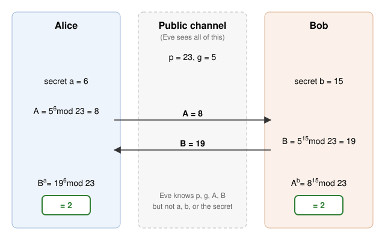

Every time you load a website over HTTPS, your browser and a server that have never met agree on a secret key, while anyone on the network can watch every byte they exchange. That sounds impossible. If an eavesdropper sees everything you send, how can the two of you end up knowing something the eavesdropper doesn't?

The answer is public-key cryptography, one of the most important ideas in computing of the last fifty years. This post walks through how it works with real (if tiny) numbers. You need only a little arithmetic.

## The problem: sharing a secret in public

Classical encryption is *symmetric*: the same key locks and unlocks the message. AES, which protects most of the data on the internet, works this way. It is fast and, as far as anyone knows, unbreakable with a good key. But it has a chicken-and-egg problem. To talk securely with someone, you first need to share a key with them securely. For most of history that meant couriers, codebooks or meeting in person.

In 1976, Whitfield Diffie and Martin Hellman published a way around this.[^dh] Their idea was to use mathematical operations that are easy to do but very hard to undo.

## One-way functions and trapdoors

A *one-way function* is easy to compute and hard to invert. A good everyday analogy is mixing paint. Combining yellow and blue to get green is easy. Starting from a can of green and recovering the exact shades that went into it is much harder.

The mathematical version used in cryptography is **modular exponentiation**. Given numbers $g$, $x$ and $p$, computing

$$
y = g^x \bmod p
$$

is fast, even for numbers hundreds of digits long. But given $y$, $g$ and $p$, finding $x$ (the *discrete logarithm*) is believed to be infeasible when $p$ is large and chosen well.

A *trapdoor* one-way function is one that becomes easy to invert if you know a secret piece of information. That is the basis of RSA, which we will get to below.

## Five minutes of modular arithmetic

"$a \bmod n$" means the remainder when $a$ is divided by $n$. It is clock arithmetic: on a 12-hour clock, 5 hours after 10 o'clock is 3 o'clock, because $15 \bmod 12 = 3$. We write $a \equiv b \pmod{n}$ when $a$ and $b$ leave the same remainder.

The key property is that you can reduce at every step without changing the final answer:

$$
(a \cdot b) \bmod n = \bigl[(a \bmod n)\cdot(b \bmod n)\bigr] \bmod n.
$$

This is why computers can calculate $g^x \bmod p$ quickly even when $g^x$ itself would have more digits than there are atoms in the universe. Using *repeated squaring*, a 2048-bit exponent takes only about 3,000 multiplications.

For example, to compute $5^{15} \bmod 23$, square repeatedly and reduce each time:

$$
\begin{aligned}
5^2 &= 25 \equiv 2, \\
5^4 &\equiv 2^2 = 4, \\
5^8 &\equiv 4^2 = 16, \\
5^{15} = 5^{8}\cdot 5^{4}\cdot 5^{2}\cdot 5 &\equiv 16 \cdot 4 \cdot 2 \cdot 5 = 640 \equiv 19 \pmod{23}.
\end{aligned}
$$

## Diffie–Hellman key exchange

Alice and Bob want a shared secret. They publicly agree on a prime $p$ and a base $g$. Here we use $p = 23$ and $g = 5$; in practice $p$ has 2048 bits or more.

1. Alice picks a secret number $a = 6$ and sends Bob $A = g^a \bmod p = 5^6 \bmod 23 = 8$.
2. Bob picks a secret number $b = 15$ and sends Alice $B = g^b \bmod p = 5^{15} \bmod 23 = 19$.
3. Alice computes $B^a \bmod p = 19^6 \bmod 23 = 2$.
4. Bob computes $A^b \bmod p = 8^{15} \bmod 23 = 2$.

They both arrive at **2**, because

$$
B^a = (g^b)^a = g^{ab} = (g^a)^b = A^b \pmod{p}.
$$



An eavesdropper, Eve, sees $p = 23$, $g = 5$, $A = 8$ and $B = 19$. To get the shared secret she needs $a$ or $b$, which means solving a discrete logarithm such as $5^a \equiv 8 \pmod{23}$. With $p = 23$ she can simply try all 22 possibilities. With a 2048-bit prime, the best known classical algorithms would take longer than the age of the universe.

## RSA: a lock anyone can close

Diffie–Hellman gives two parties a shared secret. RSA, published in 1977 by Rivest, Shamir and Adleman,[^rsa] does something different: it gives each person a **public key** that anyone can use to encrypt messages to them, and a **private key** that only they can use to decrypt. Think of a padlock you hand out freely. Anyone can snap it shut, but only you have the key that opens it.

### Building the keys

1. Pick two primes, $p = 61$ and $q = 53$.
2. Multiply them: $n = pq = 3233$. This is the *modulus*, and it is public.
3. Compute $\varphi(n) = (p - 1)(q - 1) = 60 \cdot 52 = 3120$. This must stay secret.
4. Choose a public exponent $e$ with $\gcd(e, \varphi(n)) = 1$. We take $e = 17$.
5. Find the private exponent $d$ with $e d \equiv 1 \pmod{\varphi(n)}$. Here $d = 2753$, since $17 \times 2753 = 46{,}801 = 15 \times 3120 + 1$.

The **public key** is $(n, e) = (3233, 17)$. The **private key** is $d = 2753$.

### Encrypting and decrypting

To send the message $m = 65$ (messages are encoded as numbers smaller than $n$), anyone can compute

$$
c = m^e \bmod n = 65^{17} \bmod 3233 = 2790.
$$

Only the key owner can reverse it:

$$
m = c^d \bmod n = 2790^{2753} \bmod 3233 = 65.
$$

### Why it works

Euler's theorem says that if $\gcd(m, n) = 1$, then $m^{\varphi(n)} \equiv 1 \pmod n$. Because $ed = 1 + k\varphi(n)$ for some integer $k$,

$$
c^d = (m^e)^d = m^{1 + k\varphi(n)} = m \cdot \left(m^{\varphi(n)}\right)^k \equiv m \cdot 1^k = m \pmod{n}.
$$

(The identity also holds when $m$ shares a factor with $n$, which can be checked using the Chinese remainder theorem.)

### Where the trapdoor is

Computing $d$ requires $\varphi(n)$, and computing $\varphi(n)$ requires knowing $p$ and $q$. Anyone can see $n = 3233$, and for a number this small you can factor it in your head. But a real RSA modulus has 2048 bits, about 617 decimal digits, and no known classical algorithm can factor numbers of that size in any practical amount of time. Knowing the factors is the trapdoor.

You can try the toy version yourself in Python:

```python
from math import gcd

p, q = 61, 53
n = p * q                    # 3233
phi = (p - 1) * (q - 1)      # 3120
e = 17
assert gcd(e, phi) == 1
d = pow(e, -1, phi)          # modular inverse (Python 3.8+): 2753

message = 65
cipher = pow(message, e, n)  # 2790
plain = pow(cipher, d, n)    # 65
print(n, d, cipher, plain)
```

## Signatures: running RSA backwards

Public-key cryptography also solves a second problem: proving who wrote something. To sign a message, you hash it to a number $h$ and compute $s = h^d \bmod n$ with your *private* key. Anyone can check the signature with your *public* key by verifying that $s^e \bmod n = h$. Only the holder of $d$ could have produced an $s$ that passes this test. This is how your browser knows that a website's certificate was really issued by a trusted certificate authority, and how software updates prove they came from the vendor.

## What real systems do differently

The toy examples leave out several things that matter in practice.

- **Hybrid encryption.** Public-key operations are slow, roughly a thousand times slower than AES. Real protocols such as TLS use public-key cryptography only to agree on a symmetric key, then switch to AES or ChaCha20 for the actual data.
- **Padding.** "Textbook" RSA, as shown above, is deterministic and malleable: the same message always encrypts to the same ciphertext, and an attacker can manipulate ciphertexts in useful ways. Real RSA encryption uses randomized padding such as OAEP, and signatures use schemes such as PSS.
- **Elliptic curves.** Most modern systems replace modular exponentiation with arithmetic on elliptic curves, which gives the same security with much smaller keys.
- **Ephemeral keys.** TLS 1.3 uses a fresh Diffie–Hellman key pair for every connection. Even if a server's long-term key is stolen later, past conversations stay secret. This property is called *forward secrecy*.

| Scheme | Key size | Approximate security level |
|---|---|---|
| RSA | 2048 bits | 112 bits |
| RSA | 3072 bits | 128 bits |
| Elliptic curve (P-256, X25519) | 256 bits | 128 bits |
| AES (symmetric) | 128 bits | 128 bits |

A "128-bit security level" means an attacker would need roughly $2^{128}$ operations to break it, about $3.4 \times 10^{38}$.

## The quantum caveat

In 1994 Peter Shor showed that a large enough quantum computer could factor integers and compute discrete logarithms efficiently. That would break RSA, Diffie–Hellman and elliptic-curve cryptography alike. No quantum computer today comes close to the required scale, but encrypted data recorded now could be decrypted later, so the transition is already under way. In August 2024, NIST published its first post-quantum standards, ML-KEM for key exchange (FIPS 203) and ML-DSA for signatures (FIPS 204).[^pqc] Both rely on hard problems involving lattices rather than factoring, and major browsers already combine ML-KEM with X25519 in their TLS handshakes.

## Summary

Public-key cryptography rests on functions that are easy to compute and hard to reverse. Diffie–Hellman lets two strangers agree on a shared secret in public, because combining your secret with their public value gives the same result as their secret combined with yours. RSA gives everyone a public padlock and keeps the key private, using the difficulty of factoring large numbers as its trapdoor. Run backwards, the same machinery produces digital signatures. Together they make it possible to talk securely with someone you have never met, over a network you do not trust.

[^dh]: W. Diffie and M. E. Hellman, "New Directions in Cryptography," *IEEE Transactions on Information Theory* 22, no. 6 (1976): 644–654. James Ellis, Clifford Cocks and Malcolm Williamson at the UK's GCHQ discovered equivalent ideas a few years earlier, but their work stayed classified until 1997.
[^rsa]: R. L. Rivest, A. Shamir and L. Adleman, "A Method for Obtaining Digital Signatures and Public-Key Cryptosystems," *Communications of the ACM* 21, no. 2 (1978): 120–126.
[^pqc]: National Institute of Standards and Technology, FIPS 203 (*Module-Lattice-Based Key-Encapsulation Mechanism Standard*) and FIPS 204 (*Module-Lattice-Based Digital Signature Standard*), August 2024.
