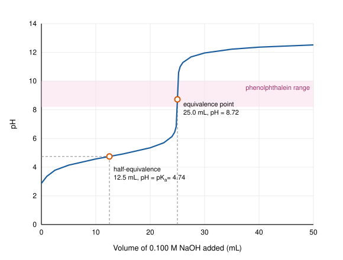

All equilibrium constants are at 25 °C unless stated otherwise. Square brackets denote molar concentrations at equilibrium.

# 1. Definitions of acids and bases

| Theory | Acid | Base | Example |
|---|---|---|---|
| Arrhenius | Produces $\ce{H+}$ in water | Produces $\ce{OH-}$ in water | $\ce{HCl}$, $\ce{NaOH}$ |
| Brønsted–Lowry | Proton ($\ce{H+}$) donor | Proton acceptor | $\ce{NH3}$ accepts $\ce{H+}$ from $\ce{H2O}$ |
| Lewis | Electron-pair acceptor | Electron-pair donor | $\ce{BF3}$ accepts a pair from $\ce{NH3}$ |

We will use the **Brønsted–Lowry** picture almost exclusively. In every acid–base reaction, the acid and the base each turn into their *conjugates*:

$$
\underbrace{\ce{CH3COOH}}_{\text{acid}} + \underbrace{\ce{H2O}}_{\text{base}} \ce{<=>} \underbrace{\ce{CH3COO-}}_{\text{conjugate base}} + \underbrace{\ce{H3O+}}_{\text{conjugate acid}}
$$

$\ce{H+}$ and $\ce{H3O+}$ are used interchangeably; a bare proton does not exist in water, but the shorthand simplifies the algebra.

# 2. Water, pH and pOH

Water ionizes slightly:

$$
\ce{2 H2O(l) <=> H3O+(aq) + OH-(aq)} \qquad K_w = [\ce{H3O+}][\ce{OH-}] = 1.0 \times 10^{-14}
$$

We define

$$
\mathrm{pH} = -\log_{10}[\ce{H3O+}], \qquad \mathrm{pOH} = -\log_{10}[\ce{OH-}], \qquad \mathrm{pH} + \mathrm{pOH} = \mathrm{p}K_w = 14.00.
$$

Neutral water has $[\ce{H3O+}] = [\ce{OH-}] = 1.0 \times 10^{-7}$ M and pH 7.00. Note that $K_w$ depends on temperature: at 37 °C, $K_w \approx 2.4 \times 10^{-14}$ and neutral pH is about 6.81.

**Significant figures in pH:** the number of decimal places in a pH equals the number of significant figures in the concentration. $[\ce{H3O+}] = 2.5 \times 10^{-4}$ M gives pH $= 3.60$ (two decimal places).

# 3. Strong acids and bases

Strong acids ionize completely in water. The six common ones are $\ce{HCl}$, $\ce{HBr}$, $\ce{HI}$, $\ce{HNO3}$, $\ce{HClO4}$ and $\ce{H2SO4}$ (first proton only). Strong bases are the Group 1 hydroxides and $\ce{Ca(OH)2}$, $\ce{Sr(OH)2}$, $\ce{Ba(OH)2}$.

For a strong acid, $[\ce{H3O+}]$ equals the acid's formal concentration. For example, 0.025 M $\ce{HNO3}$ has pH $= -\log(0.025) = 1.60$. For 0.010 M $\ce{Ba(OH)2}$, $[\ce{OH-}] = 2 \times 0.010 = 0.020$ M, so pOH $= 1.70$ and pH $= 12.30$.

# 4. Weak acids and bases

## 4.1 Acid dissociation constant

A weak acid $\ce{HA}$ only partly ionizes:

$$
\ce{HA(aq) + H2O(l) <=> H3O+(aq) + A-(aq)}, \qquad K_a = \frac{[\ce{H3O+}][\ce{A-}]}{[\ce{HA}]}, \qquad \mathrm{p}K_a = -\log K_a.
$$

The larger $K_a$ (the smaller p$K_a$), the stronger the acid.

| Acid | Formula | $K_a$ | p$K_a$ |
|---|---|---:|---:|
| Hydrofluoric acid | $\ce{HF}$ | $6.8 \times 10^{-4}$ | 3.17 |
| Nitrous acid | $\ce{HNO2}$ | $4.5 \times 10^{-4}$ | 3.35 |
| Formic acid | $\ce{HCOOH}$ | $1.8 \times 10^{-4}$ | 3.74 |
| Acetic acid | $\ce{CH3COOH}$ | $1.8 \times 10^{-5}$ | 4.74 |
| Carbonic acid (1st) | $\ce{H2CO3}$ | $4.3 \times 10^{-7}$ | 6.37 |
| Ammonium ion | $\ce{NH4+}$ | $5.6 \times 10^{-10}$ | 9.25 |
| Hydrocyanic acid | $\ce{HCN}$ | $4.9 \times 10^{-10}$ | 9.31 |

## 4.2 Worked example: pH of a weak acid (ICE table)

*Find the pH and percent ionization of 0.10 M acetic acid.*

| | $\ce{CH3COOH}$ | $\ce{H3O+}$ | $\ce{CH3COO-}$ |
|---|---:|---:|---:|
| **I**nitial (M) | 0.10 | 0 | 0 |
| **C**hange (M) | $-x$ | $+x$ | $+x$ |
| **E**quilibrium (M) | $0.10 - x$ | $x$ | $x$ |

$$
K_a = \frac{x^2}{0.10 - x} = 1.8 \times 10^{-5}.
$$

Because $K_a$ is small, assume $x \ll 0.10$, so $0.10 - x \approx 0.10$:

$$
x = \sqrt{(1.8 \times 10^{-5})(0.10)} = 1.34 \times 10^{-3} \text{ M}, \qquad \mathrm{pH} = -\log(1.34 \times 10^{-3}) = 2.87.
$$

*Check the approximation* with the 5% rule: $\frac{1.34 \times 10^{-3}}{0.10} \times 100\% = 1.3\% < 5\%$. ✓ The percent ionization is **1.3%**.

If the 5% rule fails (dilute solutions or larger $K_a$), solve the quadratic $x^2 + K_a x - K_a C_0 = 0$ instead.

## 4.3 Weak bases

$$
\ce{B(aq) + H2O(l) <=> BH+(aq) + OH-(aq)}, \qquad K_b = \frac{[\ce{BH+}][\ce{OH-}]}{[\ce{B}]}.
$$

*Example:* 0.20 M $\ce{NH3}$ with $K_b = 1.8 \times 10^{-5}$. Then $[\ce{OH-}] = \sqrt{(1.8 \times 10^{-5})(0.20)} = 1.9 \times 10^{-3}$ M, so pOH $= 2.72$ and **pH $= 11.28$**.

## 4.4 Conjugate pairs

For any conjugate acid–base pair,

$$
K_a \cdot K_b = K_w \qquad \Longleftrightarrow \qquad \mathrm{p}K_a + \mathrm{p}K_b = 14.00.
$$

The stronger an acid, the weaker its conjugate base. The conjugate bases of strong acids ($\ce{Cl-}$, $\ce{NO3-}$, ...) have negligible basicity.

# 5. Salts in water (hydrolysis)

A salt's solution is acidic, basic or neutral depending on its ions:

- **Cation from a strong base and anion from a strong acid** ($\ce{NaCl}$, $\ce{KNO3}$): neutral.
- **Anion that is the conjugate base of a weak acid** ($\ce{CH3COO-}$, $\ce{F-}$, $\ce{CO3^2-}$): basic.
- **Cation that is the conjugate acid of a weak base** ($\ce{NH4+}$): acidic.
- **Small, highly charged metal cations** ($\ce{Al^3+}$, $\ce{Fe^3+}$): acidic, through hydrated ions such as $\ce{[Al(H2O)6]^3+}$.

*Example:* the pH of 0.10 M sodium acetate. The acetate ion is a weak base:

$$
\ce{CH3COO- + H2O <=> CH3COOH + OH-}, \qquad K_b = \frac{K_w}{K_a} = \frac{1.0 \times 10^{-14}}{1.8 \times 10^{-5}} = 5.6 \times 10^{-10}.
$$

$[\ce{OH-}] = \sqrt{(5.6 \times 10^{-10})(0.10)} = 7.5 \times 10^{-6}$ M, so pOH $= 5.13$ and **pH $= 8.87$**.

# 6. Buffers

A buffer contains a weak acid and its conjugate base (or a weak base and its conjugate acid) in comparable amounts. It resists pH changes because added $\ce{H3O+}$ is consumed by $\ce{A-}$ and added $\ce{OH-}$ is consumed by $\ce{HA}$:

$$
\ce{A- + H3O+ -> HA + H2O} \qquad\qquad \ce{HA + OH- -> A- + H2O}
$$

## 6.1 Henderson–Hasselbalch equation

Taking $-\log$ of the $K_a$ expression gives

$$
\mathrm{pH} = \mathrm{p}K_a + \log\frac{[\ce{A-}]}{[\ce{HA}]}.
$$

It works well when both concentrations are much larger than $K_a$ and their ratio is between 0.1 and 10. A buffer's effective range is therefore p$K_a \pm 1$.

## 6.2 Worked example

*A buffer is 0.10 M $\ce{CH3COOH}$ and 0.15 M $\ce{CH3COONa}$ in 1.00 L. Find its pH, then the pH after adding 0.010 mol $\ce{HCl}$.*

Initial pH:

$$
\mathrm{pH} = 4.74 + \log\frac{0.15}{0.10} = 4.74 + 0.18 = 4.92.
$$

The added $\ce{HCl}$ reacts completely with acetate: $\ce{CH3COO-}$ goes from 0.15 to 0.14 mol and $\ce{CH3COOH}$ goes from 0.10 to 0.11 mol. Then

$$
\mathrm{pH} = 4.74 + \log\frac{0.14}{0.11} = 4.74 + 0.10 = 4.84.
$$

The pH drops by only 0.08 units. The same 0.010 mol of $\ce{HCl}$ in 1.00 L of pure water would take the pH from 7.00 to 2.00.

# 7. Titration curves

## 7.1 Weak acid titrated with strong base

Figure 1 shows the titration of 25.0 mL of 0.100 M $\ce{CH3COOH}$ with 0.100 M $\ce{NaOH}$. There are four regions, each with its own calculation:

| Region | Volume of NaOH | What is in the flask | How to calculate pH |
|---|---|---|---|
| Start | 0 mL | Weak acid only | ICE table: pH 2.87 |
| Buffer region | 0–25.0 mL | $\ce{HA}$ and $\ce{A-}$ | Henderson–Hasselbalch |
| Equivalence point | 25.0 mL | $\ce{A-}$ only (0.0500 M) | Weak-base $K_b$: pH 8.72 |
| Past equivalence | > 25.0 mL | Excess $\ce{OH-}$ | Excess strong base |

At the **half-equivalence point** (12.5 mL), $[\ce{HA}] = [\ce{A-}]$, so pH $=$ p$K_a$ $=$ 4.74. This is how p$K_a$ values are measured experimentally.

At the **equivalence point**, the 2.50 mmol of acetate is in 50.0 mL, so $[\ce{CH3COO-}] = 0.0500$ M and

$$
[\ce{OH-}] = \sqrt{(5.6 \times 10^{-10})(0.0500)} = 5.3 \times 10^{-6} \text{ M} \quad\Rightarrow\quad \mathrm{pOH} = 5.28, \quad \mathrm{pH} = 8.72.
$$

The equivalence point of a weak acid–strong base titration is always **above 7**.

{width=80%}

## 7.2 Choosing an indicator

Choose an indicator whose color change range contains the equivalence-point pH.

| Indicator | Color change range (pH) | Acid color → base color | Suitable for |
|---|---|---|---|
| Methyl orange | 3.1–4.4 | red → yellow | Strong acid with weak base |
| Bromothymol blue | 6.0–7.6 | yellow → blue | Strong acid with strong base |
| Phenolphthalein | 8.2–10.0 | colorless → pink | Weak acid with strong base |

For the acetic acid titration above, **phenolphthalein** is the right choice.

# 8. Polyprotic acids

Polyprotic acids lose protons one at a time, and each step has its own, progressively smaller, $K_a$. For phosphoric acid:

$$
\begin{aligned}
&\ce{H3PO4 + H2O <=> H2PO4- + H3O+} && K_{a1} = 7.5 \times 10^{-3} \\
&\ce{H2PO4- + H2O <=> HPO4^2- + H3O+} && K_{a2} = 6.2 \times 10^{-8} \\
&\ce{HPO4^2- + H2O <=> PO4^3- + H3O+} && K_{a3} = 4.8 \times 10^{-13}
\end{aligned}
$$

When successive constants differ by a factor of $10^3$ or more, the pH is determined almost entirely by the first ionization, and you can treat the acid as monoprotic with $K_{a1}$. The concentration of the doubly deprotonated species is then approximately $K_{a2}$: in a phosphoric acid solution, $[\ce{HPO4^2-}] \approx 6.2 \times 10^{-8}$ M regardless of the starting concentration.

# 9. Summary of key equations

$$
\begin{aligned}
K_w &= [\ce{H3O+}][\ce{OH-}] = 1.0 \times 10^{-14} & \mathrm{pH} + \mathrm{pOH} &= 14.00 \\
[\ce{H3O+}] &\approx \sqrt{K_a C_0} \ \ (\text{weak acid}) & [\ce{OH-}] &\approx \sqrt{K_b C_0} \ \ (\text{weak base}) \\
K_a K_b &= K_w & \mathrm{pH} &= \mathrm{p}K_a + \log\frac{[\ce{A-}]}{[\ce{HA}]}
\end{aligned}
$$

**Common mistakes to avoid**

1. Using Henderson–Hasselbalch for a solution that contains only a weak acid, or only its conjugate base. It needs both.
2. Forgetting to account for dilution when titrant is added. Work in moles first, then divide by the total volume.
3. Assuming the equivalence point is always at pH 7. That is true only for strong acid–strong base titrations.
4. Mixing up $K_a$ and $K_b$ for a salt. Ask which ion reacts with water, and whether it acts as an acid or a base.
