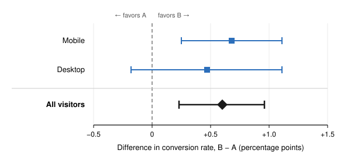

# Summary

We tested a redesigned single-page checkout (variant **B**) against the current three-step checkout (control **A**) for 14 days, from September 15 to September 28, 2026. Visitors who reached the cart page were randomized 50/50.

- **Primary metric, checkout conversion rate:** B converted 4.80% of visitors versus 4.20% for A, an absolute lift of **+0.60 percentage points** (95% CI: +0.23 to +0.96 pp) and a relative lift of **+14.3%**. The difference is statistically significant ($z = 3.21$, $p = 0.0013$).
- **Secondary metric, revenue per visitor:** B earned $3.78 per visitor versus $3.41 for A (+$0.37, 95% CI: −$0.03 to +$0.77). This difference is *not* statistically significant ($p = 0.073$).
- **Guardrails:** no sample ratio mismatch, no change in page-load time or payment errors, and no increase in refund requests.

**Recommendation:** ship variant B. The conversion gain is robust, and the revenue estimate, while noisier, points in the same direction. We suggest monitoring average order value for four weeks after launch, because it dipped slightly in B (see Section 5.3).

# Experiment design

| Item | Value |
|---|---|
| Unit of randomization | Visitor (persistent cookie ID), assigned on first cart-page view |
| Eligible population | All web visitors who reached `/cart` with at least one item; app users excluded |
| Allocation | 50% A, 50% B |
| Primary metric | Checkout conversion: share of visitors who completed an order within the test window |
| Secondary metric | Revenue per visitor (RPV), net of discounts, before refunds |
| Guardrail metrics | Sample ratio, median page load time, payment error rate, 14-day refund rate |
| Duration | 14 days (two full weekly cycles), fixed in advance |
| Significance level | $\alpha = 0.05$, two-sided |

Table: Experiment design, pre-registered on September 12.

## Sample size

The pre-registration targeted a minimum detectable effect (MDE) of a 12.5% relative lift on a 4.2% baseline, that is, from $p_A = 0.0420$ to $p_B = 0.04725$, with 80% power. For a two-sided test of two proportions, the required sample size per arm is approximately

$$
n = \frac{\left(z_{1-\alpha/2} + z_{1-\beta}\right)^2 \left[p_A(1 - p_A) + p_B(1 - p_B)\right]}{(p_B - p_A)^2}
  = \frac{(1.960 + 0.842)^2 (0.04024 + 0.04502)}{(0.00525)^2} \approx 24{,}300. \tag{1}
$$

Based on historical traffic, we expected about 1,750 eligible visitors per arm per day, so 14 days was sufficient. We did not look at the primary metric before the test ended.

# Data

| Arm | Visitors | Orders | Conversion rate | Revenue | Revenue per visitor |
|---|---:|---:|---:|---:|---:|
| A (control) | 24,812 | 1,042 | 4.200% | $84,609 | $3.41 |
| B (single-page) | 24,655 | 1,183 | 4.798% | $93,196 | $3.78 |
| **Total** | **49,467** | **2,225** | **4.498%** | **$177,805** | **$3.59** |

Table: Raw results by arm. Revenue figures are net of discounts and taxes.

We excluded 312 visitors flagged as bots by the edge filter (159 in A and 153 in B) and 41 internal employee accounts before unblinding.

# Validity checks

## Sample ratio mismatch

With a 50/50 design, we expect each arm to receive $49{,}467 / 2 = 24{,}733.5$ visitors. The chi-squared goodness-of-fit statistic is

$$
\chi^2 = \frac{(24{,}812 - 24{,}733.5)^2}{24{,}733.5} + \frac{(24{,}655 - 24{,}733.5)^2}{24{,}733.5} = 0.498,
$$

with 1 degree of freedom, giving $p = 0.48$. There is no evidence that assignment or logging was unbalanced.

## Guardrails

| Guardrail | A | B | Difference | Threshold | Status |
|---|---:|---:|---:|---|---|
| Median page load, checkout (ms) | 1,210 | 1,185 | −25 | +100 ms | Pass |
| Payment error rate | 0.62% | 0.59% | −0.03 pp | +0.20 pp | Pass |
| 14-day refund rate (of orders) | 3.1% | 3.0% | −0.1 pp | +0.5 pp | Pass |

Table: Guardrail metrics.

# Results

## Primary metric: conversion rate

Let $p_A$ and $p_B$ be the true conversion rates. We test $H_0\colon p_A = p_B$ against $H_1\colon p_A \neq p_B$ with a two-proportion $z$-test. Under $H_0$, the pooled estimate is

$$
\hat p = \frac{x_A + x_B}{n_A + n_B} = \frac{1{,}042 + 1{,}183}{24{,}812 + 24{,}655} = 0.04498, \tag{2}
$$

and the test statistic is

$$
z = \frac{\hat p_B - \hat p_A}{\sqrt{\hat p (1 - \hat p)\left(\frac{1}{n_A} + \frac{1}{n_B}\right)}}
  = \frac{0.047982 - 0.041996}{0.0018638} = 3.21. \tag{3}
$$

The two-sided $p$-value is $2\,[1 - \Phi(3.21)] = 0.0013$, so we reject $H_0$ at $\alpha = 0.05$.

For the confidence interval we use the unpooled standard error, since we no longer assume the rates are equal:

$$
\mathrm{SE} = \sqrt{\frac{\hat p_A(1 - \hat p_A)}{n_A} + \frac{\hat p_B(1 - \hat p_B)}{n_B}} = 0.0018639, \tag{4}
$$

$$
(\hat p_B - \hat p_A) \pm 1.96\,\mathrm{SE} = 0.005986 \pm 0.003653 = [0.00233,\ 0.00964]. \tag{5}
$$

In relative terms, dividing by the control rate, the lift is **+14.3% (95% CI: +5.6% to +23.0%)**. This interval treats $\hat p_A$ as fixed. A delta-method interval for the ratio $\hat p_B / \hat p_A$, which also accounts for uncertainty in the baseline, is slightly wider: +5.3% to +23.9%.

| Arm | Conversion rate | 95% CI (Wald) |
|---|---:|---|
| A | 4.20% | [3.95%, 4.45%] |
| B | 4.80% | [4.53%, 5.07%] |
| B − A | +0.60 pp | [+0.23, +0.96] pp |

Table: Conversion rates with 95% confidence intervals.

## Secondary metric: revenue per visitor

Revenue per visitor is heavily skewed: 95.5% of visitors spend nothing, and a few large orders dominate the variance. With samples this large, the sampling distribution of the mean is still close to normal, so we use Welch's $t$-test:

$$
t = \frac{\bar y_B - \bar y_A}{\sqrt{\dfrac{s_A^2}{n_A} + \dfrac{s_B^2}{n_B}}}
  = \frac{3.78 - 3.41}{\sqrt{\dfrac{21.80^2}{24{,}812} + \dfrac{23.95^2}{24{,}655}}}
  = \frac{0.37}{0.206} = 1.80, \tag{6}
$$

which gives $p = 0.073$ (two-sided). The 95% confidence interval for the difference is $0.37 \pm 1.96 \times 0.206 = [-\$0.03, +\$0.77]$. We cannot rule out zero effect on revenue, but the point estimate (+10.9%) is consistent with the conversion gain. A bootstrap with 10,000 resamples gave a nearly identical interval, [−$0.04, +$0.78].

## Average order value

Average order value (AOV) among converters was **$81.20 in A and $78.78 in B**, a 3.0% decrease. This is not a pre-registered metric, and the difference is not significant (Welch $t = -1.12$, $p = 0.26$), but it is plausible: the single-page design removes the separate "review order" step, where cross-sell recommendations used to appear. The additional orders in B outweigh the lower AOV, which is why RPV still rises.

## Segments (exploratory)

| Segment | A conv. | B conv. | Difference (pp) | 95% CI (pp) | $p$ |
|---|---:|---:|---:|---|---:|
| Mobile ($n$ = 29,700) | 3.40% | 4.08% | +0.68 | [+0.25, +1.11] | 0.002 |
| Desktop ($n$ = 19,767) | 5.41% | 5.87% | +0.47 | [−0.18, +1.11] | 0.16 |
| **All visitors** | **4.20%** | **4.80%** | **+0.60** | **[+0.23, +0.96]** | **0.001** |

Table: Conversion by device. These comparisons were not pre-registered and are not corrected for multiple testing.

The lift appears larger on mobile, which matches the design's intent (fewer page loads on slow connections). The interaction between device and arm is not significant, however (likelihood-ratio test, $p = 0.61$), so these data do not show that the effect differs by device.

{width=80%}

# Reproducing the analysis

```python
import numpy as np
from statsmodels.stats.proportion import proportions_ztest, confint_proportions_2indep

conversions = np.array([1183, 1042])   # B, A
visitors    = np.array([24655, 24812])

z, p = proportions_ztest(conversions, visitors, alternative="two-sided")
print(f"z = {z:.2f}, p = {p:.4f}")                         # z = 3.21, p = 0.0013

lo, hi = confint_proportions_2indep(conversions[0], visitors[0],
                                    conversions[1], visitors[1],
                                    method="wald", compare="diff")
print(f"95% CI for difference: [{lo:.5f}, {hi:.5f}]")     # [0.00233, 0.00964]
```

# Caveats

1. **Novelty effects.** Fourteen days may not be long enough for returning visitors to settle into the new flow. Conversion by day showed no trend in the lift (slope test, $p = 0.54$), which is reassuring but not conclusive.
2. **Seasonality.** The test ran in the second half of September, outside any major promotion. Effects during the holiday season, when traffic includes more first-time visitors, may differ.
3. **Revenue lag.** Revenue is measured before refunds. We will repeat the RPV analysis at 30 days, once the refund window has closed.

# Decision

Ship variant B to 100% of web traffic, keeping a 5% holdout on the old checkout through November 15, 2026, to measure the long-run effect on conversion and AOV.
