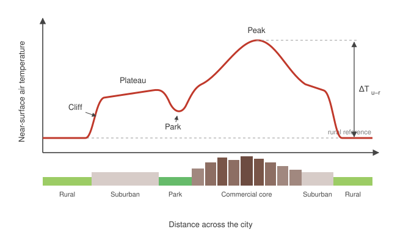

## 2.1 Introduction

Cities are warmer than the land around them. Luke Howard noticed this in London two centuries ago, recording that the city was on average warmer than its rural surroundings and attributing part of the difference to the "great quantity of fuel" burned there [@howard1833]. The phenomenon, now called the urban heat island (UHI), has since become one of the best documented examples of inadvertent climate modification by human activity [@arnfield2003; @grimmond2007; @oke2017].

This chapter reviews the literature that frames the rest of the thesis. Section 2.2 sets out how the UHI is defined and quantified, and why those definitions matter. Section 2.3 summarizes the physical mechanisms. Section 2.4 compares measurement approaches, and Section 2.5 reviews what is known about spatial and temporal variability, including interactions with heat waves. Section 2.6 turns to health and equity, and Section 2.7 to mitigation. Section 2.8 identifies the gaps that Chapters 3 to 5 address.

## 2.2 Defining and quantifying the urban heat island

### 2.2.1 Three heat islands, not one

The term "urban heat island" covers at least three related but distinct phenomena [@oke1982; @voogt2003]:

1. The **canopy-layer UHI** is the air-temperature excess measured between the ground and roughly roof level, where people live. It is what weather stations and mobile traverses record.
2. The **boundary-layer UHI** is the warmer air above roof level, extending up through the urban boundary layer and often advected downwind as an "urban plume".
3. The **surface UHI** (SUHI) is the excess in land surface temperature (LST), usually retrieved from thermal infrared satellite imagery.

These three do not behave alike. The canopy-layer UHI is typically strongest on calm, clear nights, while the SUHI peaks in the daytime in summer, when sunlit roofs and pavements become far hotter than vegetated rural surfaces [@voogt2003; @peng2012]. Treating a satellite-derived SUHI as a proxy for the air temperature that people experience is a common error, and one that Section 2.4 returns to.

### 2.2.2 UHI intensity

The magnitude of a heat island is conventionally expressed as the urban–rural temperature difference,

$$
\Delta T_{u-r} = \overline{T}_{\text{urban}} - \overline{T}_{\text{rural}},
$$

where the overbars denote averages over a reference period or a set of stations. The maximum of $\Delta T_{u-r}$ over a night, $\Delta T_{u-r(\max)}$, was the focus of much early work. @oke1973 related it to city population $P$ and found a logarithmic dependence, with different coefficients for North American and European cities:

$$
\begin{aligned}
\Delta T_{u-r(\max)} &= 2.96 \log_{10} P - 6.41 \quad \text{(North America)}, \\
\Delta T_{u-r(\max)} &= 2.01 \log_{10} P - 4.06 \quad \text{(Europe)}.
\end{aligned}
$$

Population is a proxy for urban form, and later work replaced it with geometric descriptors (Section 2.3).

### 2.2.3 The trouble with "urban" and "rural"

The simple difference in the equation above depends heavily on which stations count as urban and which as rural. @stewart2011 reviewed 190 UHI studies and found that most did not describe their sites well enough for the reported intensity to be interpreted or compared. In response, @stewart2012 proposed the Local Climate Zone (LCZ) scheme: seventeen standard classes, ten built (from "compact high-rise" to "heavy industry") and seven land-cover types, each defined by surface structure, cover, and human activity. Intensity is then reported as a difference between LCZ classes, for example $\Delta T_{\text{LCZ 2} - \text{LCZ D}}$, rather than between loosely defined "urban" and "rural" points. The LCZ framework is now the standard for site description, and this thesis adopts it in Chapter 3.

## 2.3 Physical mechanisms

### 2.3.1 The urban surface energy balance

The causes of the UHI are best organized through the surface energy balance of an urban volume [@oke1982]:

$$
Q^{*} + Q_F = Q_H + Q_E + \Delta Q_S + \Delta Q_A,
$$

where $Q^{*}$ is net all-wave radiation, $Q_F$ is anthropogenic heat release, $Q_H$ and $Q_E$ are the turbulent sensible and latent heat fluxes, $\Delta Q_S$ is the net storage heat flux into buildings, roads and ground, and $\Delta Q_A$ is net horizontal advection. All terms are in $\mathrm{W\,m^{-2}}$. Every proposed cause of the UHI changes one or more of these terms relative to a rural surface.

### 2.3.2 Principal causes

Table 2.1 summarizes the main causes and the energy balance terms they act on.

| Cause | Energy balance term | Effect |
|---|---|---|
| Replacement of vegetation and soil by impervious surfaces | $Q_E$ decreases | Less energy goes to evaporation, more to heating |
| High thermal admittance of building materials | $\Delta Q_S$ increases | Heat stored by day is released at night |
| Canyon geometry (low sky view factor) | $Q^{*}$ increases at night | Longwave loss to the sky is reduced; multiple reflection of shortwave |
| Lower albedo of roofs and pavements | $Q^{*}$ increases by day | More shortwave radiation absorbed |
| Heating, cooling, traffic and metabolism | $Q_F > 0$ | Direct heat input, large in dense cores and cold climates |
| Reduced wind speed in the canopy layer | $Q_H$ decreases | Less turbulent removal of heat |

: Table 2.1. Principal causes of the canopy-layer urban heat island, after @oke1982 and @arnfield2003.

The nocturnal canopy-layer UHI is controlled mainly by geometry and storage. Using scale models and field data, @oke1981 showed that the maximum nocturnal intensity in calm, clear conditions is closely related to the street canyon height-to-width ratio $H/W$ and the sky view factor $\psi_{\text{sky}}$:

$$
\Delta T_{u-r(\max)} = 7.54 + 3.97 \ln(H/W), \qquad \Delta T_{u-r(\max)} = 15.27 - 13.88\, \psi_{\text{sky}}.
$$

The daytime SUHI, by contrast, is dominated by the loss of evapotranspiration [@taha1997]. Anthropogenic heat is usually a secondary term in mid-latitude summers, where @sailor2011 found typical city-scale values of 20 to $70\ \mathrm{W\,m^{-2}}$, but it can rival net radiation in dense cores during winter.

### 2.3.3 Background climate

The relative weight of these mechanisms depends on the regional climate. Comparing 65 North American cities, @zhao2014 attributed much of the variation in daytime UHI intensity to differences in convection efficiency, the ease with which the surface sheds heat to the lower atmosphere. Humid cities, where the rural surroundings are densely vegetated and aerodynamically rough, showed larger daytime UHIs than dry cities. @manoli2019 extended the analysis globally and found that UHI intensity scales with both population and precipitation, with a nonlinear dependence that saturates in wet climates. Both studies imply that a mitigation measure that works in one climate cannot simply be transplanted to another.

## 2.4 Measurement approaches

Figure 2.1 shows the idealized canopy-layer profile that motivated most early fieldwork: a "cliff" at the rural–urban boundary, a "plateau" over the suburbs, a "peak" over the dense core, and local dips over parks and water.

{width=90%}

Three broad families of measurement have been used to characterize that profile and its surface counterpart. Table 2.2 compares them.

| Approach | What it measures | Spatial coverage | Temporal coverage | Main limitation |
|---|---|---|---|---|
| Fixed stations | Air temperature at screen height | Points, often sparse | Continuous, multi-year | Station siting rarely representative [@stewart2011] |
| Mobile traverses | Air temperature along a route | Transects | Snapshots of a few hours | Readings along the route are not simultaneous; needs time correction |
| Thermal remote sensing | Land surface temperature | Whole city, 30 m to 1 km | Overpass times only | Measures surfaces, not air; biased to clear skies and to horizontal surfaces [@voogt2003] |
| Crowdsourced sensors | Air temperature, uncalibrated | Dense in some cities | Continuous | Variable quality; requires filtering |

: Table 2.2. Comparison of urban heat island measurement approaches.

Satellite studies have transformed the scale of UHI research. @imhoff2010 used MODIS LST over 38 US cities and showed that the summer daytime SUHI is largest in cities built in forested biomes and smallest, sometimes negative, in deserts. @peng2012 analyzed 419 large cities worldwide and reported an average annual daytime SUHI of $1.5 \pm 1.2\ ^\circ\mathrm{C}$, larger than the nighttime value of $1.1 \pm 0.5\ ^\circ\mathrm{C}$, with the daytime SUHI controlled mainly by differences in vegetation cover. @clinton2013 confirmed these patterns and documented "heat sinks", cities cooler than their surroundings, in arid regions. Algorithmic choices matter: @chakraborty2019 showed that the definition of the urban extent and the rural reference changes estimated SUHI intensity enough to reverse the sign of some trends.

The tension between surface and air measurements is not merely technical. Remote sensing "sees" the hottest horizontal surfaces from above and misses walls, shaded ground, and the air in between [@voogt2003]. For questions about human exposure, which is the focus of this thesis, air-temperature measurement in the canopy layer remains necessary.

## 2.5 Spatial and temporal variability

### 2.5.1 Diurnal and seasonal cycles

The canopy-layer UHI follows a strong diurnal cycle. Intensity is small or even negative around midday, grows after sunset as rural surfaces cool faster than the city releases stored heat, and peaks a few hours after sunset [@oke1982; @arnfield2003]. Wind and cloud suppress it; a wind speed above roughly $5$ to $7\ \mathrm{m\,s^{-1}}$ at rural stations usually eliminates the nocturnal UHI in mid-sized cities. Seasonally, mid-latitude canopy UHIs tend to be largest in summer and early autumn, while the SUHI follows the vegetation cycle of the rural surroundings [@imhoff2010].

### 2.5.2 Intra-urban variability

Temperature varies as much within a city as between a city and its surroundings. Tree canopy is the strongest local control. Using bicycle-mounted sensors in Madison, Wisconsin, @ziter2019 found that daytime air temperature fell nonlinearly with canopy cover, with the largest cooling only once canopy exceeded about 40 percent of a block-scale neighborhood. Impervious cover had the opposite effect, and the two interacted: trees cooled more when impervious cover was low.

### 2.5.3 Interaction with heat waves

The UHI matters most when temperatures are already dangerous. @li2013 combined observations and simulations for the Baltimore–Washington area and showed that during heat waves the UHI intensity increased rather than merely adding a fixed offset; low wind speeds and dry soils during heat waves amplified the urban–rural contrast. This synergy means that the extra heat burden in cities is largest exactly when it is least tolerable.

## 2.6 Health and equity impacts

Excess heat is a leading weather-related cause of death in many countries. A 384-location analysis by @gasparrini2015 attributed 7.71 percent of deaths to non-optimal temperature, most of it to moderate cold, but heat-related mortality rises steeply during heat waves. The 1995 Chicago heat wave, in which over 700 excess deaths occurred, showed that the risk concentrated among older residents living alone, without air conditioning, and in top-floor apartments [@semenza1996].

Exposure is unevenly distributed within cities. In Phoenix, @harlan2006 found that lower-income and minority neighborhoods were hotter, had less vegetation, and had fewer resources to cope with heat. Two recent national studies tied this pattern to policy history and to race. @hoffman2020 examined 108 US urban areas and found that neighborhoods graded "hazardous" under 1930s Home Owners' Loan Corporation redlining are today, on average, about $2.6\ ^\circ\mathrm{C}$ hotter in land surface temperature than those graded "best". @hsu2021 showed that in nearly all of the 175 largest US urbanized areas, the average person of color lives in a census tract with higher SUHI intensity than the average non-Hispanic white resident, a disparity that persists after controlling for income.

These findings have shifted the framing of the field. The UHI is no longer only a question of urban climatology but a question of environmental justice, and mitigation is increasingly judged by who benefits from it.

## 2.7 Mitigation strategies

Mitigation measures act on the same energy balance terms as the causes listed in Table 2.1. Table 2.3 summarizes the magnitudes reported in the reviewed literature; the ranges are wide because the studies differ in scale, method, and climate.

| Strategy | Mechanism | Reported cooling | Scale | Sources |
|---|---|---|---|---|
| Cool (high-albedo) roofs | Raise albedo, reduce $Q^{*}$ | Roof surface 10–30 °C lower at peak sun; ambient air about 0.1–0.3 °C per 0.1 increase in city albedo (models) | Building to city | @akbari2001; @santamouris2014 |
| Cool pavements | Raise albedo | Surface 5–15 °C lower; small air effect | Street | @santamouris2014 |
| Urban parks | Shade, evapotranspiration | Parks about 0.9 °C cooler than surroundings by day, on average | Park and edge | @bowler2010 |
| Street trees | Shade, evapotranspiration | Strongest above about 40 % canopy cover | Block | @ziter2019 |
| Green roofs | Evapotranspiration, insulation | Large roof-surface effect; small at street level | Building | @santamouris2014 |
| Reduced anthropogenic heat | Lower $Q_F$ | Up to 1–2 °C in dense cores in winter | Core | @sailor2011 |

: Table 2.3. Reported cooling from common mitigation strategies.

High-albedo surfaces are the most studied measure. @akbari2001 estimated that combining cool roofs, cool pavements, and shade trees could reduce cooling energy use in US cities substantially and lower peak summer air temperatures by up to about $2\ ^\circ\mathrm{C}$. Later reviews have tempered these numbers: @santamouris2014 found that large-scale albedo increases reduce ambient temperature by a few tenths of a degree per $0.1$ of albedo change, with diminishing returns and possible winter heating penalties at high latitudes.

Greening offers both cooling and co-benefits. The meta-analysis by @bowler2010 supports a modest park cooling effect but notes that most studies are observational, small, and short, which limits causal inference. @gago2013 argue for combining measures at the neighborhood scale rather than relying on any single technology, a conclusion shared by most recent reviews.

## 2.8 Research gaps

Four gaps emerge from this review and motivate the rest of the thesis.

First, most studies of exposure rely on land surface temperature, while health outcomes depend on air temperature and humidity in the canopy layer (Section 2.4). The relationship between the two varies across LCZ classes and is poorly characterized for mid-sized cities.

Second, the intra-urban variability documented by @ziter2019 and @hsu2021 is usually described at one or two scales. How canopy, imperviousness, and building geometry interact across scales during heat waves, when the synergy described by @li2013 operates, has received little attention.

Third, mitigation studies report cooling as a change in mean temperature. Few assess changes in the nighttime minimum, which is more strongly linked to heat mortality, or the distribution of benefits across neighborhoods.

Fourth, the climate dependence shown by @zhao2014 and @manoli2019 implies that evidence from large, humid cities may not transfer to the semi-arid, mid-sized city studied here.

Chapter 3 addresses the first two gaps with a dense network of canopy-layer air temperature sensors stratified by LCZ. Chapter 4 uses those observations to evaluate the nighttime benefits of tree planting scenarios, and Chapter 5 examines their distribution across neighborhoods with different histories of investment.

## References {-}

::: {#refs}
:::
