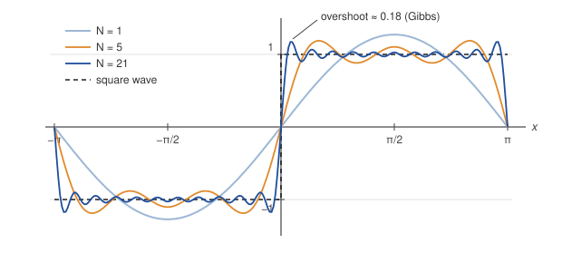

# Overview

These notes cover two lectures. The first develops Fourier series for periodic functions: the coefficient formulas, convergence, the Gibbs phenomenon, and Parseval's identity. The second passes to the limit of infinite period to obtain the Fourier transform, collects its main properties, and uses it to solve the heat equation on an infinite rod.

**Prerequisites:** integration by parts, complex exponentials ($e^{i\theta} = \cos\theta + i\sin\theta$), and the idea of an orthogonal basis from linear algebra.

# 1. Fourier series

## 1.1 Orthogonality of the trigonometric system

The key fact behind everything that follows is that sines and cosines of different integer frequencies are orthogonal on $[-\pi, \pi]$. For integers $m, n \ge 0$:

$$
\int_{-\pi}^{\pi} \cos(mx)\cos(nx)\,dx = \begin{cases} 0, & m \ne n, \\ \pi, & m = n \ge 1, \\ 2\pi, & m = n = 0, \end{cases}
\qquad
\int_{-\pi}^{\pi} \sin(mx)\sin(nx)\,dx = \begin{cases} 0, & m \ne n, \\ \pi, & m = n \ge 1, \end{cases}
$$

and $\int_{-\pi}^{\pi} \sin(mx)\cos(nx)\,dx = 0$ for all $m, n$. Each follows from a product-to-sum identity; for example $\cos(mx)\cos(nx) = \tfrac12[\cos((m-n)x) + \cos((m+n)x)]$, and the integral of $\cos(kx)$ over a full period vanishes for $k \ne 0$.

In the language of linear algebra, $\{1, \cos x, \sin x, \cos 2x, \sin 2x, \dots\}$ is an orthogonal set in the inner product space of square-integrable functions on $[-\pi, \pi]$ with

$$
\langle f, g \rangle = \int_{-\pi}^{\pi} f(x)\,g(x)\,dx.
$$

## 1.2 The coefficient formulas

Suppose a $2\pi$-periodic function can be written as

$$
f(x) = \frac{a_0}{2} + \sum_{n=1}^{\infty} \bigl( a_n \cos(nx) + b_n \sin(nx) \bigr). \tag{1}
$$

Multiply both sides by $\cos(mx)$, integrate over $[-\pi, \pi]$, and use orthogonality (assuming term-by-term integration is allowed). Every term on the right vanishes except the one with $n = m$, which gives

$$
a_n = \frac{1}{\pi} \int_{-\pi}^{\pi} f(x)\cos(nx)\,dx, \qquad
b_n = \frac{1}{\pi} \int_{-\pi}^{\pi} f(x)\sin(nx)\,dx. \tag{2}
$$

The factor $\tfrac12$ on $a_0$ in (1) is there so that the formula for $a_n$ also holds for $n = 0$: $a_0/2$ is the average value of $f$ over one period.

**Symmetry shortcuts.** If $f$ is even, every $b_n = 0$ and $f$ has a *cosine series*. If $f$ is odd, every $a_n = 0$ and $f$ has a *sine series*. Checking parity first saves a lot of integration.

**Other periods.** For a function of period $2L$, replace $nx$ by $n\pi x / L$:

$$
f(x) = \frac{a_0}{2} + \sum_{n=1}^{\infty} \left( a_n \cos\frac{n\pi x}{L} + b_n \sin\frac{n\pi x}{L} \right), \qquad
a_n = \frac{1}{L}\int_{-L}^{L} f(x)\cos\frac{n\pi x}{L}\,dx,
$$

and similarly for $b_n$.

## 1.3 Example: the square wave

Let $f$ be the $2\pi$-periodic function with

$$
f(x) = \begin{cases} -1, & -\pi < x < 0, \\ \phantom{-}1, & 0 < x < \pi. \end{cases}
$$

Since $f$ is odd, $a_n = 0$ for all $n$. For the sine coefficients,

$$
b_n = \frac{2}{\pi}\int_0^{\pi} \sin(nx)\,dx = \frac{2}{\pi}\left[ -\frac{\cos(nx)}{n} \right]_0^{\pi} = \frac{2}{n\pi}\bigl(1 - (-1)^n\bigr)
= \begin{cases} \dfrac{4}{n\pi}, & n \text{ odd}, \\[2mm] 0, & n \text{ even}. \end{cases}
$$

Therefore

$$
f(x) = \frac{4}{\pi}\left( \sin x + \frac{\sin 3x}{3} + \frac{\sin 5x}{5} + \cdots \right) = \frac{4}{\pi}\sum_{k=0}^{\infty} \frac{\sin\bigl((2k+1)x\bigr)}{2k+1}. \tag{3}
$$

Figure 1 shows the partial sums $S_N(x) = \frac{4}{\pi}\sum_{n \text{ odd},\, n \le N} \frac{\sin(nx)}{n}$ for $N = 1, 5, 21$.

Evaluating (3) at $x = \pi/2$, where $f = 1$ and $\sin\bigl((2k+1)\pi/2\bigr) = (-1)^k$, gives Leibniz's series as a bonus:

$$
1 - \frac13 + \frac15 - \frac17 + \cdots = \frac{\pi}{4}.
$$

## 1.4 Convergence

When does the series (1) actually equal $f$? The answer most useful in practice is the following.

> **Theorem (Dirichlet).** Let $f$ be $2\pi$-periodic and piecewise smooth, meaning $f$ and $f'$ are continuous except for finitely many jump discontinuities per period. Then for every $x$ the Fourier series of $f$ converges to
> $$\frac{f(x^+) + f(x^-)}{2}.$$
> In particular, it converges to $f(x)$ wherever $f$ is continuous.

At $x = 0$ the square wave jumps from $-1$ to $1$, and every partial sum in (3) equals $0$ there, the average of the one-sided limits, just as the theorem predicts.

## 1.5 The Gibbs phenomenon

Look again at Figure 1. Near each jump the partial sums overshoot the value $1$, and adding more terms does not remove the overshoot. It moves closer to the jump and gets narrower, but its height tends to a fixed limit:

$$
\lim_{N \to \infty} \max_{0 < x < \pi} S_N(x) = \frac{2}{\pi}\int_0^{\pi} \frac{\sin t}{t}\,dt \approx 1.1790.
$$

The overshoot is about $0.179$, roughly $9\%$ of the jump height of $2$. This is the **Gibbs phenomenon**. It does not contradict Dirichlet's theorem, because pointwise convergence at each fixed $x$ is compatible with a moving bump whose peak never decreases. What fails is *uniform* convergence, which is impossible anyway: a uniform limit of continuous functions is continuous, and $f$ is not.

## 1.6 Complex form

Using $\cos\theta = \tfrac12(e^{i\theta} + e^{-i\theta})$ and $\sin\theta = \tfrac{1}{2i}(e^{i\theta} - e^{-i\theta})$, the series (1) can be rewritten as

$$
f(x) = \sum_{n=-\infty}^{\infty} c_n e^{inx}, \qquad c_n = \frac{1}{2\pi}\int_{-\pi}^{\pi} f(x)e^{-inx}\,dx. \tag{4}
$$

The two forms are related by $c_0 = a_0/2$, $c_n = \tfrac12(a_n - i b_n)$ and $c_{-n} = \tfrac12(a_n + i b_n)$ for $n \ge 1$. For real $f$, $c_{-n} = \overline{c_n}$. The complex form is shorter to manipulate and is the bridge to the Fourier transform.

## 1.7 Parseval's identity

For square-integrable $f$, the "energy" of the function equals the sum of the energies of its components:

$$
\frac{1}{\pi}\int_{-\pi}^{\pi} |f(x)|^2\,dx = \frac{a_0^2}{2} + \sum_{n=1}^{\infty}\bigl(a_n^2 + b_n^2\bigr), \qquad \text{equivalently} \qquad
\frac{1}{2\pi}\int_{-\pi}^{\pi} |f(x)|^2\,dx = \sum_{n=-\infty}^{\infty} |c_n|^2.
$$

**Example (the Basel problem).** Take $f(x) = x$ on $(-\pi, \pi)$. It is odd, and integration by parts gives $b_n = \frac{2(-1)^{n+1}}{n}$. Parseval's identity then reads

$$
\frac{1}{\pi}\int_{-\pi}^{\pi} x^2\,dx = \frac{2\pi^2}{3} = \sum_{n=1}^{\infty} \frac{4}{n^2},
\qquad\text{so}\qquad
\sum_{n=1}^{\infty} \frac{1}{n^2} = \frac{\pi^2}{6}.
$$

# 2. The Fourier transform

## 2.1 From series to integral

A non-periodic function on $\mathbb{R}$ can be viewed as the limit of a $2L$-periodic one as $L \to \infty$. In the complex form for period $2L$, the frequencies are $\omega_n = n\pi/L$, spaced $\Delta\omega = \pi/L$ apart. As $L \to \infty$ the spacing goes to zero, the sum over $n$ becomes an integral over $\omega$, and the coefficients become a function of a continuous frequency variable. The result is the transform pair

$$
\hat{f}(\omega) = \int_{-\infty}^{\infty} f(t)\,e^{-i\omega t}\,dt, \qquad
f(t) = \frac{1}{2\pi}\int_{-\infty}^{\infty} \hat{f}(\omega)\,e^{i\omega t}\,d\omega. \tag{5}
$$

> **Warning on conventions.** Textbooks disagree on where to put the $2\pi$. Some use $\frac{1}{\sqrt{2\pi}}$ on both integrals; signal processing often uses ordinary frequency $\xi$ with $e^{-2\pi i \xi t}$, which removes the constant entirely. All conventions are equivalent, but formulas from different sources cannot be mixed. These notes use (5) throughout.

## 2.2 Three transforms to know by heart

**Rectangular pulse.** Let $\Pi_a(t) = 1$ for $|t| < a$ and $0$ otherwise. Then

$$
\hat{\Pi}_a(\omega) = \int_{-a}^{a} e^{-i\omega t}\,dt = \frac{2\sin(a\omega)}{\omega}.
$$

A sharply localized pulse in time has a transform that decays slowly, like $1/|\omega|$, and oscillates.

**Two-sided exponential.** For $a > 0$,

$$
f(t) = e^{-a|t|} \quad\Longrightarrow\quad \hat{f}(\omega) = \frac{2a}{a^2 + \omega^2}.
$$

**Gaussian.** For $a > 0$,

$$
f(t) = e^{-a t^2} \quad\Longrightarrow\quad \hat{f}(\omega) = \sqrt{\frac{\pi}{a}}\; e^{-\omega^2/(4a)}.
$$

The Gaussian is its own transform up to scaling. Note the trade-off: a large $a$ makes $f$ narrow and $\hat f$ wide. This is a first glimpse of the uncertainty principle.

## 2.3 Properties

Let $f \leftrightarrow \hat f$ and $g \leftrightarrow \hat g$ be transform pairs, $a, b \in \mathbb{C}$, $t_0, \omega_0 \in \mathbb{R}$ and $c \ne 0$.

| Property | Function | Transform |
|---|---|---|
| Linearity | $a f(t) + b g(t)$ | $a\hat f(\omega) + b\hat g(\omega)$ |
| Time shift | $f(t - t_0)$ | $e^{-i\omega t_0}\hat f(\omega)$ |
| Frequency shift | $e^{i\omega_0 t} f(t)$ | $\hat f(\omega - \omega_0)$ |
| Scaling | $f(ct)$ | $\dfrac{1}{\lvert c\rvert}\hat f\!\left(\dfrac{\omega}{c}\right)$ |
| Derivative | $f'(t)$ | $i\omega \hat f(\omega)$ |
| Multiplication by $t$ | $t f(t)$ | $i\,\dfrac{d\hat f}{d\omega}$ |
| Convolution | $(f * g)(t)$ | $\hat f(\omega)\,\hat g(\omega)$ |
| Product | $f(t)\,g(t)$ | $\dfrac{1}{2\pi}(\hat f * \hat g)(\omega)$ |
| Plancherel | $\displaystyle\int \lvert f\rvert^2\,dt$ | $\displaystyle\frac{1}{2\pi}\int \lvert\hat f\rvert^2\,d\omega$ |

The derivative rule is the reason the transform is so useful for differential equations: it turns differentiation into multiplication by $i\omega$.

## 2.4 The convolution theorem

The convolution of $f$ and $g$ is

$$
(f * g)(t) = \int_{-\infty}^{\infty} f(s)\,g(t - s)\,ds.
$$

**Theorem.** $\widehat{f * g} = \hat f\,\hat g$.

*Proof sketch.* Assuming enough integrability to swap the order of integration (Fubini),

$$
\begin{aligned}
\widehat{f*g}(\omega) &= \int_{-\infty}^{\infty}\!\int_{-\infty}^{\infty} f(s)\,g(t-s)\,ds\;e^{-i\omega t}\,dt \\
&= \int_{-\infty}^{\infty} f(s)\,e^{-i\omega s}\left(\int_{-\infty}^{\infty} g(t-s)\,e^{-i\omega(t-s)}\,dt\right) ds \\
&= \int_{-\infty}^{\infty} f(s)\,e^{-i\omega s}\,\hat g(\omega)\,ds = \hat f(\omega)\,\hat g(\omega),
\end{aligned}
$$

where the inner integral was evaluated with the substitution $u = t - s$. $\square$

## 2.5 Application: heat flow in an infinite rod

The temperature $u(x, t)$ in an infinite rod with initial profile $u(x, 0) = \phi(x)$ satisfies

$$
\frac{\partial u}{\partial t} = k\,\frac{\partial^2 u}{\partial x^2}, \qquad x \in \mathbb{R},\ t > 0.
$$

Take the Fourier transform in $x$, writing $\hat u(\omega, t)$. By the derivative rule, $\partial^2/\partial x^2$ becomes multiplication by $(i\omega)^2 = -\omega^2$, so for each fixed $\omega$ we get an ordinary differential equation in $t$:

$$
\frac{\partial \hat u}{\partial t} = -k\omega^2\,\hat u, \qquad \hat u(\omega, 0) = \hat\phi(\omega)
\quad\Longrightarrow\quad
\hat u(\omega, t) = \hat\phi(\omega)\,e^{-k\omega^2 t}.
$$

The factor $e^{-k\omega^2 t}$ is a Gaussian in $\omega$. By the Gaussian pair in Section 2.2 with $a = 1/(4kt)$, it is the transform of the **heat kernel**

$$
G(x, t) = \frac{1}{\sqrt{4\pi k t}}\,e^{-x^2/(4kt)}.
$$

A product of transforms is the transform of a convolution, so

$$
u(x, t) = (\phi * G)(x, t) = \frac{1}{\sqrt{4\pi k t}}\int_{-\infty}^{\infty} \phi(s)\,e^{-(x-s)^2/(4kt)}\,ds.
$$

High frequencies are damped fastest (the decay rate grows like $\omega^2$), which is why heat flow smooths out any initial profile almost immediately.

# 3. Exercises

1. Find the Fourier series of the $2\pi$-periodic function $f(x) = |x|$ on $[-\pi, \pi]$. Use it to show that $\sum_{k=0}^{\infty} \frac{1}{(2k+1)^2} = \frac{\pi^2}{8}$.
2. Verify the relations between $c_n$ and $a_n, b_n$ stated in Section 1.6.
3. Apply Parseval's identity to the square wave (3). Which famous sum do you obtain?
4. Compute the Fourier transform of $f(t) = e^{-at}$ for $t > 0$ and $f(t) = 0$ for $t < 0$, with $a > 0$. Is $\hat f$ real? Explain using symmetry.
5. Use the convolution theorem to compute $\Pi_1 * \Pi_1$, and check your answer by computing the convolution directly.
6. *(Challenge.)* Show that the overshoot in the Gibbs phenomenon for the square wave approaches $\frac{2}{\pi}\operatorname{Si}(\pi) - 1$, where $\operatorname{Si}(x) = \int_0^x \frac{\sin t}{t}\,dt$. *Hint:* write $S_N(x)$ as an integral of a sum of cosines and locate its first maximum.

# Further reading

- E. M. Stein and R. Shakarchi, *Fourier Analysis: An Introduction*, Princeton University Press, 2003. Chapters 2 to 5.
- R. Haberman, *Applied Partial Differential Equations with Fourier Series and Boundary Value Problems*, 5th ed., Pearson, 2013. Chapters 3 and 10.
- T. W. Körner, *Fourier Analysis*, Cambridge University Press, 1988. Short, readable chapters with history.
