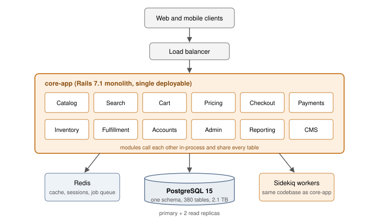
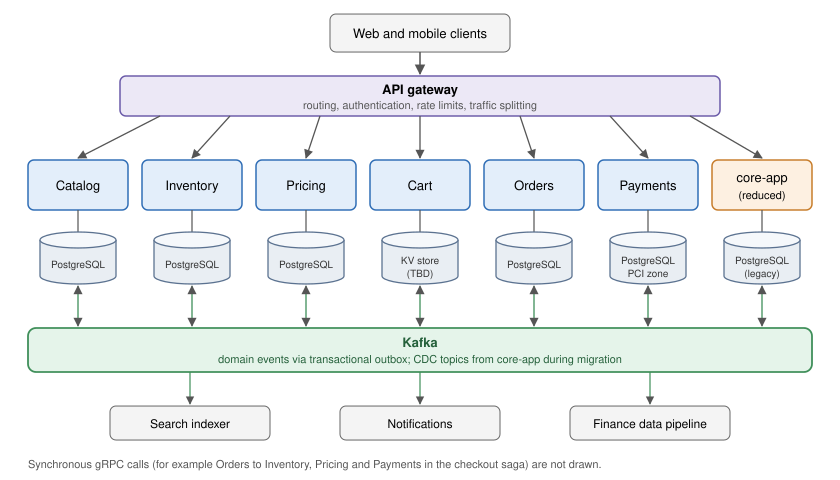
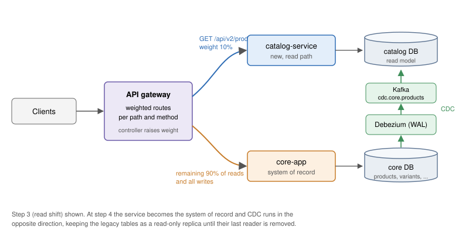

| | |
|---|---|
| **Status** | In review |
| **Authors** | Dana Whitfield (Platform), Marcus Oyelaran (Checkout) |
| **Reviewers** | Architecture Review Board, SRE, Data Engineering, Security |
| **Target decision date** | 2026-10-28 |
| **Related** | RFC-0117 (Kafka platform), RFC-0131 (Service template), INC-2291 postmortem |

# 1. Summary

The `core-app` Rails monolith serves all customer and back-office traffic for the storefront. It has outgrown the organization that works on it: 11 teams share one deployable, one database, and one release train. This document proposes extracting six services along business-capability boundaries over roughly 18 months, using the strangler fig pattern at the edge and change data capture (CDC) for data migration. We do not propose a rewrite, and we expect `core-app` to remain in production in reduced form at the end of the program.

# 2. Background

## 2.1 Current architecture

`core-app` is a Ruby on Rails 7.1 application of about 610,000 lines, backed by a single PostgreSQL 15 primary with two read replicas, Redis for caching and sessions, and Sidekiq for background jobs. Figure 1 shows the main components.



## 2.2 Problems

The problems below are measured over the last two quarters unless noted.

| Symptom | Measurement | Consequence |
|---|---|---|
| Slow delivery | Median 47 min CI build; 2 deploys/day shared by 11 teams | Teams batch changes, so each deploy is riskier |
| Coupled failures | 9 of 14 Sev-1/Sev-2 incidents started in one module and degraded others | Checkout went down because of a reporting query (INC-2291) |
| Database contention | 380 tables, 2.1 TB; p99 lock wait on `orders` 840 ms at peak | Black Friday required a write freeze on admin tools |
| Unclear ownership | 31% of files changed by 3+ teams in 6 months | Slow reviews, regressions in code nobody owns |
| Uniform scaling | Must scale the whole app for catalog read traffic | Roughly 40% of compute is idle outside peaks |

The database is the root of most of these problems. Any module can read or write any table, so the real interfaces between modules are SQL joins that no one designed.

# 3. Goals and non-goals

**Goals**

1. Teams can deploy their services independently, at least daily, without a shared release train.
2. A failure in a non-critical capability (recommendations, reviews, reporting) cannot take down browse, cart, or checkout.
3. Each extracted service owns its data; no other service reads its tables directly.
4. Customer-facing behavior is unchanged throughout the migration. No big-bang cutovers.
5. Checkout availability stays at or above the current 99.95% monthly SLO during the program.

**Non-goals**

- Rewriting the storefront front end. The Next.js app is out of scope.
- Changing programming languages for its own sake. New services default to the Kotlin service template (RFC-0131), but a team may stay on Ruby with justification.
- Extracting every module. Admin tools, CMS, and reporting stay in `core-app` for now.
- Multi-region active-active. That is a separate effort that this work should not block.

# 4. Proposed architecture

## 4.1 Target state

Figure 2 shows the architecture at the end of the program. An API gateway routes requests either to new services or to `core-app`. Services communicate synchronously over gRPC for queries that need an immediate answer, and asynchronously through Kafka for everything that reports a change of state.



## 4.2 Service boundaries

Boundaries follow business capabilities and the existing team structure. We validated them by clustering the co-change history of `core-app` files and the table access graph from `pg_stat_statements`; the six candidates below have the fewest cross-boundary joins.

| Service | Owns (system of record) | Owning team | Wave | Key consumers |
|---|---|---|:---:|---|
| Catalog | Products, variants, categories, media | Discovery | 1 | Storefront, Search, Pricing |
| Inventory | Stock levels, reservations, warehouses | Supply | 1 | Cart, Checkout, Fulfillment |
| Pricing | Price lists, promotions, coupons | Merchandising | 2 | Cart, Checkout |
| Cart | Active carts, saved items | Checkout | 2 | Storefront, Checkout |
| Orders | Orders, order lines, order state machine | Checkout | 3 | Fulfillment, Notifications, Finance |
| Payments | Payment intents, refunds, PSP tokens | Payments | 3 | Orders, Finance |

Identity (accounts, authentication) is deliberately excluded. It is already fronted by our identity provider, and moving the remaining profile data is low value.

## 4.3 Communication rules

1. **Commands and queries are synchronous** (gRPC with deadlines). A caller must set a deadline no larger than its own remaining budget, and every call must have a fallback or fail fast.
2. **State changes are published as events**, after commit, through the transactional outbox (Section 5.3). Events are facts in the past tense: `OrderPlaced`, `StockReserved`, `PriceChanged`.
3. **No distributed transactions.** Multi-service workflows use sagas with explicit compensating actions (Section 4.4).
4. **No shared databases.** A service that needs another service's data either calls its API or keeps a local read model built from its events.

## 4.4 Checkout as an orchestrated saga

Checkout is the only workflow that spans four services on the critical path. The Orders service orchestrates it as a saga. Each step has a compensation that undoes its effect if a later step fails.

| Step | Service | Action | Compensation |
|:---:|---|---|---|
| 1 | Orders | Create order in `PENDING` | Mark order `CANCELLED` |
| 2 | Inventory | Reserve stock for each line (TTL 15 min) | Release reservation |
| 3 | Pricing | Lock final price and promotions | Release coupon redemption |
| 4 | Payments | Authorize payment | Void authorization |
| 5 | Orders | Mark order `PLACED`; emit `OrderPlaced` | None (final step) |

The orchestrator persists saga state after each step, so a crash resumes from the last completed step. Steps are idempotent and keyed by `order_id`, so retries are safe. If step 4 fails, steps 3, 2 and 1 are compensated in reverse order and the customer sees the existing "payment declined" page.

# 5. Migration strategy

## 5.1 Strangler fig at the edge

We will not change `core-app` callers one by one. Instead, the API gateway gradually routes traffic away from the monolith, path by path. Each extraction follows the same sequence:

1. Build the new service behind the gateway with its own datastore, populated by CDC from the monolith tables (Section 5.2).
2. Run in **shadow mode**: the gateway mirrors read traffic to the new service and a comparator logs differences. Exit criterion: mismatch rate below 0.01% for 7 days.
3. **Shift reads** gradually (1%, 10%, 50%, 100%) using weighted routes.
4. **Shift writes**. The service becomes the system of record; CDC direction reverses so the monolith tables become a read-only replica for remaining legacy readers.
5. **Remove** the legacy code paths and, once no readers remain, the replicated tables.

Figure 3 shows the state during steps 3 and 4.



An example of the gateway route configuration during a read shift:

```yaml
# gateway/routes/catalog.yaml
routes:
  - name: catalog-product-read
    match:
      path_prefix: /api/v2/products
      methods: [GET]
    split:
      - backend: catalog-service
        weight: 10          # percent; raised by the rollout controller
      - backend: core-app
        weight: 90
    timeout_ms: 800
    retry:
      attempts: 2
      on: [connect-failure, 503]

  - name: catalog-product-write
    match:
      path_prefix: /api/v2/products
      methods: [POST, PUT, PATCH, DELETE]
    backend: core-app       # writes stay on the monolith until step 4
```

## 5.2 Data migration with change data capture

Debezium reads the PostgreSQL write-ahead log of `core-app` and publishes row-level changes to Kafka topics named `cdc.core.<table>`. Each new service consumes the topics for the tables it will own and builds its own schema from them. This avoids dual writes from application code, which we rejected because a crash between the two writes leaves the stores inconsistent with no record of the failure.

Two constraints apply:

- Every table being migrated must have a primary key and `REPLICA IDENTITY FULL` during the migration window, so that update and delete events carry complete rows.
- Consumers must be idempotent and tolerate reordering across partitions. We partition by the aggregate root key (for example `product_id`) to preserve per-entity ordering.

## 5.3 Transactional outbox

New services publish events through an outbox table written in the same database transaction as the business change. A relay (Debezium's outbox router) publishes the rows to Kafka. This gives at-least-once delivery without two-phase commit.

```sql
CREATE TABLE outbox (
    id              UUID PRIMARY KEY,
    aggregate_type  TEXT        NOT NULL,   -- e.g. 'order'
    aggregate_id    TEXT        NOT NULL,   -- partition key
    event_type      TEXT        NOT NULL,   -- e.g. 'OrderPlaced'
    payload         JSONB       NOT NULL,
    created_at      TIMESTAMPTZ NOT NULL DEFAULT now()
);

-- In the same transaction as the business write:
BEGIN;
UPDATE orders SET status = 'PLACED', placed_at = now() WHERE id = $1;
INSERT INTO outbox (id, aggregate_type, aggregate_id, event_type, payload)
VALUES (gen_random_uuid(), 'order', $1, 'OrderPlaced', $2);
COMMIT;
```

Event payloads are defined in Protobuf and registered in the schema registry with backward-compatibility checks enforced in CI:

```protobuf
syntax = "proto3";
package commerce.orders.v1;

import "google/protobuf/timestamp.proto";

message OrderPlaced {
  string order_id = 1;
  string customer_id = 2;
  repeated OrderLine lines = 3;
  Money total = 4;
  google.protobuf.Timestamp placed_at = 5;
}

message OrderLine {
  string sku = 1;
  int32 quantity = 2;
  Money unit_price = 3;
}

message Money {
  string currency = 1;   // ISO 4217
  int64 amount_minor = 2; // cents, to avoid floating point
}
```

# 6. Reliability and observability

Every service is created from the service template, which provides OpenTelemetry tracing, RED metrics, structured logs, health checks, and a default dashboard. Trace context propagates through the gateway, gRPC calls, and Kafka headers, so a checkout can be followed end to end across services and the monolith.

Each service publishes SLOs before it takes production traffic. The initial targets are:

| Service | Availability (30 days) | Latency objective | Error budget policy |
|---|:---:|---|---|
| Catalog | 99.9% | p99 < 250 ms for product reads | Freeze features when budget exhausted |
| Inventory | 99.95% | p99 < 150 ms for reservations | Freeze features; page on burn rate > 14.4 |
| Pricing | 99.95% | p99 < 120 ms for price quotes | As Inventory |
| Cart | 99.9% | p99 < 200 ms | As Catalog |
| Orders | 99.95% | p99 < 400 ms for checkout saga | Freeze features; exec review |
| Payments | 99.95% | p99 < 1.5 s (PSP-bound) | As Orders |

Resilience defaults: client-side timeouts on every call, retries only for idempotent operations with exponential backoff and jitter, circuit breakers on all cross-service calls, and bulkheads separating critical-path thread pools from everything else.

# 7. Rollout plan

| Phase | Quarter | Scope | Exit criteria |
|---|---|---|---|
| 0. Foundations | Q1 2027 | Gateway in front of `core-app`; Kafka and Debezium in production; service template GA | 100% of traffic via gateway with no latency regression above 5 ms p99 |
| 1. Wave 1 | Q2 2027 | Catalog and Inventory extracted | Both services are system of record; legacy code deleted |
| 2. Wave 2 | Q3 to Q4 2027 | Pricing and Cart | Same as above; cart conversion unchanged within noise |
| 3. Wave 3 | Q1 to Q2 2028 | Orders and Payments; checkout saga live | Checkout SLO met for 60 consecutive days |
| 4. Consolidation | Q3 2028 | Remove replicated tables; right-size `core-app` | `core-app` database below 800 GB |

Each wave ends with a review against the goals in Section 3. We will stop after any wave if the measured benefits do not justify continuing.

# 8. Risks

| Risk | Likelihood | Impact | Mitigation |
|---|:---:|:---:|---|
| Hidden coupling through shared tables discovered late | High | Medium | Table access audit before each wave; shadow mode catches behavioral differences |
| CDC lag causes stale reads after the read shift | Medium | Medium | Alert on lag over 5 s; route read-your-writes requests to the system of record |
| Saga bugs leave orders in inconsistent states | Medium | High | Persisted saga state, idempotent steps, reconciliation job, game days before launch |
| Increased latency from network hops | Medium | Medium | Latency budgets per hop; co-locate chatty services; avoid call chains deeper than 3 |
| Operational load on teams new to on-call for a service | High | Medium | SRE embedding for first 90 days per service; runbooks are a launch requirement |
| Program stalls halfway, leaving two systems to maintain | Medium | High | Waves are independently valuable; explicit go/no-go review after each |

# 9. Alternatives considered

**Modular monolith.** Enforce module boundaries inside `core-app` with Packwerk and separate schemas per module, without splitting deployables. This is cheaper and addresses ownership, and we will adopt it for the modules that stay in `core-app`. It does not address independent deployment, failure isolation, or independent scaling, which are the top three problems in Section 2.2.

**Rewrite.** Build a new platform in parallel and cut over. Rejected: it delays all value until the end, requires feature parity with a moving target, and concentrates risk in one cutover.

**Split by technical layer** (for example, a "data service" in front of the database). Rejected: it adds a network hop without reducing coupling, since every feature change would still touch the shared layer.

# 10. Open questions

1. Should Cart move to a key-value store (DynamoDB or Redis with persistence) instead of PostgreSQL? Load testing is scheduled for November.
2. Do we need a separate read-optimized Search service in Wave 1, or can Catalog serve search via the existing OpenSearch index?
3. Finance relies on nightly SQL exports from `core-app`. Who owns building the replacement from events, and by when?
4. What is the policy for breaking changes to event schemas, beyond the registry compatibility check?

# Appendix A. Glossary

**CDC.** Change data capture: streaming row-level changes from a database's log.

**Outbox.** A table written in the same transaction as a business change, from which events are published, guaranteeing that a committed change produces an event.

**Saga.** A sequence of local transactions with compensating actions, used instead of a distributed transaction.

**Strangler fig.** Incremental replacement of a legacy system by routing functionality to new components until the old system can be removed.
