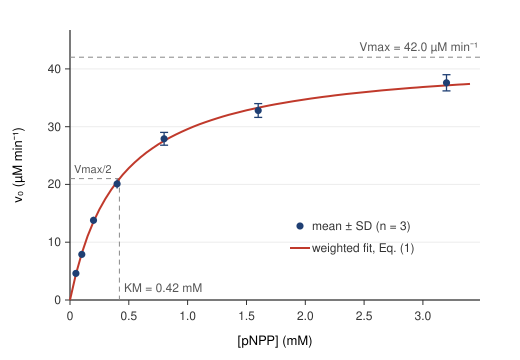

# Abstract

We measured initial rates of hydrolysis of *p*-nitrophenyl phosphate (pNPP) by calf intestinal alkaline phosphatase (CIAP) at seven substrate concentrations from 0.05 to 3.20 mM, following the release of *p*-nitrophenolate at 405 nm in 1.0 M diethanolamine buffer, pH 9.8, at 25 °C. A weighted nonlinear least-squares fit of the Michaelis–Menten equation gave $V_{\max} = 42.0 \pm 1.3\ \mu\mathrm{M\,min^{-1}}$ and $K_M = 0.42 \pm 0.03$ mM. With an enzyme concentration of 2.0 nM, the turnover number is $k_{\text{cat}} = 350\ \mathrm{s^{-1}}$ and the specificity constant is $k_{\text{cat}}/K_M = 8.3 \times 10^{5}\ \mathrm{M^{-1}\,s^{-1}}$. A Lineweaver–Burk analysis of the same data underestimated both parameters by about 4 to 6 percent.

# 1. Introduction

Alkaline phosphatase (EC 3.1.3.1) is a dimeric zinc- and magnesium-dependent enzyme that hydrolyzes phosphate monoesters at alkaline pH [@mccomb1979]. With the artificial substrate pNPP, the product *p*-nitrophenol ionizes at pH 9.8 to the yellow *p*-nitrophenolate anion, so the reaction can be followed continuously by absorbance:

$$
\text{pNPP} + \mathrm{H_2O} \xrightarrow{\ \text{CIAP}\ } p\text{-nitrophenolate} + \mathrm{HPO_4^{2-}}
$$

For a single-substrate enzyme that binds substrate reversibly and converts the complex to product,

$$
\mathrm{E} + \mathrm{S} \underset{k_{-1}}{\overset{k_1}{\rightleftharpoons}} \mathrm{ES} \xrightarrow{\ k_2\ } \mathrm{E} + \mathrm{P},
$$

the steady-state assumption $d[\mathrm{ES}]/dt \approx 0$ [@briggs1925] leads to the Michaelis–Menten equation [@michaelis1913; @johnson2011]

$$
v_0 = \frac{V_{\max}[\mathrm{S}]}{K_M + [\mathrm{S}]}, \qquad V_{\max} = k_{\text{cat}}[\mathrm{E}]_T, \qquad K_M = \frac{k_{-1} + k_2}{k_1}. \tag{1}
$$

Here $v_0$ is the initial rate, $[\mathrm{E}]_T$ the total enzyme concentration, and $k_{\text{cat}} = k_2$ in this simple mechanism. $K_M$ is the substrate concentration at which $v_0 = V_{\max}/2$.

Historically, Equation (1) was fitted after linearization. Taking reciprocals gives the Lineweaver–Burk (double-reciprocal) form [@lineweaver1934]

$$
\frac{1}{v_0} = \frac{K_M}{V_{\max}}\cdot\frac{1}{[\mathrm{S}]} + \frac{1}{V_{\max}}, \tag{2}
$$

which is a straight line in $1/v_0$ versus $1/[\mathrm{S}]$. The transformation distorts the experimental errors, giving the least precise points (lowest $[\mathrm{S}]$) the greatest leverage [@cornishbowden2012]. The objectives of this experiment were to determine $K_M$ and $k_{\text{cat}}$ for CIAP with pNPP by direct nonlinear fitting of Equation (1), and to compare the result with a Lineweaver–Burk analysis.

# 2. Materials and Methods

## 2.1 Reagents

- Assay buffer: 1.0 M diethanolamine, 0.50 mM $\mathrm{MgCl_2}$, adjusted to pH 9.8 with HCl at 25 °C.
- Substrate stock: 20.0 mM pNPP (disodium salt hexahydrate) in assay buffer, prepared fresh and kept on ice in the dark.
- Enzyme stock: CIAP diluted to 40 nM (dimer, based on $M_r = 140{,}000$) in assay buffer containing 0.1 mg/mL bovine serum albumin.

## 2.2 Assay

Reactions were run in 1.00 cm quartz cuvettes in a thermostatted spectrophotometer at 25.0 °C. Each 1.000 mL reaction contained assay buffer and pNPP at a final concentration of 0.05, 0.10, 0.20, 0.40, 0.80, 1.60, or 3.20 mM. After 5 min of temperature equilibration, the reaction was started by adding 50 µL of enzyme stock (final $[\mathrm{E}]_T = 2.0$ nM) and mixing by inversion. Absorbance at 405 nm was recorded every 5 s for 3 min. Each concentration was measured in triplicate, and a blank without enzyme was run at 3.20 mM to check for spontaneous hydrolysis (rate below 0.001 $\mathrm{min^{-1}}$, neglected).

## 2.3 Data analysis

The initial slope $\Delta A_{405}/\Delta t$ was taken from a linear regression over the first 30 s, during which less than 5 percent of the substrate was consumed at every concentration. Slopes were converted to rates with the Beer–Lambert law, $A = \varepsilon \ell c$:

$$
v_0 = \frac{\Delta A_{405}/\Delta t}{\varepsilon_{405}\,\ell}, \qquad \varepsilon_{405} = 18.0\ \mathrm{mM^{-1}\,cm^{-1}},\quad \ell = 1.00\ \mathrm{cm}. \tag{3}
$$

For example, a slope of $0.248\ \mathrm{min^{-1}}$ corresponds to

$$
v_0 = \frac{0.248\ \mathrm{min^{-1}}}{(18.0\ \mathrm{mM^{-1}\,cm^{-1}})(1.00\ \mathrm{cm})} = 0.0138\ \mathrm{mM\,min^{-1}} = 13.8\ \mu\mathrm{M\,min^{-1}}.
$$

Equation (1) was fitted to the mean rates by weighted nonlinear least squares (Levenberg–Marquardt, weights $1/\sigma_i^2$ from the triplicate standard deviations) using SciPy's `curve_fit` (Appendix A). Parameter uncertainties are standard errors from the covariance matrix. For comparison, Equation (2) was fitted to the same means by ordinary linear regression.

# 3. Results

Table 1 lists the measured slopes and the corresponding initial rates.

| $[\mathrm{S}]$ (mM) | $\Delta A_{405}/\Delta t$ ($\mathrm{min^{-1}}$) | $v_0$ ($\mu\mathrm{M\,min^{-1}}$) | Fit residual ($\mu\mathrm{M\,min^{-1}}$) |
|---:|---:|---:|---:|
| 0.05 | $0.083 \pm 0.005$ | $4.6 \pm 0.3$ | $+0.13$ |
| 0.10 | $0.142 \pm 0.007$ | $7.9 \pm 0.4$ | $-0.18$ |
| 0.20 | $0.248 \pm 0.011$ | $13.8 \pm 0.6$ | $+0.25$ |
| 0.40 | $0.362 \pm 0.014$ | $20.1 \pm 0.8$ | $-0.39$ |
| 0.80 | $0.502 \pm 0.020$ | $27.9 \pm 1.1$ | $+0.35$ |
| 1.60 | $0.590 \pm 0.022$ | $32.8 \pm 1.2$ | $-0.48$ |
| 3.20 | $0.677 \pm 0.025$ | $37.6 \pm 1.4$ | $+0.46$ |

: Table 1. Initial rates of pNPP hydrolysis by 2.0 nM CIAP at 25 °C, pH 9.8. Values are mean ± SD of three replicates.

The rates rise steeply at low substrate concentration and approach saturation above about 2 mM, as expected for Michaelis–Menten behavior (Figure 1). The residuals of the nonlinear fit alternate in sign with no trend, which supports the model.

{width=80%}

The fitted parameters from both methods are summarized in Table 2.

| Parameter | Nonlinear fit | Lineweaver–Burk | Units |
|---|---:|---:|---|
| $V_{\max}$ | $42.0 \pm 1.3$ | $40.6$ | $\mu\mathrm{M\,min^{-1}}$ |
| $K_M$ | $0.420 \pm 0.026$ | $0.395$ | mM |
| $k_{\text{cat}} = V_{\max}/[\mathrm{E}]_T$ | $350 \pm 11$ | $338$ | $\mathrm{s^{-1}}$ |
| $k_{\text{cat}}/K_M$ | $(8.3 \pm 0.6) \times 10^{5}$ | $8.6 \times 10^{5}$ | $\mathrm{M^{-1}\,s^{-1}}$ |
| $R^2$ | 0.9991 | 0.9990 (in $1/v_0$) | |

: Table 2. Kinetic parameters for CIAP with pNPP. Uncertainties are standard errors of the fit.

The unit conversion for $k_{\text{cat}}$ is worth showing explicitly, since it is a common source of error:

$$
k_{\text{cat}} = \frac{V_{\max}}{[\mathrm{E}]_T} = \frac{42.0 \times 10^{-6}\ \mathrm{M\,min^{-1}} \times \dfrac{1\ \mathrm{min}}{60\ \mathrm{s}}}{2.0 \times 10^{-9}\ \mathrm{M}} = 350\ \mathrm{s^{-1}}.
$$

# 4. Discussion

The data are well described by the Michaelis–Menten equation over a 64-fold range of substrate concentration that brackets $K_M$ from $0.12\,K_M$ to $7.6\,K_M$. This range matters: concentrations well above $K_M$ define $V_{\max}$, while those near and below $K_M$ define $K_M$. Our highest concentration reached only 89 percent of $V_{\max}$, so $V_{\max}$ is still partly an extrapolation, which is reflected in its larger relative uncertainty (3.1 percent) compared with the rates themselves.

The fitted $K_M$ of 0.42 mM lies within the range reported for mammalian alkaline phosphatases with pNPP in diethanolamine buffer, which spans roughly 0.1 to 1 mM depending on pH, buffer, and $\mathrm{Mg^{2+}}$ concentration [@mccomb1979]. The value of $k_{\text{cat}}/K_M \approx 10^{6}\ \mathrm{M^{-1}\,s^{-1}}$ indicates an efficient enzyme, though about two orders of magnitude below the diffusion limit.

The Lineweaver–Burk estimates are lower than the nonlinear estimates by 3.5 percent for $V_{\max}$ and 6.0 percent for $K_M$. Both shifts are expected. In the double-reciprocal plot, the point at 0.05 mM sits at $1/[\mathrm{S}] = 20\ \mathrm{mM^{-1}}$, far from the others, so it dominates the slope even though its relative error ($\pm 6.5$ percent) is the largest in the data set. A small positive error in that rate flattens the line and lowers both parameters. The nonlinear fit weights each point by its actual uncertainty and avoids this problem, which is why direct fitting is now the recommended practice [@cornishbowden2012].

**Sources of error.** (i) The value of $\varepsilon_{405}$ for *p*-nitrophenolate depends on pH and temperature; an error of 3 percent in $\varepsilon$ propagates directly into $V_{\max}$ and $k_{\text{cat}}$ but leaves $K_M$ unchanged. (ii) The enzyme concentration was calculated from the supplier's protein assay and the dimer mass, not from active-site titration, so $k_{\text{cat}}$ is a lower bound if some enzyme was inactive. (iii) Pipetting 50 µL of enzyme into 950 µL introduces about 1 percent volumetric uncertainty. (iv) The reduced chi-square of the weighted fit was 0.23 (5 degrees of freedom), well below 1, which suggests that triplicate standard deviations overestimate the true scatter. The quoted parameter errors are therefore conservative.

**Product inhibition.** Inorganic phosphate is a competitive inhibitor of alkaline phosphatase. Because we used only the first 30 s, phosphate concentration stayed below about 3 µM at the lowest substrate concentration and below 20 µM at the highest. Linear absorbance traces over this window indicate that inhibition did not measurably affect the initial rates.

# 5. Conclusion

CIAP hydrolyzes pNPP with Michaelis–Menten kinetics, with $K_M = 0.42 \pm 0.03$ mM and $k_{\text{cat}} = 350 \pm 11\ \mathrm{s^{-1}}$ at 25 °C and pH 9.8. Direct nonlinear fitting should be preferred to the Lineweaver–Burk plot, which in this data set biased both parameters low by several percent. A follow-up experiment adding $\mathrm{Na_2HPO_4}$ at two fixed concentrations would allow the inhibition constant for phosphate to be determined.

# References

::: {#refs}
:::

# Appendix A. Fitting script

```python
import numpy as np
from scipy.optimize import curve_fit

S   = np.array([0.05, 0.10, 0.20, 0.40, 0.80, 1.60, 3.20])   # mM
v   = np.array([4.6, 7.9, 13.8, 20.1, 27.9, 32.8, 37.6])     # uM/min
sd  = np.array([0.3, 0.4, 0.6, 0.8, 1.1, 1.2, 1.4])          # uM/min

def michaelis_menten(s, vmax, km):
    return vmax * s / (km + s)

popt, pcov = curve_fit(michaelis_menten, S, v, p0=[40, 0.5],
                       sigma=sd, absolute_sigma=True)
perr = np.sqrt(np.diag(pcov))
print(f"Vmax = {popt[0]:.1f} +/- {perr[0]:.1f} uM/min")
print(f"Km   = {popt[1]:.3f} +/- {perr[1]:.3f} mM")

E_total = 2.0e-9                                   # M
kcat = popt[0] * 1e-6 / 60 / E_total               # s^-1
print(f"kcat = {kcat:.0f} s^-1, kcat/Km = {kcat / (popt[1] * 1e-3):.2e} M^-1 s^-1")

# Lineweaver-Burk for comparison
slope, intercept = np.polyfit(1 / S, 1 / v, 1)
print(f"LB: Vmax = {1 / intercept:.1f} uM/min, Km = {slope / intercept:.3f} mM")
```
