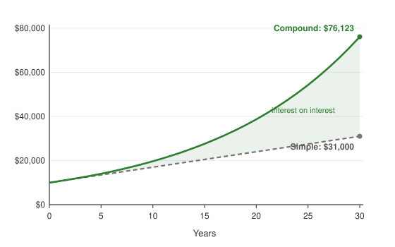

# The short version

Compound interest is interest earned on interest. When your savings earn interest and that interest is added to the balance, the next period's interest is calculated on a larger amount. Over long periods this snowball effect becomes the dominant force in how savings grow, and in how debts get out of hand.

This guide explains the formula, shows how compounding frequency and time change the result, and works through examples for savings, regular contributions, and credit card debt. All figures are rounded to the nearest cent.

# Simple interest versus compound interest

With **simple interest**, you earn interest only on the original amount (the *principal*). Put $10,000 in an account paying 7% simple interest and you earn $700 every year, no matter how long you wait.

With **compound interest**, each year's interest is added to the balance, and the next year's 7% is calculated on the new total. The first year still earns $700, but the second year earns 7% of $10,700, which is $749. The third year earns 7% of $11,449, which is $801.43, and so on.

The difference is small at first and enormous later:

| Year | Simple interest balance | Compound interest balance | Difference |
|-----:|------------------------:|--------------------------:|-----------:|
| 0 | $10,000.00 | $10,000.00 | $0.00 |
| 1 | $10,700.00 | $10,700.00 | $0.00 |
| 2 | $11,400.00 | $11,449.00 | $49.00 |
| 3 | $12,100.00 | $12,250.43 | $150.43 |
| 5 | $13,500.00 | $14,025.52 | $525.52 |
| 10 | $17,000.00 | $19,671.51 | $2,671.51 |
| 15 | $20,500.00 | $27,590.32 | $7,090.32 |
| 20 | $24,000.00 | $38,696.84 | $14,696.84 |
| 25 | $27,500.00 | $54,274.33 | $26,774.33 |
| 30 | $31,000.00 | $76,122.55 | $45,122.55 |

: $10,000 at 7% per year, compounded annually, with no withdrawals.

After 30 years, simple interest has roughly tripled the money. Compound interest has multiplied it by more than seven and a half.

{width=80%}

# The formula

The balance after compounding is

$$
A = P\left(1 + \frac{r}{n}\right)^{nt}
$$

where

- $A$ is the final amount,
- $P$ is the principal (the starting amount),
- $r$ is the annual interest rate as a decimal (5% is $r = 0.05$),
- $n$ is the number of times interest is compounded per year,
- $t$ is the number of years.

The idea is that each compounding period multiplies the balance by $(1 + r/n)$, and there are $nt$ periods in total.

**Worked example.** You deposit $10,000 at 5% interest, compounded monthly, for 10 years. Here $P = 10{,}000$, $r = 0.05$, $n = 12$ and $t = 10$:

$$
A = \$10{,}000 \times \left(1 + \frac{0.05}{12}\right)^{12 \times 10} = \$10{,}000 \times (1.0041667)^{120} \approx \$16{,}470.09.
$$

You earned $6,470.09 in interest. With simple interest you would have earned only $5,000.

# Does compounding frequency matter?

A little. The more often interest is compounded, the sooner each bit of interest starts earning interest of its own. Here is the same $10,000 at a 5% annual rate for 10 years:

| Compounding | $n$ | Balance after 10 years | Effective annual yield |
|---|---:|---:|---:|
| Simple (no compounding) | n/a | $15,000.00 | 5.000% |
| Annually | 1 | $16,288.95 | 5.000% |
| Semiannually | 2 | $16,386.16 | 5.063% |
| Quarterly | 4 | $16,436.19 | 5.095% |
| Monthly | 12 | $16,470.09 | 5.116% |
| Daily | 365 | $16,486.65 | 5.127% |
| Continuously | $\infty$ | $16,487.21 | 5.127% |

Going from annual to monthly compounding adds $181.14 over the decade. Going from monthly to daily adds only $16.56 more. Frequency matters much less than the rate itself or the length of time.

The last row uses **continuous compounding**, the limit as $n \to \infty$:

$$
A = Pe^{rt} = \$10{,}000 \times e^{0.05 \times 10} \approx \$16{,}487.21.
$$

## APR versus APY

Banks quote two different numbers, and the difference is compounding.

- **APR** (annual percentage rate) is the nominal rate $r$, before compounding.
- **APY** (annual percentage yield) is what you actually earn in a year once compounding is included:

$$
\text{APY} = \left(1 + \frac{r}{n}\right)^{n} - 1.
$$

A savings account advertising 5% APR compounded monthly has an APY of $(1 + 0.05/12)^{12} - 1 \approx 5.116\%$. When comparing savings accounts, compare APYs. Lenders, on the other hand, tend to advertise APR because it looks smaller.

# Adding money regularly

Most people don't invest one lump sum; they add a little every month. If you deposit an amount $\text{PMT}$ at the end of each period, the future value of those deposits is

$$
FV = \text{PMT} \times \frac{\left(1 + \frac{r}{n}\right)^{nt} - 1}{\frac{r}{n}}.
$$

**Example.** You invest $200 a month in a fund that averages 7% a year, compounded monthly. After 30 years:

$$
FV = \$200 \times \frac{(1 + 0.07/12)^{360} - 1}{0.07/12} \approx \$243{,}994.20.
$$

You deposited $200 × 360 = $72,000. The other $171,994.20 is compound growth, more than twice what you put in.

## The cost of waiting

Time matters more than the amount. Compare three savers, all earning 7% compounded monthly:

| Saver | Monthly deposit | Years investing | Total deposited | Final balance |
|---|---:|---:|---:|---:|
| Starts at 25 | $200 | 30 | $72,000 | $243,994.20 |
| Starts at 35 | $200 | 20 | $48,000 | $104,185.33 |
| Starts at 35, doubles deposits | $400 | 20 | $96,000 | $208,370.66 |

The saver who starts ten years later and puts in $24,000 *more* still ends up about $35,600 behind. Those first ten years of growth can't be bought back later.

# The Rule of 72

For a quick estimate of how long it takes money to double, divide 72 by the annual interest rate in percent:

$$
\text{years to double} \approx \frac{72}{\text{rate in \%}}.
$$

The exact answer, for annual compounding, is $t = \dfrac{\ln 2}{\ln(1 + r)}$. The rule is close for typical rates:

| Annual rate | Rule of 72 | Exact (annual compounding) |
|---:|---:|---:|
| 2% | 36.0 years | 35.0 years |
| 4% | 18.0 years | 17.7 years |
| 6% | 12.0 years | 11.9 years |
| 8% | 9.0 years | 9.0 years |
| 10% | 7.2 years | 7.3 years |
| 12% | 6.0 years | 6.1 years |

At 7%, money doubles roughly every 10 years. That is why the $10,000 in the first table became about $20,000 after 10 years, $40,000 after 20, and $76,000 after 30.

# When compounding works against you

Credit cards compound too, usually monthly, at rates far higher than any savings account. A card with a 22% APR has an effective annual rate of

$$
\left(1 + \frac{0.22}{12}\right)^{12} - 1 \approx 24.36\%.
$$

Suppose you owe $5,000 on that card, stop using it, and pay a fixed amount each month:

| Monthly payment | Time to pay off | Total paid | Total interest |
|---:|---:|---:|---:|
| $100 | 137 months (11 years, 5 months) | $13,678.06 | $8,678.06 |
| $200 | 34 months (2 years, 10 months) | $6,749.88 | $1,749.88 |

Paying $100 a month, you hand the card issuer more in interest than you originally borrowed. Doubling the payment cuts the interest by about $6,900 and finishes the debt more than eight years sooner. The same arithmetic that makes long-term saving so powerful makes slow repayment so expensive.

# Key takeaways

1. Compound interest earns interest on previous interest, so growth accelerates over time.
2. The formula $A = P(1 + r/n)^{nt}$ covers most situations; regular deposits add a second term.
3. The interest rate and the number of years matter far more than the compounding frequency.
4. Compare savings accounts by APY, not APR.
5. Starting early is worth more than contributing more later.
6. High-interest debt compounds against you; paying it down is often the best "investment" available.

---

*This guide is for general education only and is not financial advice. Examples assume constant rates and no taxes, fees, or inflation, none of which hold exactly in practice.*
