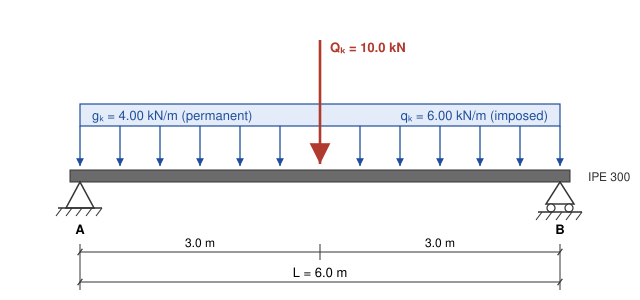

| | | | |
|---|---|---|---|
| **Project** | Harbour Street Mixed-Use, Level 2 | **Job no.** | 26-0417 |
| **Element** | Beam B3, gridline C/4–5 | **Sheet** | 1 of 3 |
| **Calculated by** | R. Okonkwo | **Date** | 2026-10-07 |
| **Checked by** | S. Lindgren | **Revision** | A (for checking) |

# 1. Scope and design basis

This sheet checks steel beam B3, which supports a non-composite metal deck slab for an office floor over a clear span of 6.0 m. The beam is checked for bending and shear at the ultimate limit state (ULS) and for deflection and vibration at the serviceability limit state (SLS).

| Item | Basis |
|---|---|
| Actions and combinations | EN 1990, Eq. 6.10 with UK National Annex partial factors |
| Imposed load | EN 1991-1-1, category B (offices) |
| Steel design | EN 1993-1-1 with UK National Annex |
| Deflection limits | Span/360 for imposed load (brittle finishes below); span/250 for total load |

**Assumptions.**

1. Simply supported at both ends on web-cleat connections (nominally pinned).
2. Compression flange fully restrained against lateral movement by the metal deck, which is fixed to the top flange at no more than 600 mm centers. Lateral-torsional buckling therefore does not govern.
3. The partition allowance is included in the imposed load.
4. Connection and bearing design are covered on sheet 3.

# 2. Geometry and loading

{width=85%}

**Span.** $L = 6.0\ \text{m} = 6000\ \text{mm}$.

**Characteristic loads.** The beam carries a 2.0 m wide strip of floor.

| Load | Calculation | Value |
|---|---|---:|
| Deck, lightweight concrete topping and finishes | $1.75\ \text{kN/m}^2 \times 2.0\ \text{m}$ | 3.50 kN/m |
| Services and ceiling | $0.045\ \text{kN/m}^2 \times 2.0\ \text{m}$ | 0.09 kN/m |
| Beam self-weight (IPE 300) | $42.2\ \text{kg/m} \times 9.81\ \text{m/s}^2$ | 0.41 kN/m |
| **Permanent, $g_k$** | | **4.00 kN/m** |
| Imposed, offices (category B) | $2.50\ \text{kN/m}^2 \times 2.0\ \text{m}$ | 5.00 kN/m |
| Movable partitions | $0.50\ \text{kN/m}^2 \times 2.0\ \text{m}$ | 1.00 kN/m |
| **Variable, $q_k$** | | **6.00 kN/m** |
| **Point load at midspan, $Q_k$** (imposed, from post above) | | **10.0 kN** |

**ULS design loads** (EN 1990, Eq. 6.10, $\gamma_G = 1.35$, $\gamma_Q = 1.5$):

$$
w_{Ed} = 1.35\,g_k + 1.5\,q_k = 1.35(4.00) + 1.5(6.00) = 14.4\ \text{kN/m}
$$

$$
P_{Ed} = 1.5\,Q_k = 1.5(10.0) = 15.0\ \text{kN}
$$

# 3. Section properties

Trial section: **IPE 300, S275** (properties from the manufacturer's tables).

| Property | Symbol | Value |
|---|:---:|---:|
| Depth | $h$ | 300 mm |
| Flange width | $b$ | 150 mm |
| Web thickness | $t_w$ | 7.1 mm |
| Flange thickness | $t_f$ | 10.7 mm |
| Root radius | $r$ | 15 mm |
| Second moment of area | $I_y$ | 8356 cm⁴ $= 83.56 \times 10^{6}\ \text{mm}^4$ |
| Elastic section modulus | $W_{el,y}$ | 557 cm³ |
| Plastic section modulus | $W_{pl,y}$ | 628 cm³ $= 628 \times 10^{3}\ \text{mm}^3$ |
| Shear area | $A_{v,z}$ | 25.7 cm² $= 2568\ \text{mm}^2$ |

**Material.** S275 with $t_f \le 16$ mm, so $f_y = 275\ \text{N/mm}^2$. $E = 210{,}000\ \text{N/mm}^2$. $\gamma_{M0} = 1.0$.

**Section classification** (EN 1993-1-1, Table 5.2). With $\varepsilon = \sqrt{235/f_y} = \sqrt{235/275} = 0.924$:

$$
\text{Flange: } \frac{c}{t_f} = \frac{(150 - 7.1 - 2 \times 15)/2}{10.7} = \frac{56.45}{10.7} = 5.28 \le 9\varepsilon = 8.32 \quad\Rightarrow\quad \text{Class 1}
$$

$$
\text{Web (bending): } \frac{c}{t_w} = \frac{300 - 2 \times 10.7 - 2 \times 15}{7.1} = \frac{248.6}{7.1} = 35.0 \le 72\varepsilon = 66.5 \quad\Rightarrow\quad \text{Class 1}
$$

The section is **Class 1**, so the plastic moment resistance may be used.

# 4. Ultimate limit state

## 4.1 Design actions

For a simply supported beam with a uniform load and a central point load, the maximum moment and shear are

$$
M_{Ed} = \frac{w_{Ed}L^2}{8} + \frac{P_{Ed}L}{4} = \frac{14.4 \times 6.0^2}{8} + \frac{15.0 \times 6.0}{4} = 64.8 + 22.5 = 87.3\ \text{kN·m}
$$

$$
V_{Ed} = \frac{w_{Ed}L}{2} + \frac{P_{Ed}}{2} = \frac{14.4 \times 6.0}{2} + \frac{15.0}{2} = 43.2 + 7.5 = 50.7\ \text{kN}
$$

## 4.2 Bending resistance (EN 1993-1-1, 6.2.5)

$$
M_{c,Rd} = \frac{W_{pl,y}\,f_y}{\gamma_{M0}} = \frac{628 \times 10^{3}\ \text{mm}^3 \times 275\ \text{N/mm}^2}{1.0} = 172.7 \times 10^{6}\ \text{N·mm} = 172.7\ \text{kN·m}
$$

$$
\frac{M_{Ed}}{M_{c,Rd}} = \frac{87.3}{172.7} = 0.51 \le 1.0 \qquad \checkmark\ \textbf{OK}
$$

## 4.3 Shear resistance (EN 1993-1-1, 6.2.6)

$$
V_{pl,Rd} = \frac{A_{v,z}\,(f_y/\sqrt{3})}{\gamma_{M0}} = \frac{2568 \times 275/\sqrt{3}}{1.0} = 407.7 \times 10^{3}\ \text{N} = 407.7\ \text{kN}
$$

$$
\frac{V_{Ed}}{V_{pl,Rd}} = \frac{50.7}{407.7} = 0.12 \le 1.0 \qquad \checkmark\ \textbf{OK}
$$

**Shear buckling** (6.2.6(6)). With $\eta = 1.0$ (UK NA), $h_w/t_w = (300 - 2 \times 10.7)/7.1 = 39.2 \le 72\varepsilon/\eta = 66.5$, so no shear buckling check is needed.

**Bending and shear interaction** (6.2.8). $V_{Ed} = 50.7\ \text{kN} < 0.5\,V_{pl,Rd} = 203.9\ \text{kN}$, and maximum shear occurs at the supports where the moment is zero. No reduction of the moment resistance is required.

# 5. Serviceability limit state

## 5.1 Deflection formulas

Midspan deflection of a simply supported beam:

$$
\delta_{\text{udl}} = \frac{5\,w\,L^4}{384\,E\,I}, \qquad \delta_{\text{point}} = \frac{P\,L^3}{48\,E\,I}.
$$

Useful constants for this beam, in N and mm (note that $1\ \text{kN/m} = 1\ \text{N/mm}$):

$$
E I = 210{,}000 \times 83.56 \times 10^{6} = 1.7548 \times 10^{13}\ \text{N·mm}^2, \qquad L^4 = 1.296 \times 10^{15}\ \text{mm}^4, \qquad L^3 = 2.16 \times 10^{11}\ \text{mm}^3.
$$

## 5.2 Deflection under imposed load

Uniform imposed load, $q_k = 6.00\ \text{N/mm}$:

$$
\delta_{q} = \frac{5 \times 6.00 \times 1.296 \times 10^{15}}{384 \times 1.7548 \times 10^{13}} = \frac{3.888 \times 10^{16}}{6.738 \times 10^{15}} = 5.77\ \text{mm}
$$

Point load, $Q_k = 10{,}000\ \text{N}$:

$$
\delta_{Q} = \frac{10{,}000 \times 2.16 \times 10^{11}}{48 \times 1.7548 \times 10^{13}} = \frac{2.16 \times 10^{15}}{8.423 \times 10^{14}} = 2.56\ \text{mm}
$$

Total imposed-load deflection and check against span/360:

$$
\delta_{\text{imposed}} = 5.77 + 2.56 = 8.33\ \text{mm} \le \frac{L}{360} = \frac{6000}{360} = 16.7\ \text{mm} \qquad \checkmark\ \textbf{OK}
$$

## 5.3 Deflection under total load

Permanent load, $g_k = 4.00\ \text{N/mm}$:

$$
\delta_{g} = \frac{5 \times 4.00 \times 1.296 \times 10^{15}}{384 \times 1.7548 \times 10^{13}} = 3.85\ \text{mm}
$$

$$
\delta_{\text{total}} = 3.85 + 8.33 = 12.18\ \text{mm} \le \frac{L}{250} = \frac{6000}{250} = 24.0\ \text{mm} \qquad \checkmark\ \textbf{OK}
$$

No precamber is required. If the client prefers a flat floor under permanent load, a precamber of 4 mm would offset $\delta_g$, but this is below the practical minimum for an IPE 300 and is not recommended.

## 5.4 Vibration (simplified check)

The fundamental natural frequency of a simply supported beam can be estimated from its deflection under permanent load plus a realistic fraction of imposed load. Taking 10% of the imposed UDL:

$$
\delta_{\text{dyn}} = \delta_g + 0.1\,\delta_q = 3.85 + 0.58 = 4.43\ \text{mm}, \qquad
f_1 \approx \frac{18}{\sqrt{\delta_{\text{dyn}}\ [\text{mm}]}} = \frac{18}{\sqrt{4.43}} = 8.6\ \text{Hz}
$$

This exceeds the commonly used minimum of 4 Hz for office floors, so a full response analysis is not required at this stage. The floor-level vibration assessment on sheet 2 accounts for the slab and adjacent bays.

# 6. Summary

| Check | Design value | Limit or resistance | Utilization | Result |
|---|---:|---:|---:|:---:|
| Bending, ULS | 87.3 kN·m | 172.7 kN·m | 0.51 | OK |
| Shear, ULS | 50.7 kN | 407.7 kN | 0.12 | OK |
| Deflection, imposed (L/360) | 8.33 mm | 16.7 mm | 0.50 | OK |
| Deflection, total (L/250) | 12.18 mm | 24.0 mm | 0.51 | OK |
| Natural frequency | 8.6 Hz | 4.0 Hz min. | n/a | OK |

**Conclusion.** IPE 300 in S275 is adequate for beam B3. Bending and deflection govern equally at about 51% utilization. A lighter IPE 270 would also pass (bending utilization about 0.66, imposed-load deflection about 12.0 mm), but IPE 300 is adopted to match the depth of the adjacent beams B1 and B2, which keeps the deck level and allows the same connection detail throughout.

**End reactions for connection design** (to sheet 3):

| Case | Reaction per end |
|---|---:|
| Characteristic permanent, $R_{G,k} = g_k L/2$ | 12.0 kN |
| Characteristic imposed, $R_{Q,k} = q_k L/2 + Q_k/2$ | 23.0 kN |
| ULS design, $R_{Ed}$ | 50.7 kN |
