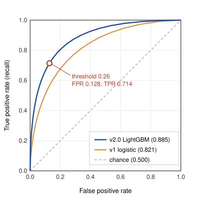

# Executive summary

We evaluated a new churn prediction model (v2.0, LightGBM) on 10,000 customers from an out-of-time test period (October to December 2025), in which 18.0% of customers churned within 60 days of scoring. Key results:

- **Ranking quality improved substantially.** ROC AUC rose from 0.821 (v1 baseline) to **0.885**, and average precision from 0.542 to **0.681**.
- **At the recommended threshold of 0.26**, the model flags 2,335 customers per 10,000 scored, of whom 1,285 actually churn. It catches **71.4%** of churners (recall) with **55.0%** precision. The baseline, flagging the same number of customers, catches only 60.7%.
- **Probabilities are well calibrated** (expected calibration error 0.011), so the scores can be used directly in expected-value calculations.
- **Estimated net value** of a retention campaign at this threshold is about **$137,900 per 10,000 customers scored**, compared with about $103,200 when the baseline model flags the same number of customers.

We recommend deploying v2.0 with a threshold of 0.26, subject to the monitoring plan in Section 7.

# 1. Problem and data

The goal is to identify customers likely to cancel their subscription within the next 60 days so that the retention team can contact them with an offer. A positive label means the customer churned within 60 days of the scoring date.

| Split | Period | Customers | Churn rate | Use |
|---|---|---:|---:|---|
| Train | Jan 2024 to Jun 2025 | 48,200 | 17.4% | Model fitting |
| Validation | Jul to Sep 2025 | 9,600 | 17.9% | Early stopping, hyperparameters, calibration |
| Test | Oct to Dec 2025 | 10,000 | 18.0% | Final evaluation (this report) |

The split is by time, not random, so that the test set mimics deployment: the model is evaluated on customers from a period it has never seen. All features are computed as of the scoring date, and we audited them for leakage (for example, we removed `cancellation_page_visits_30d`, which was partly recorded after the cancellation decision).

# 2. Metrics used

With TP, FP, TN and FN denoting true positives, false positives, true negatives and false negatives at a given threshold:

$$
\text{Precision} = \frac{TP}{TP + FP}, \qquad
\text{Recall (TPR)} = \frac{TP}{TP + FN}, \qquad
\text{FPR} = \frac{FP}{FP + TN},
$$

$$
F_1 = \frac{2 \cdot \text{Precision} \cdot \text{Recall}}{\text{Precision} + \text{Recall}}.
$$

The **ROC curve** plots TPR against FPR as the threshold varies, and the **ROC AUC** is the area under it. It has a useful interpretation: the probability that a randomly chosen churner receives a higher score than a randomly chosen non-churner. Because churners are only 18% of customers, we also report **average precision** (AP, the area under the precision–recall curve), which is more sensitive to performance among the highest-scored customers. A random model has AP equal to the churn rate, 0.18.

To assess the probabilities themselves, we use the **Brier score** and **log loss**, where $p_i$ is the predicted probability and $y_i \in \{0, 1\}$ the outcome for customer $i$:

$$
\text{Brier} = \frac{1}{n}\sum_{i=1}^{n} (p_i - y_i)^2, \qquad
\text{Log loss} = -\frac{1}{n}\sum_{i=1}^{n} \bigl[y_i \log p_i + (1 - y_i)\log(1 - p_i)\bigr].
$$

Lower is better for both. Always predicting the base rate of 0.18 gives a Brier score of 0.148 and a log loss of 0.471.

# 3. Overall performance

| Metric | v1 logistic regression | v2.0 LightGBM | Change |
|---|---:|---:|---:|
| ROC AUC (95% CI) | 0.821 (0.809–0.833) | **0.885 (0.875–0.895)** | +0.064 |
| Average precision | 0.542 | **0.681** | +0.139 |
| Brier score | 0.112 | **0.092** | −0.020 |
| Log loss | 0.362 | **0.301** | −0.061 |
| Recall at 2,335 flagged | 0.607 | **0.714** | +0.107 |
| Precision at 2,335 flagged | 0.468 | **0.550** | +0.082 |

: Table 1. Test-set performance. Confidence intervals for AUC are from 2,000 bootstrap resamples.

The improvement holds across the whole ROC curve (Figure 1). The confidence intervals do not overlap, and a paired DeLong test gives $p < 0.001$.

{width=70%}

# 4. Performance at the operating threshold

## 4.1 Confusion matrix

At a threshold of 0.26 on the calibrated probability:

| | **Predicted: churn** | **Predicted: stay** | **Total** |
|---|---:|---:|---:|
| **Actual: churn** | 1,285 (TP) | 515 (FN) | 1,800 |
| **Actual: stay** | 1,050 (FP) | 7,150 (TN) | 8,200 |
| **Total** | 2,335 | 7,665 | 10,000 |

: Table 2. Confusion matrix for v2.0 at threshold 0.26 (test set).

From this matrix:

$$
\text{Precision} = \frac{1285}{2335} = 0.550, \qquad
\text{Recall} = \frac{1285}{1800} = 0.714, \qquad
\text{FPR} = \frac{1050}{8200} = 0.128,
$$

$$
F_1 = \frac{2(0.550)(0.714)}{0.550 + 0.714} = 0.622, \qquad
\text{Accuracy} = \frac{1285 + 7150}{10000} = 0.844.
$$

Accuracy is reported for completeness but is not a useful target here: a model that predicts "stay" for everyone would score 0.820.

## 4.2 Choosing the threshold

The threshold should reflect the economics of the retention campaign, not a default of 0.5. Finance and the retention team provided these assumptions:

- Each contact (call plus discount offer) costs **$40** on average.
- A contacted customer who would have churned is retained with probability **30%**.
- A retained customer is worth **$600** in future margin.

Contacting a customer with churn probability $p$ is therefore worth it when

$$
p \times 0.30 \times \$600 > \$40 \quad\Longleftrightarrow\quad p > \frac{40}{180} \approx 0.22.
$$

Across the test set, the expected net value of a campaign at threshold $t$ is

$$
V(t) = 0.30 \times \$600 \times TP(t) - \$40 \times \bigl(TP(t) + FP(t)\bigr).
$$

| Threshold | Flagged | TP | Precision | Recall | $F_1$ | Net value $V(t)$ |
|---:|---:|---:|---:|---:|---:|---:|
| 0.46 | 1,350 | 940 | 0.696 | 0.522 | 0.597 | $115,200 |
| 0.36 | 1,765 | 1,109 | 0.628 | 0.616 | 0.622 | $129,020 |
| 0.31 | 2,012 | 1,192 | 0.592 | 0.662 | 0.625 | $134,080 |
| **0.26** | **2,335** | **1,285** | **0.550** | **0.714** | **0.622** | **$137,900** |
| 0.23 | 2,574 | 1,344 | 0.522 | 0.747 | 0.615 | $138,960 |
| 0.18 | 3,088 | 1,448 | 0.469 | 0.804 | 0.592 | $137,120 |
| 0.14 | 3,575 | 1,525 | 0.427 | 0.847 | 0.567 | $131,500 |

: Table 3. Threshold trade-offs for v2.0, per 10,000 customers scored.

Value peaks near the break-even probability, as theory predicts, and the curve is flat between 0.18 and 0.31. The retention team can handle about 2,400 contacts per scoring cycle per 10,000 customers, so we recommend **0.26**: it stays within capacity and captures 99% of the maximum value in the table. For comparison, the v1 model flagging the same 2,335 customers finds 1,092 churners, for an estimated value of $0.30 \times 600 \times 1092 - 40 \times 2335 = \$103{,}160$. Even at its own value-maximizing threshold, v1 reaches only about $105,000, and it needs 2,843 contacts to get there.

# 5. Calibration

The raw LightGBM scores were overconfident at the high end, so we applied isotonic regression fitted on the validation set. After calibration:

| Predicted probability bin | Customers | Mean predicted | Observed churn rate |
|---|---:|---:|---:|
| 0.0 to 0.1 | 5,412 | 0.031 | 0.028 |
| 0.1 to 0.2 | 1,489 | 0.146 | 0.152 |
| 0.2 to 0.4 | 1,357 | 0.288 | 0.281 |
| 0.4 to 0.6 | 842 | 0.494 | 0.507 |
| 0.6 to 1.0 | 900 | 0.694 | 0.683 |

: Table 4. Calibration of v2.0 on the test set (expected calibration error 0.011).

Predicted and observed rates agree within about 1.5 percentage points in every bin, which justifies using the probabilities directly in the value calculation above.

# 6. What drives the predictions

Mean absolute SHAP values on the test set rank the features by their average contribution to the predicted log-odds:

| Rank | Feature | Mean \|SHAP\| | Direction of effect |
|---:|---|---:|---|
| 1 | `tenure_months` | 0.412 | Shorter tenure raises risk |
| 2 | `contract_type` | 0.356 | Month-to-month raises risk |
| 3 | `support_tickets_90d` | 0.241 | More tickets raise risk, especially unresolved ones |
| 4 | `monthly_charges` | 0.198 | Higher charges raise risk |
| 5 | `payment_method` | 0.143 | Manual payment raises risk relative to autopay by card |
| 6 | `days_since_last_login` | 0.137 | Longer inactivity raises risk |
| 7 | `num_products` | 0.094 | More products lower risk |
| 8 | `autopay_enabled` | 0.081 | Autopay lowers risk |
| 9 | `plan_changes_12m` | 0.052 | Recent downgrades raise risk |
| 10 | `region` | 0.021 | Small effect |

: Table 5. Global feature importance (mean absolute SHAP value, log-odds scale).

These patterns agree with the retention team's experience and with the v1 coefficients, which gives us some confidence that the model is not exploiting artifacts. The new information in v2.0 comes mainly from interactions, for example the combination of short tenure and recent support tickets.

## 6.1 Performance by segment

| Contract type | Customers | Churn rate | ROC AUC | Recall at 0.26 | Precision at 0.26 |
|---|---:|---:|---:|---:|---:|
| Month-to-month | 4,100 | 34.1% | 0.81 | 0.81 | 0.58 |
| One-year | 3,300 | 9.4% | 0.83 | 0.42 | 0.41 |
| Two-year | 2,600 | 3.5% | 0.85 | 0.17 | 0.30 |

: Table 6. Segment-level results. Within-segment AUC is lower than overall AUC because contract type itself separates churners well.

Recall is low for annual contracts. Most of those churners leave at renewal, and the 60-day window often does not include the renewal date. We recommend a separate renewal-focused model for contract customers (Section 8).

# 7. Deployment and monitoring

The model will score all active customers weekly. We will monitor:

1. **Input drift:** population stability index (PSI) on each of the top 10 features, alerting at PSI > 0.2.
2. **Score drift:** weekly share of customers above threshold, alerting if it moves outside 18% to 29%.
3. **Outcome performance:** ROC AUC and recall on matured labels (60 days after scoring), with retraining triggered if AUC falls below 0.85 for two consecutive months.
4. **Campaign effect:** a 10% randomized holdout of flagged customers receives no contact, so that the true retention lift can be measured instead of assumed. This is the most important item, because the 30% save rate used above is an estimate.

# 8. Limitations and next steps

- **The value estimate rests on assumed save rates.** The holdout in Section 7 will replace the assumption with a measurement within one quarter.
- **The model predicts churn, not persuadability.** Some flagged customers will churn regardless of the offer, and some would have stayed anyway. An uplift model trained on holdout data is the natural next step.
- **Annual contracts are under-served,** as shown in Table 6.
- **One test period.** Q4 includes the holiday season; we will re-evaluate on Q1 2026 data as soon as labels mature.

# Appendix A. Evaluation code

```python
import numpy as np
from sklearn.metrics import (roc_auc_score, average_precision_score,
                             brier_score_loss, log_loss, confusion_matrix,
                             precision_score, recall_score, f1_score)

def evaluate(y_true, p_pred, threshold=0.26, n_boot=2000, seed=7):
    y_hat = (p_pred >= threshold).astype(int)
    tn, fp, fn, tp = confusion_matrix(y_true, y_hat).ravel()

    rng = np.random.default_rng(seed)
    n = len(y_true)
    boot = []
    for _ in range(n_boot):
        idx = rng.integers(0, n, n)
        boot.append(roc_auc_score(y_true[idx], p_pred[idx]))

    return {
        "roc_auc": roc_auc_score(y_true, p_pred),
        "roc_auc_ci": tuple(np.percentile(boot, [2.5, 97.5])),
        "avg_precision": average_precision_score(y_true, p_pred),
        "brier": brier_score_loss(y_true, p_pred),
        "log_loss": log_loss(y_true, p_pred),
        "confusion": {"tp": tp, "fp": fp, "fn": fn, "tn": tn},
        "precision": precision_score(y_true, y_hat),
        "recall": recall_score(y_true, y_hat),
        "f1": f1_score(y_true, y_hat),
        "net_value": 0.30 * 600 * tp - 40 * (tp + fp),
    }
```
