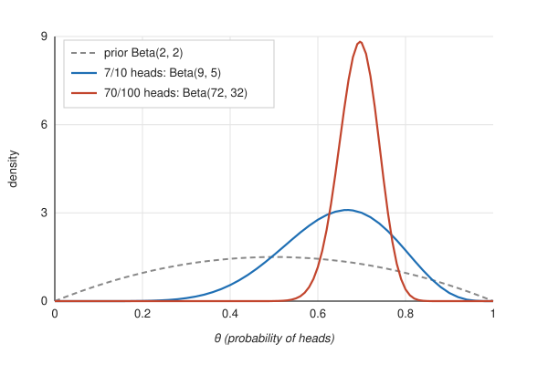

# 1. Problem

We flip a coin $n$ times and observe $k$ heads. We want to learn the probability $\theta$ that the coin lands heads. The frequentist answer is the maximum likelihood estimate $\hat\theta = k/n$ with a confidence interval. The Bayesian answer is a full probability distribution over $\theta$ that combines what we believed before the experiment with what the experiment showed [@gelman2013; @jaynes2003].

This note works through the conjugate Beta–Binomial model, shows how the choice of prior matters (and when it stops mattering), and covers posterior summaries, prediction, and a simple model comparison against the hypothesis that the coin is fair.

# 2. The model

## 2.1 Likelihood

Assuming independent flips with a common probability $\theta$, the number of heads follows a binomial distribution:

$$
p(k \mid \theta) = \binom{n}{k}\, \theta^{k} (1-\theta)^{n-k}, \qquad k = 0, 1, \dots, n.
$$

As a function of $\theta$ with the data held fixed, this is the likelihood $L(\theta) \propto \theta^{k}(1-\theta)^{n-k}$. The binomial coefficient does not depend on $\theta$ and drops out of the posterior.

## 2.2 Prior

The natural prior is the Beta distribution,

$$
p(\theta) = \mathrm{Beta}(\theta \mid \alpha, \beta) = \frac{\theta^{\alpha-1}(1-\theta)^{\beta-1}}{B(\alpha,\beta)}, \qquad 0 < \theta < 1,
$$

where $B(\alpha,\beta) = \Gamma(\alpha)\Gamma(\beta)/\Gamma(\alpha+\beta)$. The hyperparameters have a convenient reading: $\alpha - 1$ and $\beta - 1$ act like heads and tails "already seen" before the experiment, and $\alpha + \beta$ measures how strongly the prior is held. Useful facts:

$$
\mathbb{E}[\theta] = \frac{\alpha}{\alpha+\beta}, \qquad
\operatorname{Var}[\theta] = \frac{\alpha\beta}{(\alpha+\beta)^2(\alpha+\beta+1)}, \qquad
\operatorname{mode}[\theta] = \frac{\alpha-1}{\alpha+\beta-2} \quad (\alpha,\beta>1).
$$

## 2.3 Posterior

By Bayes' theorem the posterior is proportional to likelihood times prior:

$$
p(\theta \mid k) \propto \theta^{k}(1-\theta)^{n-k} \cdot \theta^{\alpha-1}(1-\theta)^{\beta-1}
= \theta^{\alpha+k-1}(1-\theta)^{\beta+n-k-1}.
$$

This is the kernel of another Beta distribution, so

$$
\theta \mid k \;\sim\; \mathrm{Beta}(\alpha + k,\; \beta + n - k).
$$

The prior is *conjugate* to the binomial likelihood: updating is just adding counts. The posterior mean is a weighted average of the prior mean and the sample proportion,

$$
\mathbb{E}[\theta \mid k] = \frac{\alpha + k}{\alpha + \beta + n}
= w \cdot \frac{\alpha}{\alpha+\beta} + (1-w)\cdot\frac{k}{n},
\qquad w = \frac{\alpha+\beta}{\alpha+\beta+n},
$$

so the weight on the prior shrinks like $1/n$ as data accumulate.

# 3. Worked example

Suppose we flip the coin $n = 10$ times and get $k = 7$ heads. Table 1 shows the posterior under three priors.

| Prior | Interpretation | Posterior | Mean | 95% equal-tailed interval | $P(\theta > 0.5 \mid k)$ |
|---|---|---|---:|:---:|---:|
| Beta(1, 1) | Uniform, "no idea" | Beta(8, 4) | 0.667 | [0.390, 0.891] | 0.887 |
| Beta(2, 2) | Mild belief in fairness | Beta(9, 5) | 0.643 | [0.386, 0.861] | 0.867 |
| Beta(50, 50) | Strong belief in fairness | Beta(57, 53) | 0.518 | [0.425, 0.611] | 0.649 |

: Table 1. Posterior summaries after 7 heads in 10 flips.

The sample proportion is 0.7, but none of the posteriors put their mean there. The uniform prior pulls the estimate slightly toward 0.5 (it acts like one extra head and one extra tail), and the strong prior barely moves at all: ten flips are weak evidence against a prior worth a hundred.

Figure 1 shows how the posterior under the Beta(2, 2) prior sharpens as data come in. After 10 flips the distribution is still wide. After 100 flips with 70 heads the posterior is Beta(72, 32), with mean 0.692 and 95% interval [0.601, 0.777], and the prior has almost no influence on it.



## 3.1 Credible intervals

The 95% equal-tailed interval takes the 2.5% and 97.5% quantiles of the posterior. The highest posterior density (HPD) interval is the shortest interval containing 95% of the mass; for Beta(9, 5) it is [0.401, 0.874], slightly shifted right of the equal-tailed interval because the posterior is skewed. Unlike a confidence interval, either one supports the direct statement "given the model and the prior, $\theta$ lies in this range with probability 0.95."

## 3.2 Posterior predictive

The probability that the *next* flip is heads integrates over our uncertainty about $\theta$:

$$
P(\tilde y = 1 \mid k) = \int_0^1 \theta \, p(\theta \mid k)\, d\theta = \mathbb{E}[\theta \mid k] = \frac{\alpha + k}{\alpha + \beta + n}.
$$

With the uniform prior this is Laplace's rule of succession, $(k+1)/(n+2) = 8/12 \approx 0.667$. More generally, the number of heads $\tilde k$ in $m$ future flips follows a Beta-Binomial distribution:

$$
P(\tilde k \mid k) = \binom{m}{\tilde k}\frac{B(\alpha + k + \tilde k,\; \beta + n - k + m - \tilde k)}{B(\alpha + k,\; \beta + n - k)}.
$$

# 4. Is the coin fair? A Bayes factor

Point hypotheses like $\theta = 0.5$ have zero probability under a continuous posterior, so asking for $P(\theta = 0.5 \mid k)$ makes no sense. The Bayesian way to test fairness is to compare two models [@kass1995]:

- $M_0$: $\theta = 0.5$ exactly.
- $M_1$: $\theta \sim \mathrm{Beta}(1,1)$.

The marginal likelihoods are

$$
p(k \mid M_0) = \binom{n}{k} 0.5^{n}, \qquad
p(k \mid M_1) = \int_0^1 \binom{n}{k}\theta^k(1-\theta)^{n-k}\,d\theta = \frac{1}{n+1}.
$$

For 7 heads in 10 flips, $p(k \mid M_0) = 120/1024 \approx 0.117$ and $p(k \mid M_1) = 1/11 \approx 0.091$, giving

$$
\mathrm{BF}_{01} = \frac{p(k \mid M_0)}{p(k \mid M_1)} \approx 1.29.
$$

The data mildly favor the fair coin. That may seem odd when the posterior under $M_1$ puts 89% of its mass above 0.5, but the two numbers answer different questions. The posterior asks "if the coin is biased in some unknown way, which direction?" while the Bayes factor asks "is a specific fair coin a better explanation than a vague alternative?" A diffuse alternative spreads its predictions thin and pays for it. Bayes factors are also sensitive to the prior under $M_1$ in a way that posteriors are not; a narrower alternative such as Beta(10, 10) would change the answer.

# 5. Choosing a prior

A few defaults come up repeatedly:

1. **Uniform, Beta(1, 1).** Every value of $\theta$ equally likely. Simple and easy to defend.
2. **Jeffreys, Beta(½, ½).** Invariant under reparameterization [@jeffreys1946]; puts more weight near 0 and 1, which suits processes that are often nearly deterministic.
3. **Weakly informative, e.g. Beta(2, 2).** Rules out extreme values a priori without saying much else. For a physical coin this is usually more honest than the uniform prior, since nobody expects a minted coin to land heads 99% of the time.
4. **Informative.** Built from past data or physics. Diaconis, Holmes and Montgomery [-@diaconis2007] argue from the mechanics of flipping that a caught coin lands on the side it started on with probability about 0.51, which would justify a prior concentrated tightly near 0.5.

With enough data the choice stops mattering: the posterior concentrates around the true $\theta$ at rate $1/\sqrt{n}$ regardless of any prior that puts positive density there (the Bernstein–von Mises theorem). With small $n$ the prior matters and should be reported alongside the result.

# 6. Code

The whole analysis fits in a few lines of Python.

```python
from scipy import stats
from math import comb

n, k = 10, 7
for a, b in [(1, 1), (2, 2), (50, 50)]:
    post = stats.beta(a + k, b + n - k)
    lo, hi = post.ppf([0.025, 0.975])
    print(f"Beta({a},{b}) -> mean {post.mean():.3f}, "
          f"95% CI [{lo:.3f}, {hi:.3f}], P(theta>0.5) {post.sf(0.5):.3f}")

# Bayes factor: fair coin vs uniform prior
m0 = comb(n, k) * 0.5**n
m1 = 1 / (n + 1)
print("BF01 =", round(m0 / m1, 2))
```

# 7. Summary

- The Beta prior is conjugate to the binomial likelihood; the update is $\mathrm{Beta}(\alpha,\beta) \to \mathrm{Beta}(\alpha+k, \beta+n-k)$.
- The posterior mean shrinks the sample proportion toward the prior mean, with prior weight $(\alpha+\beta)/(\alpha+\beta+n)$.
- Credible intervals have the direct probability reading people often (wrongly) give confidence intervals.
- Testing a point hypothesis like fairness requires model comparison, and the answer depends on how the alternative is specified.

# References
