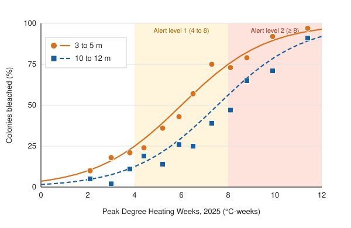

^1^ Isla Coralina Marine Station, Department of Marine Biology · ^2^ School of Earth and Ocean Sciences, Northshore University
Contact: a.ruiz-tamayo@coralina-station.example.org · Poster #B-117, Reef Futures Symposium 2026

---

## Background

Mass coral bleaching events are now arriving faster than reefs can recover [@hughes2018]. When sea surface temperature (SST) stays above the summer maximum for weeks, corals expel their symbiotic algae, lose their color and most of their energy supply, and die if the stress lasts too long [@glynn1993].

Heat stress is usually summarized as **Degree Heating Weeks** (DHW), the accumulated HotSpot over the previous 12 weeks [@liu2014]:

$$
\mathrm{DHW}(t) = \frac{1}{7}\sum_{i=t-83}^{t} \mathrm{HS}_i \cdot \mathbb{1}[\mathrm{HS}_i \ge 1\,^\circ\mathrm{C}],
\qquad \mathrm{HS}_i = \mathrm{SST}_i - \mathrm{MMM},
$$

where MMM is the climatological maximum monthly mean SST. Significant bleaching is expected above 4 °C-weeks and widespread mortality above 8 °C-weeks [@hughes2017].

Satellite DHW measures surface temperature, but the corals live meters below it. **Does depth protect corals experiencing the same satellite-measured heat stress?**

## Methods

- **Sites:** 12 fore-reef sites spanning the island's windward and leeward coasts, chosen to cover a range of 2025 peak DHW (2.1 to 11.4 °C-weeks).
- **Surveys:** at each site, three 30 m belt transects (1 m wide) at a shallow (3 to 5 m) and a deep (10 to 12 m) station, surveyed within two weeks of peak DHW (March to April 2025) and resurveyed six months later.
- **Scoring:** every colony larger than 5 cm scored as healthy, pale, partially bleached, fully bleached, or recently dead. A colony counted as "bleached" if partially or fully bleached. 6,912 colonies in total.
- **Temperature:** NOAA Coral Reef Watch 5 km daily DHW for each site's pixel, plus in situ loggers at both depths (HOBO, 30 min interval).
- **Analysis:** binomial generalized linear mixed model with a random intercept for site, fitted with glmmTMB [@brooks2017]:

$$
\operatorname{logit} P(\text{bleached}_{ij}) = \beta_0 + \beta_1\,\mathrm{DHW}_j + \beta_2\,\mathrm{Deep}_{ij} + \beta_3\,\mathrm{Genus}_{ij} + u_j,
\qquad u_j \sim \mathcal{N}(0, \sigma_u^2).
$$

## Results

**1. Bleaching rose steeply with heat stress.** Each additional °C-week of DHW multiplied the odds of a colony bleaching by 1.71 (95% CI 1.49 to 1.97). Half of shallow colonies were bleached at 6.0 °C-weeks.

**2. Deep corals bleached less at the same DHW.** At deep stations the odds of bleaching were 56% lower (OR = 0.44, 95% CI 0.31 to 0.62). The 50% bleaching threshold shifted from 6.0 to 7.5 °C-weeks, roughly 1.5 weeks of extra tolerance at peak-season heating rates (Figure 1).

**3. Loggers explain part of the depth effect.** In situ temperatures at 10 to 12 m averaged 0.4 °C below those at 3 to 5 m during the peak month. Recomputing DHW from logger data reduced the depth coefficient by about half (OR = 0.66), so the remaining protection likely reflects lower light stress at depth.

**4. Winners and losers by genus.** Branching taxa bleached most and died most; massive *Porites* largely recovered, matching earlier events [@loya2001].

| Genus | Colonies (n) | Bleached at peak | Dead at 6 months |
|---|---:|---:|---:|
| *Acropora* | 1,184 | 76% | 38% |
| *Pocillopora* | 902 | 64% | 24% |
| *Montipora* | 1,036 | 55% | 15% |
| *Dipsastraea* | 611 | 31% | 6% |
| *Porites* (massive) | 1,723 | 18% | 3% |
| Other | 1,456 | 33% | 9% |
| **All colonies** | **6,912** | **44%** | **14%** |

: Table 1. Bleaching prevalence and six-month mortality by genus, pooled over sites and depths.

## Conclusions

- Depth gave measurable but limited protection: about 1.5 °C-weeks of extra tolerance. At the hottest sites (above 10 °C-weeks), deep reefs bleached almost as badly as shallow ones.
- Satellite DHW overstates heat stress at depth. Bleaching forecasts for deeper reef zones should be corrected with in situ temperature where possible.
- Deep reefs may act as short-term refuges for heat-sensitive genera like *Acropora*, but only during moderate events. They are not a long-term substitute for cutting emissions.

## Next steps

Coring of tagged *Porites* and *Acropora* colonies at four sites to measure growth recovery; symbiont genotyping to test whether depth differences reflect different *Symbiodiniaceae* communities.

## Acknowledgments

We thank the Isla Coralina dive team and 14 volunteer surveyors. Funded by the Coralina Reef Trust (grant CRT-2024-09). Satellite data courtesy of NOAA Coral Reef Watch.

## References
