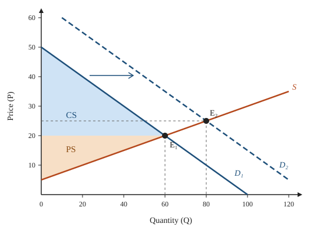

# ECON 101 Notes: Supply, Demand, and Elasticity

*Weeks 3 and 4. Based on lectures and Chapters 3 to 5 of the textbook.*

## 1. Demand

**Quantity demanded** ($Q_d$) is the amount buyers are willing and able to buy at a given price, holding everything else constant (*ceteris paribus*).

**Law of demand:** when the price of a good rises, quantity demanded falls. The demand curve slopes down.

A linear demand curve:

$$Q_d = a - bP, \qquad a, b > 0.$$

### Movement along vs. shift of the curve

- A change in the good's **own price** moves us *along* the demand curve (a change in quantity demanded).
- A change in **anything else** *shifts* the whole curve (a change in demand).

| Demand shifter | Effect on demand (shift right = increase) |
|---|---|
| Income rises, normal good | Right |
| Income rises, inferior good | Left |
| Price of a substitute rises | Right |
| Price of a complement rises | Left |
| Tastes shift toward the good | Right |
| More buyers in the market | Right |
| Buyers expect higher prices later | Right (buy now) |

## 2. Supply

**Quantity supplied** ($Q_s$) is the amount sellers are willing and able to sell at a given price.

**Law of supply:** higher prices make production more profitable, so quantity supplied rises. The supply curve slopes up.

$$Q_s = c + dP, \qquad d > 0.$$

Supply shifters: input prices, technology, number of sellers, expectations, and taxes or subsidies on producers. Cheaper inputs or better technology shift supply **right**.

## 3. Market equilibrium

Equilibrium is where the curves cross: $Q_d = Q_s$. At that price there is no shortage and no surplus.

$$a - bP^* = c + dP^* \quad\Longrightarrow\quad P^* = \frac{a - c}{b + d}, \qquad Q^* = a - bP^*.$$

- If $P > P^*$: $Q_s > Q_d$, a **surplus**, and sellers cut prices.
- If $P < P^*$: $Q_d > Q_s$, a **shortage**, and prices get bid up.

### Worked example

Let $Q_d = 100 - 2P$ and $Q_s = -20 + 4P$.

$$100 - 2P = -20 + 4P \;\Rightarrow\; 120 = 6P \;\Rightarrow\; P^* = 20, \quad Q^* = 60.$$

Now suppose incomes rise and demand shifts to $Q_d' = 130 - 2P$:

$$130 - 2P = -20 + 4P \;\Rightarrow\; P^{**} = 25, \quad Q^{**} = 80.$$

Both price and quantity rise. This is the general result for a demand increase: price up, quantity up. A supply increase gives price down, quantity up.

### When both curves shift

If both shift, one of price or quantity is ambiguous: the answer depends on which shift is bigger.

| | Supply ↑ | Supply ↓ |
|---|---|---|
| **Demand ↑** | Q ↑, P ? | P ↑, Q ? |
| **Demand ↓** | P ↓, Q ? | Q ↓, P ? |

## 4. Consumer and producer surplus

**Consumer surplus** (CS) is the difference between what buyers would have been willing to pay and what they actually pay: the area below the demand curve and above the price. **Producer surplus** (PS) is the area above the supply curve and below the price.

For the example at $E_1$: demand hits the price axis at $P = 50$ (where $Q_d = 0$) and supply at $P = 5$.

$$CS = \tfrac{1}{2}\,(60)(50 - 20) = 900, \qquad PS = \tfrac{1}{2}\,(60)(20 - 5) = 450.$$

Total surplus $CS + PS = 1350$ is maximized at the competitive equilibrium. Any policy that moves quantity away from $Q^*$ (a price ceiling, a tax) creates a **deadweight loss**.

## 5. Elasticity

Elasticity measures *how much* quantity responds, in percentage terms, so it doesn't depend on units.

### 5.1 Price elasticity of demand

$$E_d = \frac{\%\Delta Q_d}{\%\Delta P} = \frac{\Delta Q / Q}{\Delta P / P}.$$

Because demand slopes down, $E_d < 0$. Most textbooks (and these notes) talk about the absolute value $|E_d|$.

**Midpoint (arc) formula.** Use this between two points so that the answer doesn't depend on direction:

$$E_d = \frac{(Q_2 - Q_1)\big/\tfrac{1}{2}(Q_1 + Q_2)}{(P_2 - P_1)\big/\tfrac{1}{2}(P_1 + P_2)}.$$

*Example:* a café raises the price of a latte from \$4 to \$5 and daily sales fall from 120 to 90.

$$E_d = \frac{-30 / 105}{1 / 4.5} = \frac{-0.286}{0.222} \approx -1.29.$$

Demand is elastic ($|E_d| > 1$).

**Point elasticity** on a curve:

$$E_d = \frac{dQ}{dP}\cdot\frac{P}{Q}.$$

For linear demand $Q = a - bP$, this is $-bP/Q$, so elasticity *changes along a straight line*: elastic near the top (high $P$, low $Q$), inelastic near the bottom. At the midpoint of a linear demand curve, $|E_d| = 1$.

In our example at $E_1$: $E_d = -2 \cdot 20/60 = -0.67$ (inelastic).

### 5.2 Categories and total revenue

Total revenue is $TR = P \times Q$. Whether a price increase raises revenue depends on elasticity:

| $\lvert E_d \rvert$ | Name | If price rises, TR... | Example |
|---|---|---|---|
| $> 1$ | Elastic | falls | Restaurant meals, a specific brand of cereal |
| $= 1$ | Unit elastic | stays the same | |
| $< 1$ | Inelastic | rises | Gasoline (short run), insulin, salt |
| $0$ | Perfectly inelastic | rises proportionally | (vertical demand curve) |
| $\infty$ | Perfectly elastic | falls to zero | A single wheat farmer's output |

### 5.3 What makes demand elastic?

1. **Close substitutes** available → more elastic.
2. **Luxury** rather than necessity → more elastic.
3. **Narrow** market definition ("Brand X jeans" vs. "clothing") → more elastic.
4. **Longer time horizon** → more elastic (people find alternatives).
5. **Large share of budget** → more elastic.

### 5.4 Other elasticities

$$\text{Income elasticity: } E_I = \frac{\%\Delta Q_d}{\%\Delta I} \qquad \begin{cases} E_I > 1 & \text{luxury} \\ 0 < E_I < 1 & \text{necessity} \\ E_I < 0 & \text{inferior good} \end{cases}$$

$$\text{Cross-price elasticity: } E_{XY} = \frac{\%\Delta Q_X}{\%\Delta P_Y} \qquad \begin{cases} E_{XY} > 0 & \text{substitutes} \\ E_{XY} < 0 & \text{complements} \end{cases}$$

$$\text{Price elasticity of supply: } E_s = \frac{\%\Delta Q_s}{\%\Delta P} \;\geq\; 0.$$

In the example at $E_1$: $E_s = 4 \cdot 20/60 = 1.33$.

## 6. Application: who pays a tax?

When the government taxes a good, the **incidence** (who actually bears it) doesn't depend on who writes the check. It depends on elasticities. The share of a small per-unit tax borne by buyers is approximately

$$\text{buyers' share} = \frac{E_s}{E_s + |E_d|}, \qquad \text{sellers' share} = \frac{|E_d|}{E_s + |E_d|}.$$

The **less elastic** side bears more of the tax. In our example at $E_1$, buyers bear $1.33/(1.33 + 0.67) = 2/3$ of the tax.

## Summary of key formulas

| Concept | Formula |
|---|---|
| Equilibrium (linear) | $P^* = (a - c)/(b + d)$ |
| Price elasticity (midpoint) | $\dfrac{\Delta Q / \bar Q}{\Delta P / \bar P}$ |
| Point elasticity | $\dfrac{dQ}{dP}\cdot\dfrac{P}{Q}$ |
| Total revenue | $TR = P \cdot Q$ |
| Consumer surplus (linear) | $\tfrac12 Q^*(P_{\max} - P^*)$ |
| Tax burden on buyers | $E_s / (E_s + \lvert E_d \rvert)$ |

**For the midterm:** be able to solve for equilibrium, shift curves correctly for a given event, compute midpoint elasticity, and explain the elasticity–revenue link.
