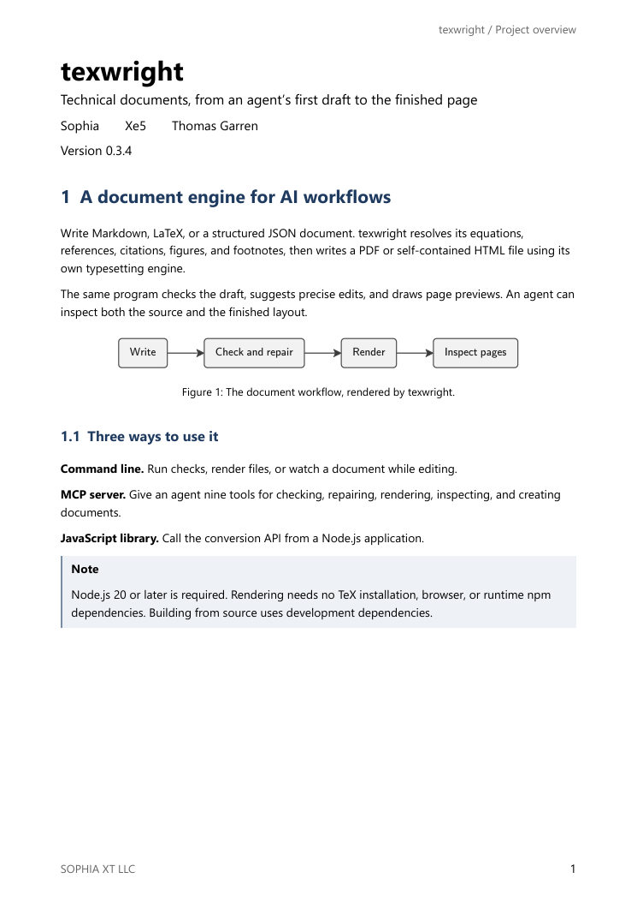
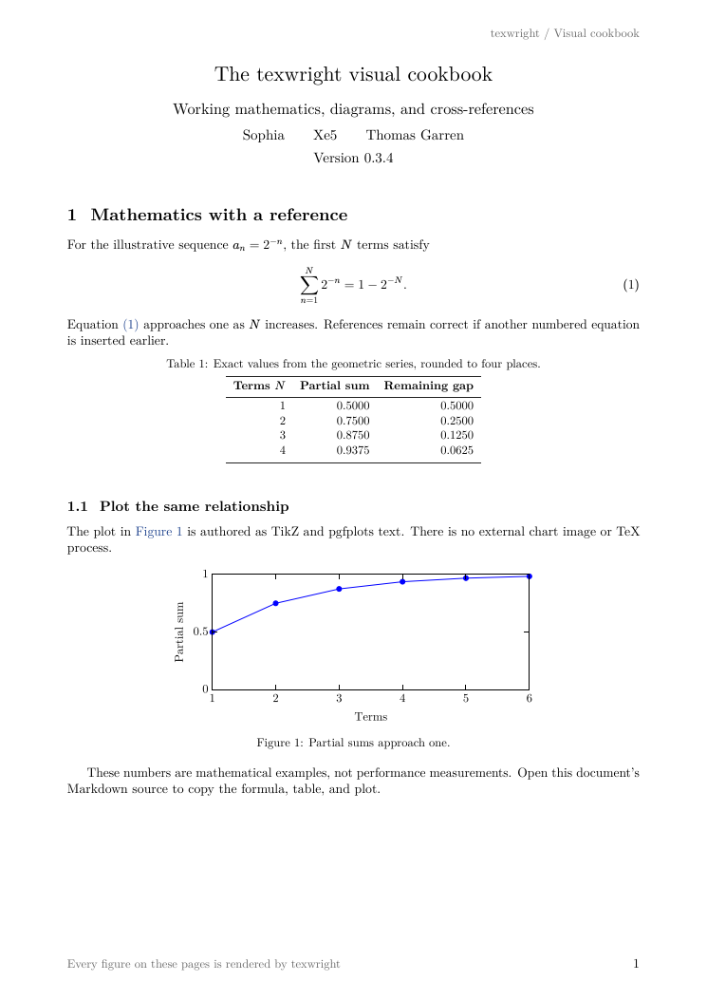
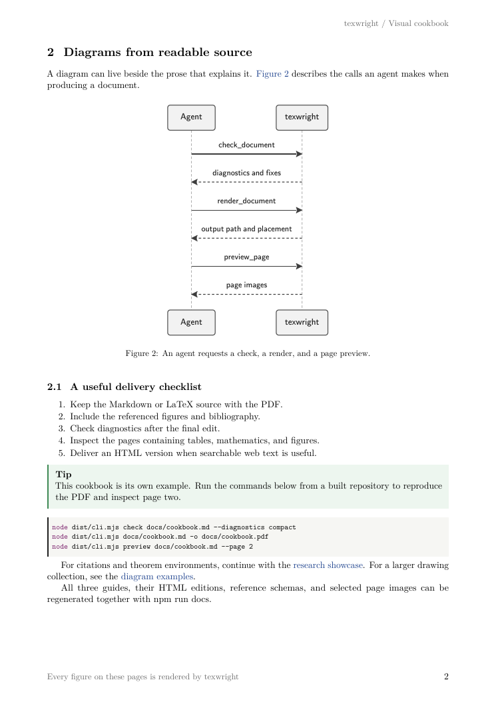

# texwright documentation

These guides are written in Markdown and rendered by texwright itself. The PDF, self-contained HTML, and PNG page images come from the same source. No browser or TeX installation generates them.

| Guide | What it covers | Read or download |
|---|---|---|
| Project overview | Capabilities, architecture, installation, boundaries | [Source](overview.md) · [PDF](overview.pdf) · [HTML](overview.html) |
| Agent integration | Workflow, nine MCP tools, exact arguments, diagnostics | [Source](agent-guide.md) · [PDF](agent-guide.pdf) · [HTML](agent-guide.html) |
| Visual cookbook | Numbered mathematics, tables, pgfplots, Mermaid | [Source](cookbook.md) · [PDF](cookbook.pdf) · [HTML](cookbook.html) |

## See the output

## For LLMs and tool builders

- [llms.txt](../llms.txt): a concise map to the most useful source documents.
- [AGENTS.md](../AGENTS.md): the full document-writing reference.
- [CHEATSHEET.md](../CHEATSHEET.md): a compact syntax reminder.
- [MCP tool catalog](reference/mcp-tools.json): generated from the built server's tools/list response.
- [Document JSON Schema](reference/document.schema.json): generated from the public API.
- [Project metadata](../project.jsonld): structured identity, repository, license, and contributors.
- [Architecture](../DESIGN.md): source-level implementation details.
- [Benchmark corpus](../bench/README.md): evaluation method and source documents.

## Rebuild

Requires Node.js 20 or later. From the repository root:

~~~sh
npm ci
npm run docs
npm run docs:check
~~~

The docs command builds texwright, checks the three sources, writes PDF and HTML editions, renders their page images, and refreshes the schema and MCP catalog. The check command validates the sources, PDF layout, links, and MCP catalog without rewriting published artifacts. Rendering warnings fail the documentation build. A fixed SOURCE_DATE_EPOCH supplies reproducible PDF timestamps; installed fonts may affect layout across machines.

The images in previews/ are actual page renders, not design mockups. Original sources are the editable authority; regenerate the outputs after changing them.

## Discovery

A public repository can be read without authentication. GitHub topics help categorize it; the [GitHub topic documentation](https://docs.github.com/en/repositories/managing-your-repositorys-settings-and-features/customizing-your-repository/classifying-your-repository-with-topics) explains discovery through topics.

The [llms.txt proposal](https://llmstxt.org/) supplies a convention for a concise documentation index. This file helps agents that read it find relevant sources; it does not promise search placement, model training inclusion, or automatic ingestion. Keep useful facts in ordinary Markdown as well as in the index.

The repository was initially created private. Its current GitHub visibility determines whether public crawlers can access these documents.
