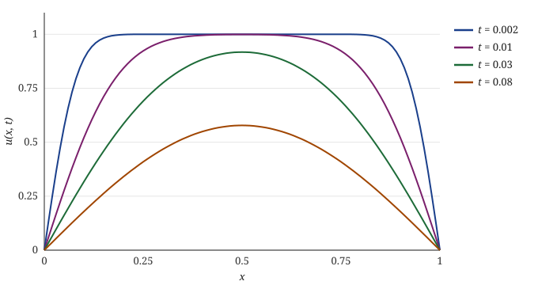

# Introduction {#sec:intro}

Fourier introduced the heat equation in 1822 [@fourier1822] and with it the series that now carry his name. We follow the modern treatment of @evans2010 and compare an exact solution with the Crank–Nicolson scheme [@crank1947; @leveque2007].

The problem sits on the unit interval. @sec:model states it, @sec:solution solves it, and @sec:numerics compares the result with a numerical scheme.[^history]

[^history]: Fourier's memoir was first submitted to the Institut de France in 1807 and published as a book only fifteen years later.

# The model {#sec:model}

Let $u(x,t)$ be the temperature of a rod of length one with diffusivity $\alpha > 0$. Then

\begin{align}
  u_t &= \alpha\, u_{xx}, & 0 < x < 1,\ t > 0, \label{eq:heat} \\
  u(0,t) &= u(1,t) = 0, & t > 0, \label{eq:bc} \\
  u(x,0) &= f(x), & 0 \le x \le 1. \nonumber
\end{align}

The boundary conditions \eqref{eq:bc} hold the ends at zero. Energy decays:

$$ \frac{\dd}{\dd t} \frac12 \norm{u}^2_{L^2} = -\alpha \norm{u_x}^2_{L^2} \le 0. $$ {#eq:energy}

::: {.theorem #thm:unique title="Uniqueness"}
Problem \eqref{eq:heat}–\eqref{eq:bc} with initial data $f \in L^2(0,1)$ has at most one solution.
:::

::: proof
If $u$ and $v$ solve the problem, $w = u - v$ solves it with $f = 0$. By @eq:energy, $\norm{w(\cdot,t)}_{L^2} \le \norm{w(\cdot,0)}_{L^2} = 0$ for all $t$.
:::

# Exact solution {#sec:solution}

Separation of variables gives

\begin{equation}
  u(x,t) = \sum_{k=1}^{\infty} b_k \, e^{-\alpha (k\pi)^2 t} \sin(k\pi x),
  \qquad b_k = 2\int_0^1 f(x)\sin(k\pi x)\,\dd x.
  \label{eq:series}
\end{equation}

For $f \equiv 1$ only odd modes survive, with $b_k = 4/(k\pi)$. @fig:heat shows how quickly the higher modes die out.

{#fig:heat width=82%}

::: {.theorem #thm:decay title="Exponential decay"}
For $f \in L^2(0,1)$, $\norm{u(\cdot,t)}_{L^2} \le e^{-\alpha\pi^2 t} \norm{f}_{L^2}$.
:::

::: tip
@thm:decay follows from \eqref{eq:series} and Parseval's identity, since every mode decays at least as fast as the first.
:::

# Numerical comparison {#sec:numerics}

The Crank–Nicolson scheme is second order in space and time. @tbl:errors lists the maximum error at $t = 0.1$.

| $N$ | $\Delta t$ | max error | rate |
|----:|-----------:|----------:|-----:|
| 16  | $10^{-2}$  | $3.1 \times 10^{-3}$ | — |
| 32  | $5 \times 10^{-3}$ | $7.8 \times 10^{-4}$ | 1.99 |
| 64  | $2.5 \times 10^{-3}$ | $1.9 \times 10^{-4}$ | 2.00 |
| 128 | $1.25 \times 10^{-3}$ | $4.9 \times 10^{-5}$ | 2.00 |

Table: Crank–Nicolson errors at $t = 0.1$. {#tbl:errors}

The scheme fits in a few lines:

```{.python #lst:cn caption="One Crank–Nicolson step"}
import numpy as np
from scipy.linalg import solve_banded

def step(u, r):
    """Advance u by one step; r = alpha * dt / dx**2."""
    n = len(u)
    ab = np.zeros((3, n))
    ab[0, 1:], ab[1, :], ab[2, :-1] = -r / 2, 1 + r, -r / 2
    rhs = (1 - r) * u
    rhs[1:] += r / 2 * u[:-1]
    rhs[:-1] += r / 2 * u[1:]
    return solve_banded((1, 1), ab, rhs)
```

@lst:cn solves one tridiagonal system per step, so the cost is linear in $N$.

::: note
Every equation, figure, table and listing number in this document, and every page number in the contents, was computed by texwright. The source contains none of them. Equation \eqref{eq:heat} is on page \pageref{eq:heat}.
:::

# Conclusion

Typesetting a document like this used to mean installing TeX. texwright needs neither TeX nor a browser: it breaks paragraphs with the Knuth–Plass algorithm [@knuth1981], lays out the mathematics by TeX's rules, and writes the PDF itself. When something is wrong, it says which line and why.

\printbibliography
