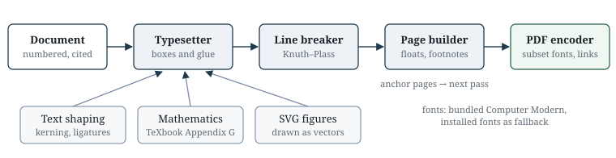

# Introduction {#sec:intro}

TeX and LaTeX still set the standard for technical documents [@knuth1984; @lamport1994], and they are hard to automate. A working installation runs to gigabytes, and when a document fails the error log speaks in terms of macro expansion rather than the line the author wrote. Pandoc [@pandoc] converts between almost any pair of formats, but to make a PDF it hands the document to a LaTeX engine and inherits that engine's size and its errors. KaTeX [@katex] typesets mathematics quickly in a browser, but only mathematics.

A growing share of documents is now written by programs. A language-model agent asked for a report, a paper or a handout produces Markdown or LaTeX easily. What slows it down is everything after that: a toolchain to install, a failure it cannot interpret, and layout changes that mean editing a template it cannot see. texwright is designed for that loop. Each step is one call, each problem comes back as data, and each layout decision lives in the document the agent already writes.

Its contributions are:

1. One document model shared by three input formats (Markdown, LaTeX, JSON), so a document may mix Markdown and raw LaTeX freely (@sec:model, @sec:parsing).
2. LaTeX numbering semantics without TeX, including per-row equation numbers and section-relative theorem counters (@sec:transforms).
3. A typesetting engine written from first principles: TeX's box and glue model, Knuth–Plass line breaking, the mathematics layout of *The TeXbook*, a page builder with floats and footnotes, and a PDF encoder with font subsetting (@sec:engine).
4. Exact page references from repeated layout passes, with a fixed-point argument for when to stop (@sec:pages).
5. Interpreters for the figures models write as text: Mermaid's twelve diagram types with a layered graph layout, and the drawing packages of LaTeX (TikZ, pgfplots in 2D and 3D, forest, the graphs library, circuitikz and PSTricks), all drawn into the same vector figures without TeX (@sec:drawings).
6. An interface built for agents: a check that answers in milliseconds, diagnostics with stable codes and fixes in the shape of an edit, layout chosen from the document's own front matter, page images an agent can look at, a JSON Schema and an MCP server (@sec:diagnostics).
7. A benchmark of documents that models wrote for a PDF, with held-out sets, and the reader extensions it led to: the packages, document classes and Markdown habits models use without being asked (@sec:bench).
8. A security model for documents written by untrusted authors, tested by an adversarial review (@sec:security), and a test suite that fuzzes every reader (@sec:robustness).

# Design goals {#sec:goals}

Built for agents
:   One file in, one call, structured results out. The command-line interface and the MCP server [@mcp] answer in JSON, a JSON Schema describes the document tree, and a one-page guide teaches the syntax.

Quick
:   Checking a document takes milliseconds and typesetting it takes a fraction of a second, so an agent can check after every edit and render as often as it likes.

Adaptable from the document
:   Paper, margins, body size, theme, running heads and authors are front matter keys in pandoc's spelling, or the LaTeX class and geometry options models already know. Nothing needs a template.

No TeX and no borrowed engines
:   Nothing in the pipeline invokes TeX or a browser, and the published package runs no code it does not contain.[^fonts] Node's standard library is the only foundation.

LaTeX semantics where readers notice them
:   Numbering, labels, references, citations, line breaks and page breaks behave as a LaTeX user expects.

Diagnostics as an API
:   A problem is data: a code that never changes meaning, a severity, a file, line and column, the offending line and a hint. Nothing a document does should raise an exception.

Safe with untrusted input
:   A document cannot read files outside its folder, run scripts, reach the network, or exhaust time or memory.

[^fonts]: Fonts and hyphenation patterns are data, not code: Latin Modern (GUST Font License), KaTeX's Computer Modern derivatives (SIL Open Font License) and TeX's US English patterns. Installed fonts fill in characters these lack.

# The document model {#sec:model}

Every reader produces the same tree, and every later stage reads and rewrites it (@fig:pipeline). Nodes are plain JSON objects tagged by a field `t`: blocks such as `Heading`, `Para`, `MathBlock`, `Table`, `Figure`, `Theorem`, and inlines such as `Text`, `Math`, `Ref`, `Cite` and `Note`. Every node may carry a source position, which is how a problem found three stages later still points at the line the author wrote.

```{.mermaid #fig:pipeline caption="The pipeline, drawn by texwright from the Mermaid source beside it in this paper's Markdown. Three readers produce one document tree; transforms number, label and cite it, and draw its diagrams; two writers render it. Every stage adds to one list of diagnostics instead of throwing."}
flowchart TB
  md[Markdown] --> tree
  tex[LaTeX] --> tree
  json[JSON] --> tree
  tree[(Document tree)] --> num
  subgraph transforms [Transforms]
    num[Number, label and cite] --> draw[Draw diagrams]
  end
  draw --> pdf([PDF engine])
  draw --> html([HTML writer])
  draw -.->|diagnostics| diag{{Diagnostics}}
```

Because the tree is plain JSON, a program can write a document directly in it. `texwright schema` prints the JSON Schema, and the reader validates input against it with errors that name the failing path:

```json
{"texwright": 1, "meta": {"title": [{"t": "Text", "text": "Notes"}]},
 "blocks": [
   {"t": "MathBlock", "tex": "e^{i\\pi}+1=0", "numbered": true, "label": "eq:euler"},
   {"t": "Para", "content": [{"t": "Text", "text": "By "},
                             {"t": "Ref", "label": "eq:euler", "style": "eq"}]}]}
```

@fig:tree shows the shape of a small document's tree. It is set with the forest package's syntax, written as raw LaTeX inside this Markdown file, and forest's packed layout places each subtree against the outline of its neighbour so that none overlap.

\begin{figure}
\centering
\begin{forest}
for tree={draw, rounded corners=2pt, font=\small, inner sep=2.5pt, s sep=5pt, l sep=9pt, edge={gray}}
[Document [meta [title] [author] [macros]] [blocks [Heading [Text]] [Para [Text] [Math] [Ref] [Cite]] [Figure [Image] [caption]] [Table [head] [body]]]]
\end{forest}
\caption{The document tree of a short paper, as forest draws it.}
\label{fig:tree}
\end{figure}

# Parsing {#sec:parsing}

## Markdown

The Markdown reader implements CommonMark [@commonmark] and GitHub's tables, and adds what people use in practice from pandoc: YAML front matter, `$` and `$$` mathematics, attributes such as `{#fig:plot width=60%}`, fenced divisions for callouts and theorems, footnotes, definition lists, and citations such as `[@doe2020, p. 4]`. It was written from the specification: a block phase that matches each line against a stack of open containers, then an inline phase with a delimiter list for emphasis, both building texwright's tree directly. A differential test against texwright's earlier reader found identical trees for all 652 CommonMark and 713 GFM examples, every test input and 20,000 generated documents, and for 99.75% of 200,000 random ones; the rest are pathological inputs, such as tabs after nested quote markers, where the new reader follows the specification's tab stops. The `$` rule follows pandoc: an opening `$` must be followed by a non-space and a closing `$` preceded by one and not followed by a digit, so "$5 and $10" stays text. Any LaTeX the reader does not handle itself is kept as a raw fragment for the LaTeX reader.

## LaTeX

The LaTeX reader is a tokenizer and a recursive-descent parser written for the subset that articles use: sectioning, lists, figures and subfigures, `tabular` with booktabs rules, `\multicolumn` and `\multirow`, theorem environments declared with `\newtheorem`, `\input` and `\include`, the `natbib` and `biblatex` citation commands, and every display-math environment. Every token carries its source offset, so mathematics is cut from the source by position and never re-serialized. A stack of open groups and environments decides where each construct ends; when the source is broken, for example an unclosed `{` or an `\end` without its `\begin`, the stack reports the opening position and recovers, so later sections still parse.

User macros are expanded in text and recorded for mathematics. Expansion is bounded by depth, by count and by the total amount of text produced, which defeats definitions such as `\def\x{\x\x}`.

## Mixing the two

Raw LaTeX inside a Markdown file is parsed by the LaTeX reader with a context whose macro table and metadata are the document's own. A `\newcommand` in one fragment therefore works in the next, and `\bibliography{refs}` written in a Markdown file reaches the citation stage.

# Numbering, references and citations {#sec:transforms}

One pass in document order numbers sections (from the highest heading level the document uses, with letters after `\appendix`), figures and subfigures, tables, captioned listings, theorems and equations. Equations follow LaTeX exactly: `equation` takes one number, `align` and `gather` number every row unless the row says `\nonumber`, and `multline` numbers the block once. The rows below are numbered by this paper's own pipeline:

\begin{align}
  u_t &= \alpha\, u_{xx}, \label{eq:heat} \\
  u(0,t) &= u(1,t) = 0, \nonumber \\
  u(x,0) &= f(x). \label{eq:init}
\end{align}

The middle row carries no number, so \eqref{eq:init} follows \eqref{eq:heat} directly. The mathematics engine keeps no counter of its own: the numbering pass decides the tag of every row and hands the tags to the engine with the formula, so the number printed and the number a reference resolves to come from the same place.

Theorem-like blocks share counters as `amsthm` declares them. With `\newtheorem{lemma}[theorem]{Lemma}`, lemmas count with theorems; with `\newtheorem{theorem}{Theorem}[section]`, both are numbered within sections, so a lemma and a theorem in the first section are 1.1 and 1.2.

A reference to a label that does not exist is an error (REF001) whose hint lists the closest existing labels by edit distance. A label defined twice is REF002; a label whose prefix contradicts its target, such as `fig:` on a table, is REF003.

| Written as | Prints | Source of the text |
|:-----------|:-------|:-------------------|
| `@fig:pipeline` | @fig:pipeline | kind name and number |
| `\ref{fig:pipeline}` | \ref{fig:pipeline} | number |
| `\eqref{eq:heat}` | \eqref{eq:heat} | equation number in parentheses |
| `\cref{eq:init,eq:heat}` | \cref{eq:init,eq:heat} | sorted and grouped as cleveref does |
| `\Cref{fig:pipeline,fig:tree}` | \Cref{fig:pipeline,fig:tree} | one name for a run of the same kind |
| `\pageref{eq:heat}` | \pageref{eq:heat} | page builder (@sec:pages) |
| `[@knuth1981]` | [@knuth1981] | citation processor |

Table: Reference and citation forms. The middle column is not typed by hand: texwright resolved each entry while producing this page. {#tbl:refs}

Citations are read from BibTeX [@patashnik1988] or CSL-JSON [@csl]. The BibTeX reader recovers from malformed entries, resolves `@string` macros, `crossref` and biblatex dates, and turns accents and protective braces into Unicode text. Two styles are built in: a numeric style that compresses runs ("[1–3]") and an author–year style that disambiguates with letters ("2020a"). Unknown keys are errors whose hint names the nearest keys.

# The typesetting engine {#sec:engine}

The PDF writer follows TeX's own architecture (@fig:engine). A typesetter walks the document tree and produces TeX's raw material: boxes, glue that can stretch and shrink, penalties that price a break, and marks that record anchors, links, footnotes and floats. Paragraphs become lines, lines and other blocks become a vertical list, the page builder cuts that list into pages, and a shipping stage turns pages into PDF drawing operations.

{#fig:engine width=100%}

## Fonts and text

Text is set in Latin Modern, the OpenType form of LaTeX's own Computer Modern, so it carries the ligatures, kerning and accented letters a LaTeX reader expects. A TrueType and OpenType reader handles `cmap` tables, metrics, `glyf` and CFF outlines, kerning from `kern` and GPOS, ligatures from GSUB, and font collections. Text is shaped against a stack of fonts: the face the style asks for, then the bundled Computer Modern faces, then installed fonts that cover the character. Where a face lacks an accented letter, the shaper builds it as TeX's `\accent` does, and a character no available font has is reported (FONT001).

## Paragraphs

Lines are broken with the Knuth–Plass algorithm [@knuth1981], which chooses all the breaks of a paragraph together. For a line with adjustment ratio $r$ the badness is $b = 100\,|r|^3$, and a break with penalty $p$ on a line costs
$$ d = \begin{cases} (l + b)^2 + p^2, & 0 \le p < 10000,\\ (l + b)^2 - p^2, & -10000 < p < 0,\\ (l + b)^2, & p \le -10000, \end{cases} $$ {#eq:demerits}
where $l$ is the line penalty. @fig:demerits draws the first case over the range a line breaker meets: the cost grows with the square of both badness and penalty, which is why one very bad line costs more than several mediocre ones. As in TeX, a first pass tries without hyphenation, a second pass hyphenates by Liang's method [@liang1983] with TeX's own US English patterns, and a final pass adds emergency stretch so that a paragraph with an unbreakable word sets loosely rather than running into the margin. Interword spaces stretch more after a full stop, ligatures and kerns come from the font, and club and widow lines are priced with penalties. Justified text also gets pdfTeX's microtypography: characters such as hyphens, full stops and quotes hang into the margin by microtype's default amounts, and the glyphs of a line may widen or narrow by up to 2% before its spaces stretch. The line breaker counts both as room it has, so a paragraph needs fewer hyphens and its spaces vary less; on the benchmark the spread of interword spaces halved and lines ending in a hyphen fell from 98 to 18.

```{.tikz #fig:demerits caption="Demerits of a break, $d = (l + b)^2 + p^2$ with line penalty $l = 10$, as a pgfplots surface that texwright projects, shades and depth-sorts itself."}
\begin{tikzpicture}
\begin{axis}[view={-35}{28}, width=9.5cm, height=6.6cm, xlabel={badness $b$}, ylabel={penalty $p$}, zlabel={$d$}, colorbar, colormap/viridis, colorbar style={width=0.25cm}, grid=major]
\addplot3[surf, shader=faceted, domain=0:100, y domain=0:100, samples=24] {(10 + x)^2 + y^2};
\end{axis}
\end{tikzpicture}
```

## Mathematics

The mathematics engine parses TeX notation into a tree of atoms and lays it out by the rules of Appendix G of *The TeXbook* [@knuth1984]: atom classes and the spacing table between them, fraction and radical placement from the font's parameters, sub- and superscript shifts, limits on large operators, and delimiters built to size from the extensible pieces in the bundled size fonts. The font parameters are the $\sigma$ and $\xi$ values of Appendix G for `cmsy10` and `cmex10`, scaled with the style. Alignment environments are boxes of columns, and an equation tag follows TeX's `\eqno` rule: the formula is centred in the space the tag leaves, and a tag that does not fit beside its formula moves to a line of its own. Inline formulas join the paragraph, so a line can break after a relation or a binary operator at TeX's penalties of 500 and 700. The same parser produces MathML for HTML output, so both writers accept exactly the same input. A formula that does not parse is reported (MATH001) at its line and column and printed as its source in red, so the rest of the document still comes out.

## Pages

The page builder is TeX's: it adds material to the current page until the page is full, prices each legal break by its badness and penalty, and cuts at the cheapest one. Headings carry a penalty that keeps them off the bottom of a page, list items and paragraphs are priced against widows and orphans, and a page that would overflow goes back to its best earlier break. Footnotes travel with the line that cites them and are set at the foot of that line's page, split across pages only when they must be. Figures float: a figure that does not fit where it is cited goes to the top of the next page, and the text continues around it.

## Figures

SVG figures are drawn as vectors by texwright's own renderer. It parses the XML itself, refusing document type declarations and never expanding custom entities, then applies the CSS cascade (attribute selectors, structural pseudo-classes and sibling combinators included), transforms, `use` and `symbol`, markers, clip paths, masks and text. Arcs are converted to cubic Bézier curves, one per quarter turn. Gradients become PDF shading patterns; one that repeats or reflects is drawn over just the periods the shape spans, and stops that differ in opacity become a soft mask. An element with opacity is drawn as a transparency group unless it paints only once, when the opacity goes on that paint. Masks become soft masks and `mix-blend-mode` a group's blend mode. Filters run on pixels: the preview rasterizer draws the element, the primitives run in linear RGB as SVG prescribes, and the result is embedded as an image with alpha. When a filter only adds something under the element, as a drop shadow does, only that part becomes an image and the element stays vector, its text still selectable. Generic serif text and the TeX family names use the bundled faces, so such labels match the document's text, while a named family such as Georgia uses the installed font when there is one. Text can follow a path, and the HTML that diagram tools put in `foreignObject` is laid out as wrapped, aligned labels. JPEG images and most PNG images are embedded without recompressing their data; a PNG with transparency is decoded, and its alpha channel becomes a soft mask.

## PDF output

The encoder writes objects and cross-reference tables directly [@iso32000]. Fonts are embedded as `Type0` fonts, TrueType with `CIDFontType2` descendants and OpenType with CFF outlines as `CIDFontType0`, both subset to the glyphs a document uses while keeping the original glyph identifiers, so the content streams address glyphs directly. The CFF subsetter replaces each unused charstring with a one-byte `endchar` and, after tracing which subroutines the kept glyphs call, each unused subroutine with a one-byte `return`, so no numbering changes; Latin Modern Roman shrinks from 112 KB to about 25 KB for a typical page. A `ToUnicode` map for each font keeps the text searchable and copyable, ligatures included [@opentype]. Links, named destinations for every label, and bookmarks for every heading are written as the pages are shipped. Given a fixed date (the `SOURCE_DATE_EPOCH` convention), the same input produces the same bytes.

# Page references {#sec:pages}

A table of contents near the start of a document lists pages that are only known once the whole document has been laid out, and printing those numbers can itself move text. texwright resolves this as LaTeX does with its auxiliary file, by repetition, but without writing anything to disk between passes (@fig:passes).

```{.tikz #fig:passes caption="Page resolution, drawn in TikZ. Each pass typesets the document with the page map $m$ found by the previous pass, the page builder records the page of every anchor, and the loop ends when nothing moves."}
\begin{tikzpicture}[>=stealth, node distance=1.1cm and 1.5cm,
  box/.style={draw, rounded corners=3pt, fill=blue!6, minimum height=0.85cm, minimum width=2.5cm, align=center, font=\small}]
\node[box] (doc) {document tree $D$};
\node[box, right=of doc] (set) {typeset with\\page map $m$};
\node[box, right=of set] (pages) {pages $P$,\\new map $m'$};
\node[box, below=of pages, fill=green!8] (pdf) {write the PDF};
\draw[->, thick] (doc) -- (set);
\draw[->, thick] (set) -- (pages);
\draw[->, thick] (pages) -- node[right, font=\small] {$m' = m$} (pdf);
\draw[->, thick] (pages.north) to[out=135, in=45] node[above, font=\small] {$m' \neq m$: $m \gets m'$} (set.north);
\end{tikzpicture}
```

The page builder records, for every anchor, the page and position where it landed. The first pass prints placeholders of a typical width in the contents and in every `\pageref`; each later pass prints the numbers the previous pass found. Only when two passes agree is the PDF written. \Cref{alg:passes} gives the loop.

\begin{algorithm}
\caption{Settling page references}
\label{alg:passes}
\begin{algorithmic}[1]
\Require document tree $D$
\State $m \gets$ placeholders of a typical width
\For{$k = 1, \dots, 4$}
  \State $(P, m') \gets \Call{Typeset}{D, m}$
  \If{$m' = m$}
    \State \Return $P$
  \EndIf
  \State $m \gets m'$
\EndFor
\State report PDF002 and \Return $P$
\end{algorithmic}
\end{algorithm}

::: {.proposition #thm:fixed}
If two consecutive passes assign every anchor the same page, a further pass produces the same document.
:::

::: proof
Typesetting is a deterministic function of the document tree and the page map from the previous pass. Equal maps give equal input, and therefore equal pages.
:::

Termination in general is not guaranteed: a contents entry growing from page 9 to page 10 can widen a line and push a section to the next page. texwright stops after four passes and reports PDF002 if numbers are still moving. In practice two passes settle; this paper took two.

# Diagrams and drawings {#sec:drawings}

When a model needs a figure it rarely draws one: it writes one as text. In Markdown that text is usually Mermaid; in LaTeX it is TikZ, pgfplots, forest, circuitikz or PSTricks. A converter without TeX drops all of these, and one with TeX needs the whole distribution and still cannot draw Mermaid. texwright interprets each language itself and draws the result into the same vector figure an SVG file would become, so a drawing is captioned, numbered and referenced like any other figure, and its labels are set in the document's own fonts.^[A "drawing" here means a picture described in a programming-like language, as opposed to an image file. The quotes in this note were typed straight and curled by texwright.]

## Mermaid

A fenced `mermaid` block becomes a figure. The twelve diagram types (flowchart, sequence, class, state, entity–relationship, gantt, pie, xy, quadrant, timeline, mindmap and user journey) have their own readers and layouts. Flowcharts and the other graph diagrams use a layered layout in the Sugiyama style: cycles are broken, nodes are assigned to ranks, crossings are reduced by barycentre ordering with clusters kept together, and coordinates are placed by isotonic regression, with edges drawn as smooth curves that end on the outline of each shape. \@fig:pipeline was drawn this way, as was the repair loop in @sec:diagnostics, and @fig:releases shows a timeline. A mistake in a diagram is error DIAG001 at its line in the document, with a fix where the answer is obvious (`flowchat` becomes `flowchart`).

```{.mermaid #fig:releases caption="texwright's releases, as a Mermaid timeline."}
timeline
  title From engine to drawings
  0.1 : Own typesetting engine : SVG figures as a browser draws them
  0.2 : Mermaid diagrams : TikZ and pgfplots : One-file bundle
  0.3 : pgfplots 3D : forest and graphs : circuitikz : PSTricks
  0.3.1 : Fixes from a bug sweep
  0.3.4 : Microtype : Watch : One-call repair
```

## TikZ, pgfplots and their relatives

The TikZ interpreter reads paths, nodes and their shapes, styles, `\foreach` loops, the `calc` and `positioning` libraries, arrows and decorations, and evaluates pgfmath expressions. Node text goes through the mathematics engine, so a label such as $\mathbf{F} = m\mathbf{a}$ matches the equations around it (@fig:passes is an example). pgfplots axes compute ticks and legends as pgfplots does, and in three dimensions they are projected from the requested view, shaded from a colour map and sorted back to front (@fig:demerits). Trees are placed as TikZ places `child` trees, or with forest's packed layout (@fig:tree), and the graphs library's layered layout reuses the Mermaid engine's. circuitikz bipoles take their sizes and label conventions from circuitikz (@fig:rc), and PSTricks pictures, including functions written in PostScript, have an interpreter of their own (@fig:pst).

```{.tikz #fig:rc caption="An RC low-pass filter in circuitikz: a source, a resistor and a capacitor with their labels and voltage arrows."}
\begin{circuitikz}
\draw (0,0) to[sV, v=$v_\mathrm{in}$] (0,3) to[R=$R$, i=$i$] (3.5,3) to[C=$C$, v^=$v_\mathrm{out}$] (3.5,0) -- (0,0);
\draw (3.5,3) to[short, -o] (5,3);
\draw (3.5,0) to[short, -o] (5,0);
\end{circuitikz}
```

\begin{figure}
\centering
\begin{pspicture}(-0.6,-1.4)(6.9,1.5)
\psaxes[Dx=1, Dy=1, ticksize=-2pt 2pt]{->}(0,0)(-0.4,-1.3)(6.8,1.4)
\psplot[linecolor=blue, linewidth=1.2pt, plotpoints=120]{0}{6.2832}{x 57.2958 mul sin}
\psplot[linecolor=red, linewidth=1pt, linestyle=dashed, algebraic, plotpoints=120]{0}{6.2832}{exp(-x/3)*cos(2*x)}
\rput[l](4.3,1.1){\blue $\sin x$}
\rput[l](4.3,0.7){\red $e^{-x/3}\cos 2x$}
\end{pspicture}
\caption{A PSTricks plot: the solid curve is PostScript code (\texttt{x 57.2958 mul sin}), the dashed one an algebraic expression.}
\label{fig:pst}
\end{figure}

Each interpreter caps its work (operations, loop iterations, nodes, samples, output size and time), reports what it draws only approximately as a warning (TIKZ001 or PST001) and draws the rest. We measured them as we measured the readers (@sec:bench): models wrote documents built around each package, and we rendered them unchanged.

| Documents built around | Count | texwright draws the figure | pandoc, no TeX |
|:-----------------------|------:|---------------------------:|---------------:|
| pgfplots in 3D | 13 | 13 | 0 |
| TikZ trees, forest, graphs | 14 | 14 | 0 |
| circuitikz | 14 | 14 | 0 |
| PSTricks | 15 | 15 | 0 |
| All | 56 | 56 | 0 |

Table: Drawing packages, rendered unchanged on a machine without TeX. pandoc's HTML output leaves raw TikZ and PSTricks out; drawing them takes a filter and a TeX installation. {#tbl:drawings}

All 56 documents check with no errors and no warnings (@tbl:drawings). That says the interpreters read what models write, not that every picture matches TeX to the point: circuit symbols such as IEEE logic gates are approximations, 3D axes have no logarithmic scale, and PSTricks' `psmatrix` is not supported.

# The agent interface {#sec:diagnostics}

## Diagnostics

Every stage appends to one list. A diagnostic records a stable code, a severity, the file, line and column, the source line, and where possible a hint. Codes are grouped by area (input, YAML, LaTeX, math, references, citations, images, fonts, layout, PDF, limits), and none changes meaning between releases. Repeated reports of one code are capped at 100 and summarized in a single line, so a document with forty thousand broken references produces a readable report in under a second.

```json
{"ok": false, "errors": 1, "warnings": 0,
 "diagnostics": [{"code": "REF001", "severity": "error",
   "message": "Reference to undefined label \"sec:intr\"",
   "file": "paper.md", "line": 3, "col": 5,
   "excerpt": "See @sec:intr and $x^{2}$.",
   "hint": "Did you mean \"sec:intro\"?"}]}
```

The engine reports layout problems the same way. A line that sticks out into the margin is LAY001 with the paragraph's position, a character that no available font contains is FONT001, and an SVG feature drawn approximately is SVG001.

`texwright check` runs every stage except page layout (it typesets every formula and resolves every image and reference) and takes about 15 ms for the showcase document once loaded. That makes the loop in @fig:loop cheap enough to run after every edit.

```{.mermaid #fig:loop caption="The repair loop an agent runs: edit, check, read the diagnostics, apply the fixes, and render and look at the pages when the check passes. Drawn from Mermaid source."}
flowchart LR
  write[Write or edit] --> check{{check}}
  check -->|errors| read[Read diagnostics]
  read --> fix[Apply fixes]
  fix --> check
  check -->|ok| render([Render PDF])
  render --> look[Look at pages]
  look -.->|layout problem| write
```

Many diagnostics carry a fix: replace this text with that, at this line and column, which is exactly an edit. Fixes that cannot be wrong (a label one transposition away from the only close match, a misspelt command with one clear neighbour) are marked safe, and `texwright check --fix` applies them, repeating until none is left. `--diagnostics compact` puts each problem on one line to save tokens, and `texwright outline` lists headings, figures, tables and equations with their lines and reference counts, so an agent can find its way in a long document without reading all of it.

The same loop is available over MCP [@mcp]. The server exposes `render_document`, `preview_page`, `check_document`, `fix_document`, `outline_document`, `repair_document`, `new_document`, `get_schema` and `get_guide`; a test drives it with the official MCP client to check interoperability. `repair_document` runs the whole loop in one call: it applies safe fixes until none is left, renders when the document is clean, and answers in a few lines with what it fixed, what is left and where things landed. For a person editing by hand, `texwright watch` keeps one process warm and renders again on every save, redoing only the layout the edit touched, so a change reaches the PDF in about a tenth of a second.

## Looking at the result

Diagnostics cannot say that a table is too wide to read or that a figure landed two pages after its text. An agent that can see images can judge that itself, so texwright draws the pages it would write to the PDF as PNG images. The layout is the PDF's own: the same passes produce the same pages, which are shipped to a rasterizer instead of the PDF writer. Glyphs are filled from their font outlines (TrueType quadratics and CFF charstrings), vector figures are stroked and filled with exact-area coverage, and PNG and baseline JPEG images are decoded and resampled, all in the same code base. On the showcase document and on this paper the images differ from poppler's rendering of the PDF by 0.2 to 0.36 levels per channel on average, and a page takes about 20 ms to draw at 100 dpi. A PDF render also reports the page each heading, figure, table and numbered equation landed on, so an agent knows which page to look at.

## Adapting a document

An agent adapts a document by editing the document. The keys below are pandoc's, which models have seen many times; LaTeX sources get the same from `\documentclass[12pt,a4paper]{article}` and `\usepackage[margin=2cm]{geometry}`.

```yaml
---
title: Quarterly results
author:
  - name: Thomas Garren
    affiliation: Sophia XT
papersize: a4
geometry: margin=2cm
fontsize: 12pt
theme: modern
---
```

A `fontsize` scales every size, skip and indent of the theme together, as LaTeX's class options do. Options given on the command line or to the MCP tool win over the document, so a pipeline can still impose a house style. A value texwright cannot use is OPT001 with a hint, like any other mistake, and `texwright check` reports it before anything is rendered.

# Writing as models write {#sec:bench}

A tool built for agents should be measured on what agents write. We asked models, each with a one-line request such as "write me homework solutions for a linear algebra problem set, I'll turn it into a PDF", for 80 documents in four sets of 20: papers, homework, lecture notes, lab reports, CVs, letters, exams, handouts, design documents, recipes, policy briefs. They were told to write for pandoc or an ordinary LaTeX installation and not to run any converter, and they supplied the bibliographies and SVG figures their documents cite. The runner in the repository's `bench/` folder renders each document unchanged and counts it clean when it has no errors and no warnings.

Sets A and C were the development sets: their failures said what to build. Set B was held out until A and C passed, then run once. Set D was written after that by a model told to report nothing about its contents, and run once at the end. @tbl:bench gives the results.

| Set | Role | Clean on the first try | No errors |
|:----|:-----|------------------:|---------------:|
| A + C | development, first run | 29 / 40 | 37 / 40 |
| B | held out | 15 / 20 | 19 / 20 |
| D | held out | 12 / 20 | 16 / 20 |
| A to D | after the fixes they led to | 80 / 80 | 80 / 80 |

Table: Documents written by language models for a PDF, rendered unchanged. {#tbl:bench}

Markdown fared far better than LaTeX: 9 of 10 Markdown documents in D were clean, against 3 of 10 in LaTeX. The failures were rarely mistakes. Models reach for packages without asking whether the reader has them: siunitx for units (`\SI{9.81}{\meter\per\second\squared}`), mhchem for chemistry (`\ce{2H2 + O2 -> 2H2O}`), the physics package for derivatives and bra-kets, amsthm's `\qedhere`, mathtools' paired delimiters. They use whole document classes (`exam` with answer keys, `letter`), `algorithmic` for pseudocode, tcolorbox for coloured boxes, `thebibliography` for references, and pandoc's habits in Markdown (`header-includes`, a closing `# References` heading, `H~2~O`). texwright now reads all of these as their authors meant. Where a reading is a guess, such as `\R` taken as $\mathbb{R}$ when no definition exists, it says so with an info diagnostic that does not count against a clean result.

The counts miss what looks wrong without being an error, so every page of the first 60 documents was also looked at through the page images. That found a siunitx table column read as several columns, amounts of money such as "\$3.78 per visitor versus \$3.41" taken for a formula, `\paragraph` headings numbered and set apart instead of run in, `\hfill` ignored, and the slash of `\neq` drawn beside the equals sign instead of across it, a bug in the PDF writer's text positioning that had affected every PDF. None of these raised a diagnostic.

The held-out numbers, 75% and 60% clean on the first try, are the ones to quote. Each set's failures led to fixes, so a set written today would likely do better than D did; only another held-out set can show by how much. All 80 documents were written by models of one family, and other models' habits may differ.

# Security model {#sec:security}

Documents are treated as untrusted, since an agent may have written them on someone else's instructions. The defenses are deliberately simple:

- Files are read only from the document's folder and folders the user adds with `--allow-path`. The check is made on the path's text before any file system access, and again after symbolic links are resolved. Images referenced from inside an SVG figure obey the same rule.
- Nothing is fetched from the network. A remote image is reported and left out, and raw HTML passes an allowlist before it reaches the HTML writer.
- Every expansion mechanism has a budget: TeX macros, mathematics macros (by count and by expanded size), footnote copies, BibTeX `@string` text, table column specifications, JSON depth, and SVG nodes, path commands and `use` references. The YAML reader refuses aliases outright.
- Font and image files are parsed defensively: a corrupt or hostile file produces a diagnostic, never a crash, and the parsers are fuzzed with random corruption of real files.
- The MCP server confines every path to a workspace root and runs each request in a worker thread with a time limit, so one hostile document can neither reach other files nor stall the server.

Before release an independent reviewer was asked to break texwright and to prove each finding with a reproduction. @tbl:review lists what it found; every item is fixed and pinned by a regression test.

| Finding | Effect before the fix | Fix |
|:--------|:----------------------|:----|
| Unclosed `[` in a `\newcommand` inside math | 19-byte document hung the checker | scan position can only move forward |
| `\input{../secret.txt}` | file outside the folder copied into output | folder confinement for every read |
| UNC image path `//host/share/x.png` | network access, credential leak on Windows | refused on its text, before any file access |
| YAML alias expansion | gigabytes of memory from 0.5 KB | own YAML reader refuses aliases |
| Image named `100%.png` | uncaught exception, stack trace | decode failure becomes IMG001 |
| One macro used 1,900 times | out of memory | refuse formulas expanding past 200,000 characters |
| Hostile Markdown patterns | minutes of parsing for tens of KB | linear scans with precomputed indexes |
| MCP `output_path` and `base_dir` | read and write anywhere | workspace root (PATH001) |

Table: Findings of the adversarial review. {#tbl:review}

# Robustness and performance {#sec:robustness}

The suite has over 1,800 tests. Beyond unit and end-to-end tests it fuzzes all three readers and the drawing interpreters with deterministic random soups of syntax fragments (nothing may throw), feeds them pathological structures (twenty thousand nested braces, deep JSON, unclosed environments by the thousand), corrupts real font and image files at random, and pins the running time of every hostile pattern found during review. The engine's parts are checked against independent implementations: font tables and CFF subsets against fontTools, the PDF output by reading it back with two unrelated PDF readers, and SVG figures against a browser. On 30 test figures covering gradients, masks, filters, text and the output of diagram tools, texwright's preview differs from Chrome's rendering by 0.7 levels in 255 per pixel on average, and the PDF itself, drawn by poppler, by 0.9; most of what remains is the anti-aliasing of text. The suite passes on Windows and on Linux, including a Linux system with no fonts installed at all, where every face comes from the package.

| Task | Time |
|:-----|-----:|
| `check` the showcase document | 15 ms |
| `check` the LaTeX article example | 13 ms |
| showcase to standalone HTML | 14 ms |
| showcase to PDF (3 pages) | 85 ms |
| LaTeX article to PDF (2 pages) | 49 ms |
| this paper to PDF (16 pages, eight drawn figures) | 0.42 s |
| a Mermaid diagram, parsed, laid out and drawn | 1 to 15 ms |
| `check` 2,000 paragraphs and 200 equations (132 KB) | 92 ms |
| the same document to PDF (67 pages) | 1.0 s |
| `check` 1 MB of mixed Markdown | 0.97 s |

Table: Median times on a desktop PC with Node 22, after the program has loaded and run each task once. `scripts/measure.mjs` in the repository reproduces them; with more warm-up the showcase PDF settles near 60 ms. {#tbl:perf}

Every PDF time in @tbl:perf includes all layout passes. The browser-based writer that this engine replaced needed 2.7 s for the showcase, most of it spent printing the document three times; the engine does the same job more than forty times faster, because a layout pass is a function call rather than a print.

A command-line call also pays for starting Node and loading the program. The package ships as one bundled module loaded through Node's compile cache, so `texwright --version` returns in about 0.2 s; through the MCP server, which keeps a warm worker, a repeated check or render returns in 15 to 20 ms. For comparison, on the 80 benchmark documents pandoc 3.7 converts to HTML in a median of 244 ms per process and texwright in 282 ms, so pandoc's native binary starts faster; but pandoc makes a PDF only through a TeX installation, and texwright makes one in a median of 0.7 s with nothing else installed.

# Limitations {#sec:limits}

Hyphenation patterns are bundled for English only; other languages are set without hyphenation, which shows in narrow columns. The mathematics engine covers `amsmath` and `amssymb` but not `\sideset` or `\multicolumn` inside arrays, and glyph metrics are measured from the outlines rather than read from TeX's font metric files, so spacing can differ from TeX's by a fraction of a point. Digits and operators in formulas come from Latin Modern, like the text, but italic letters and symbols come from KaTeX's Computer Modern faces, which are drawn slightly heavier; HTML output relies on the reader's system for a mathematics font. Complex scripts that need shaping beyond ligatures and kerning (Arabic, the Indic scripts) and bidirectional text are not supported. The SVG renderer leaves out lighting, turbulence and displacement filters and lays out HTML labels without general CSS layout, and PDF files cannot yet be used as figures (IMG003): such figures should be exported as SVG or PNG. The drawing interpreters cover what documents use those packages for, not every package built on them: PSTricks' `psmatrix`, logarithmic 3D axes and some circuit symbols are missing or approximate, a picture that cannot be drawn at all is reported (LTX004), and tikz-cd diagrams are drawn as a grid with straight arrows. Colour emoji are drawn in one colour. The citation styles are two; CSL style files are not interpreted.

# Conclusion {#sec:conclusion}

texwright shows that what makes a LaTeX document correct (numbering, references, citations, line and page breaks, page-accurate contents) can be had without TeX and without a browser, from a code base small enough to read, and that a typesetting tool built for language-model agents can be quick enough to run after every edit and simple enough to adapt from the document alone. Equation \eqref{eq:heat} is on page \pageref{eq:heat}; every number in this sentence and in the paper was computed by texwright, and none appears in its source.

\printbibliography
